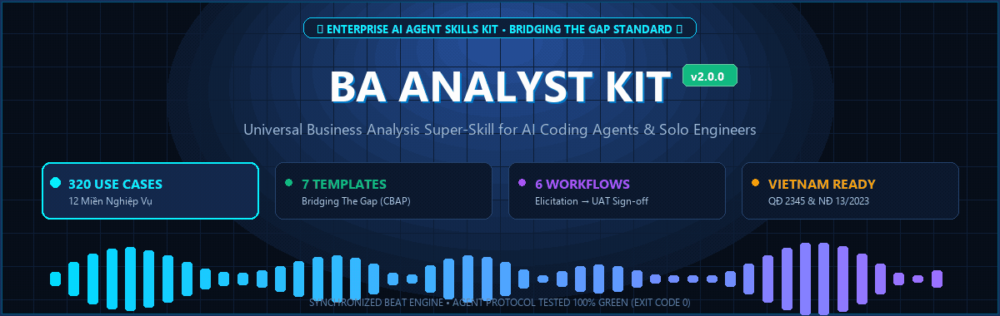
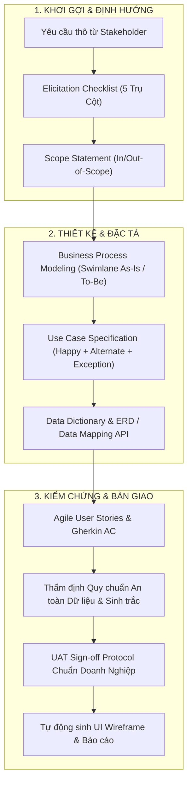

<div align="center">



# BA ANALYST KIT
### Bộ Kỹ Năng Chuyên Gia Phân Tích Nghiệp Vụ (Enterprise Business Analysis Super-Skill)

[](SKILL.md)
[](LICENSE)
[-10b981?style=for-the-badge)](docs/research/05_BA_METHODOLOGY_AND_SKILLS_ASSESSMENT.md)
[](skills/ba-analyst-kit/references/master_use_cases_catalog.md)
[](skills/ba-analyst-kit/workflows/workflow_06_vietnam_compliance_and_uat.md)
[-success?style=for-the-badge)](scripts/run_full_verification.py)

<p align="center">
  <b>Biến AI Coding Agent & Solo Developer thành Chuyên Gia Senior Business Analyst (BA)</b><br>
  Tự động hóa toàn trình từ Khơi gợi yêu cầu, Xác định phạm vi, Vẽ quy trình Swimlane, Đặc tả Use Case Agile Gherkin, Từ điển dữ liệu ERD, Ánh xạ API đến Biên bản nghiệm thu UAT chuẩn thể thức doanh nghiệp.
</p>

---

</div>

## 📌 TỔNG QUAN DỰ ÁN (EXECUTIVE OVERVIEW)

**`ba-analyst-kit`** là bộ Super-Skill mã nguồn mở đóng gói toàn diện phương pháp luận phân tích nghiệp vụ chuẩn quốc tế của **Laura Brandenburg, CBAP (Bridging The Gap)** kết hợp với tư duy kiến trúc kỹ thuật phần mềm cấp cao (Senior Engineering Architecture) và các quy chuẩn nghiệp vụ thực chiến.

Khác với các công cụ tạo tài liệu sơ sài thông thường chỉ viết "Happy Path", **`ba-analyst-kit`** buộc AI Agent và Kỹ sư phải tuân thủ nghiêm ngặt:
1. **Ranh Giới Bất Biến (Boundary Invariants)**: Bắt buộc xác định In-Scope vs Out-of-Scope để triệt tiêu nguy cơ phình phạm vi (Scope Creep); định vị rõ điểm bắt đầu và kết thúc của mọi quy trình.
2. **Luồng Biên & Rủi Ro Khắc Nghiệt (Harsh Exception Flows)**: Bao quát toàn bộ luồng lỗi phân tán (tranh chấp tồn kho mili-giây, timeout cổng thanh toán, bot gom hàng, webhook đến muộn và cơ chế tự động hoàn tiền Auto-Refund).
3. **Cầu Nối Waterfall & Agile**: Tự động chuyển giao từ đặc tả luồng tương tác chi tiết sang User Stories kèm kịch bản nghiệm thu định dạng BDD **Gherkin (`Given... When... Then...`)**.
4. **Chuẩn Thể Thức & An Toàn Dữ Liệu**: Tích hợp quy chuẩn xác thực sinh trắc học khuôn mặt cho giao dịch giá trị cao (>10 triệu VNĐ), bảo vệ dữ liệu cá nhân (Data Masking che giấu số CCCD, tài khoản, số điện thoại) và biên bản nghiệm thu kỹ thuật UAT chuẩn thể thức doanh nghiệp.

---

## 🏛️ KIẾN TRÚC BỘ SKILL (SYSTEM ARCHITECTURE)



---

## 🚀 8 PHÂN HỆ NGHIỆP VỤ SỐNG (8 LIVING DELIVERABLES)

Bộ công cụ cung cấp sẵn 7 Template chuẩn Markdown và 6 Workflow điều phối tự động:

| Mã Phân Hệ | Tên Deliverable Chuẩn | File Mẫu (Template) | Đầu Ra Tự Động Hóa |
| :---: | :--- | :--- | :--- |
| **UC-1** | **Khơi Gợi Yêu Cầu Tương Tác** | [`elicitation_checklist_template.md`](skills/ba-analyst-kit/templates/elicitation_checklist_template.md) | Bộ câu hỏi phỏng vấn theo 5 trụ cột (User, Process, Data, Business Rules, Technical) với gợi ý inline a/b/c. |
| **UC-2** | **Tuyên Bố Phạm Vi Dự Án (Scope)** | [`scope_statement_template.md`](skills/ba-analyst-kit/templates/scope_statement_template.md) | Business Drivers, Expected Benefits có thể đo lường, phân định rạch ròi In-Scope & Out-of-Scope chống Scope Creep. |
| **UC-3** | **Mô Hình Hóa Quy Trình Nghiệp Vụ** | [`business_process_template.md`](skills/ba-analyst-kit/templates/business_process_template.md) | Quy trình As-Is / To-Be, phân tách rạch ròi Entry/Exit Criteria vs Inputs/Outputs, sơ đồ phân làn **Mermaid Swimlane**. |
| **UC-4** | **Đặc Tả Chức Năng Chi Tiết (Use Case)** | [`use_case_template.md`](skills/ba-analyst-kit/templates/use_case_template.md) | Luồng chuẩn (Happy Path), Luồng rẽ nhánh (3a, 3b), Luồng ngoại lệ (Exceptions), Business Rules và kịch bản **Gherkin BDD**. |
| **UC-5** | **Đánh Giá Chất Lượng & Kỹ Năng BA** | [`ba_glossary.md`](skills/ba-analyst-kit/references/ba_glossary.md) | Ma trận kiểm toán chất lượng tài liệu và Rubric đánh giá năng lực 3 cấp độ (*Novice* $\to$ *Competent* $\to$ *Expert*). |
| **UC-6** | **Quy Chuẩn An Toàn & Nghiệm Thu UAT** | [`vietnam_uat_signoff_template.md`](skills/ba-analyst-kit/templates/vietnam_uat_signoff_template.md) | Biên bản nghiệm thu kỹ thuật UAT chuẩn thể thức doanh nghiệp; Ma trận kiểm toán an toàn dữ liệu & sinh trắc học. |
| **UC-7** | **Từ Điển Dữ Liệu & Sơ Đồ ERD** | [`data_dictionary_template.md`](skills/ba-analyst-kit/templates/data_dictionary_template.md) | Bảng đặc tả thuộc tính trường, kiểu dữ liệu, ràng buộc validation, chính sách Data Masking và sơ đồ **Mermaid ERD**. |
| **UC-8** | **Ánh Xạ Dữ Liệu & Tích Hợp API** | [`data_mapping_template.md`](skills/ba-analyst-kit/templates/data_mapping_template.md) | Ma trận ánh xạ Request/Response Payload 2 chiều, Webhook đối soát ngầm, sơ đồ **System Context**, Idempotency & Retry. |

---

## 📚 ĐẠI TỪ ĐIỂN 320 USE CASES KINH ĐIỂN (MASTER CATALOG)

Tra cứu toàn văn tại: [`skills/ba-analyst-kit/references/master_use_cases_catalog.md`](skills/ba-analyst-kit/references/master_use_cases_catalog.md)

Bao quát hơn 95% kịch bản tương tác phần mềm thực tế trong mọi dự án doanh nghiệp, phân bổ qua **12 Miền nghiệp vụ (Business Domains)**:

```text
320 Master Use Cases Taxonomy:
├── AUTH  (30 cases) - Định Danh, Xác Thực Hai Yếu Tố (2FA/OTP), FaceID, SSO, SAML, RBAC & ABAC
├── ECOMM (35 cases) - Giỏ Hàng, Flash Sale Đa Luồng, Voucher Đa Tầng, Đặt Hàng, Vận Chuyển, Trả Hàng
├── PAY   (25 cases) - VietQR Napas 247, Visa/Mastercard Tokenization, Ví Điện Tử, Hóa Đơn Điện Tử VAT
├── FIN   (35 cases) - Ngân Hàng Số, eKYC Chip CCCD, Chuyển Tiền 24/7, Vay Tiêu Dùng, Tiết Kiệm
├── CRM   (25 cases) - Quản Trị Khách Hàng, Pipeline Bán Hàng, Báo Giá Điện Tử, Hợp Đồng, Customer 360
├── CS    (20 cases) - Helpdesk, Phân Tuyến Ticket Theo SLA, AI Chatbot Handoff, Tổng Đài Ghi Âm Cuộc Gọi
├── HRM   (30 cases) - Điểm Danh Khuôn Mặt/GPS, Phép Năm Đa Cấp Duyệt, Bảng Lương Tự Động, BHXH, Thuế TNCN
├── WMS   (25 cases) - Kho Vận, Quét Mã Vạch PDA, Ô Kệ Tự Động (Putaway), Nhặt Hàng Wave Picking, FEFO
├── CMS   (20 cases) - Soạn Thảo Rich Text, Quy Trình Phê Duyệt Xuất Bản, Quản Trị Media, Tối Ưu SEO On-page
├── NOTIF (20 cases) - Bắn Thông Báo Đa Kênh (Push FCM/APNs, SMS Brandname, Zalo ZNS, Email SES, In-App)
├── DATA  (25 cases) - Nạp Excel Hàng Loạt Có File Lỗi, Xuất Dữ Liệu Data Masking, Lập Lịch Báo Cáo, BI
└── ADMIN (30 cases) - Nhật Ký Kiểm Toán Bất Biến (Audit Trail Append-Only), Feature Flags, Rate Limiting
```

---

## 🛠️ BỘ CÔNG CỤ TỰ ĐỘNG HÓA & KIỂM ĐỊNH (AUTOMATION TOOLS)

### 1. Sinh Đặc Tả Giao Diện & Wireframe Kèm Validation Trường
Tự động phác thảo layout ASCII Wireframe và sinh bảng chi tiết thuộc tính trường dữ liệu có kiểm tra tính hợp lệ của Số CCCD (12 số), Số điện thoại di động (10 số), Mã số thuế và định dạng tiền tệ VNĐ:
```powershell
python scripts/generate_ui_spec.py
```

### 2. Bộ Runner Kiểm Chứng Toàn Diện (Master Verification Runner)
Kiểm tra tính toàn vẹn của toàn bộ tri thức, templates, workflows, catalog và các bài test đối kháng:
```powershell
python scripts/run_full_verification.py
```

### 3. Tự Động Dựng Banner Motion Graphic (Banner Generator)
Tự động xuất banner động chuẩn UX 1200x440 dạng slide motion graphic mượt mà:
```powershell
python scripts/generate_motion_banner.py
```

---

## 💻 HƯỚNG DẪN CÀI ĐẶT & SỬ DỤNG (QUICKSTART)

### Cách 1: Sử dụng trong Antigravity CLI (Toàn cục)
Sao chép thư mục `skills/ba-analyst-kit` vào thư mục skill toàn cục của Antigravity:
```powershell
Copy-Item -Path "skills\ba-analyst-kit" -Destination "$HOME\.gemini\antigravity-cli\skills\ba-analyst-kit" -Recurse -Force
```
Từ bất kỳ phiên làm việc nào, bạn chỉ cần gõ yêu cầu tự nhiên:
- *"Lập Scope Statement cho hệ thống quản lý kho..."*
- *"Đặc tả Use Case đăng nhập OTP 2FA và FaceID theo mã AUTH-07..."*
- *"Thiết kế sơ đồ quy trình duyệt vay tín chấp To-Be kèm Swimlane..."*
- *"Lập biên bản nghiệm thu UAT chuẩn thể thức doanh nghiệp..."*

### Cách 2: Sử dụng trong Claude Code / Cursor / Windsurf / Copilot
Chỉ cần đưa thư mục `skills/ba-analyst-kit` vào dự án của bạn và tham chiếu `SKILL.md` trong file hướng dẫn prompt (ví dụ: `CLAUDE.md`, `.cursorrules`, hoặc `GEMINI.md`). Toàn bộ định dạng là Markdown thuần túy kèm Mermaid diagram, tương thích hoàn hảo với mọi LLM.

---

## 📂 CẤU TRÚC THƯ MỤC REPOSITORY

```text
ba-analyst-kit/
├── assets/                                 # Banner GIF hoạt họa và tài nguyên hình ảnh
│   ├── banner.gif                          # Motion graphic slide presentation (1200x440)
│   └── banner.png                          # Static poster banner
├── skills/
│   └── ba-analyst-kit/                     # GÓI SKILL TOÀN DIỆN CHO AGENT
│       ├── SKILL.md                        # Router điều hướng 8 phân hệ & 320 Use Cases
│       ├── templates/                      # 7 Mẫu Markdown chuẩn nghiệp vụ & ERD
│       ├── workflows/                      # 6 Quy trình thực thi từ Elicitation đến UAT
│       └── references/                     # Từ điển thuật ngữ, 10 Core Cases & 320 Master Catalog
├── docs/                                   # Hệ thống Living Documents & Báo cáo nghiên cứu
│   ├── research/                           # 8 Chuyên đề nghiên cứu sâu & Quy chuẩn phân tích
│   ├── plans/                              # Kế hoạch tổng thể và ma trận quản trị rủi ro
│   └── evidence/                           # Báo cáo nghiệm thu thực nghiệm
├── examples/                               # Dự án mẫu thực tế (Bảo hiểm bồi thường, Flash Sale ECOMM-11)
├── scripts/                                # Công cụ tự động hóa & Test Runner kiểm chứng
│   ├── generate_ui_spec.py                 # Sinh đặc tả trường UI & Wireframe validation
│   ├── generate_motion_banner.py           # Dựng banner GIF slide motion graphic
│   └── run_full_verification.py            # Master Test Runner 6 tầng (Exit Code 0)
├── LICENSE                                 # Giấy phép mã nguồn mở MIT License
└── README.md                               # Tài liệu hướng dẫn chính thức
```

---

## 🙏 LỜI CẢM ƠN & TRI ÂN (ACKNOWLEDGMENTS)

Dự án này được xây dựng trên sự kế thừa tri thức và đóng góp quý báu từ:

1. **Laura Brandenburg, CBAP** — Nhà sáng lập của [Bridging The Gap](https://www.bridging-the-gap.com/), tác giả của các biểu mẫu deliverable kinh điển và quy trình 8 bước phân tích nghiệp vụ được áp dụng rộng rãi trong ngành công nghệ thông tin toàn cầu. Bộ khung Scope Statement, Business Process Modeling, Use Case Specification và Requirements Checklist của bà là nguồn cảm hứng và nền tảng phương pháp luận cốt lõi cho bộ công cụ này.
2. **Cộng Đồng Business Analyst & Kỹ Sư Phần Mềm Việt Nam** — Những người tiên phong trong việc chuẩn hóa các bài toán nghiệp vụ số thực tiễn tại Việt Nam: từ hệ thống định danh điện tử eKYC, thanh toán trực tuyến VietQR/Napas, xác thực sinh trắc học khuôn mặt chống giả mạo đến các quy chuẩn bảo vệ dữ liệu cá nhân (Data Masking) và biên bản nghiệm thu doanh nghiệp.
3. **Google Antigravity & AI Agent Engineering Team** — Đội ngũ phát triển nền tảng Agentic Coding hiện đại, mở ra khả năng biến các kỹ năng chuyên môn sâu thành các Agent Skills có thể tái sử dụng và kiểm chứng tự động.

---

## 📄 GIẤY PHÉP MÃ NGUỒN MỞ (LICENSE)

Dự án được phát hành theo giấy phép mã nguồn mở **[MIT License](LICENSE)**.

```text
MIT License

Copyright (c) 2026 Le Ngoc Tu

Permission is hereby granted, free of charge, to any person obtaining a copy
of this software and associated documentation files (the "Software"), to deal
in the Software without restriction, including without limitation the rights
to use, copy, modify, merge, publish, distribute, sublicense, and/or sell
copies of the Software, and to permit persons to whom the Software is
furnished to do so, subject to the following conditions:

The above copyright notice and this permission notice shall be included in all
copies or substantial portions of the Software.
```
