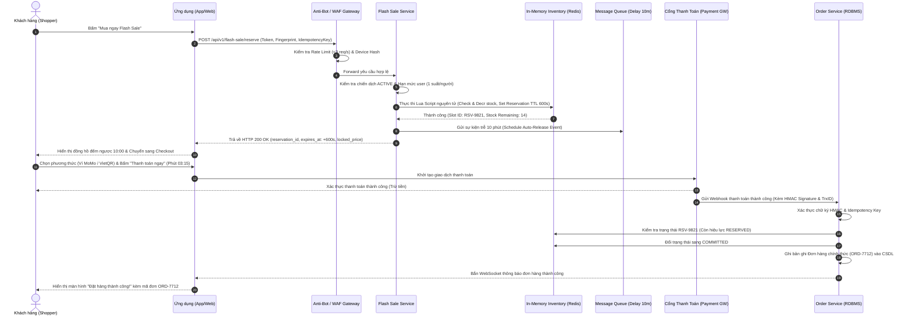

# ĐẶC TẢ USE CASE: ÁP DỤNG CHƯƠNG TRÌNH FLASH SALE VÀ TỰ ĐỘNG GIỮ CHỖ TỒN KHO
> **Mã Use Case**: `UC-ECOMM-11`  
> **Trạng thái**: Approved  
> **Áp dụng chuẩn**: Bridging The Gap (Laura Brandenburg, CBAP) kết hợp Distributed Systems & Event-Driven Architecture  
> **Tài liệu nguồn**: `skills/ba-analyst-kit/references/master_use_cases_catalog.md` (Domain `ECOMM`)  

---

## 1. THÔNG TIN USE CASE (DOCUMENT INFORMATION)

| Trường Thông Tin | Giá Trị Chi Tiết |
| :--- | :--- |
| **Tiêu đề (Use Case Title)** | Áp Dụng Chương Trình Flash Sale Và Tự Động Giữ Chỗ Tồn Kho Tức Thì |
| **Mã định danh (Use Case ID)** | `UC-ECOMM-11` |
| **Phân hệ nghiệp vụ** | Thương Mại Điện Tử & Quản Lý Tồn Kho Thời Gian Thực (E-Commerce & High-Concurrency Inventory Engine) |
| **Người phụ trách (Document Owner)** | Lead Business Analyst Chuyên Trách E-Commerce & Distributed Architecture |
| **Phiên bản (Version)** | 2.0.0 |
| **Ngày lập (Date)** | 2026-10-20 |
| **Mức độ ưu tiên (Priority)** | Critical (P0 - Trọng yếu) |

---

## 2. MÔ TẢ TÓM TẮT & RANH GIỚI BẤT BIẾN (BRIEF DESCRIPTION & BOUNDARY INVARIANTS)

Use Case này mô tả quá trình tương tác giữa Khách hàng (Shopper) và Nền tảng Thương mại điện tử (bao gồm Tầng phòng vệ Anti-Bot WAF, Động cơ Flash Sale Service, Cụm xử lý tồn kho nguyên tử Redis In-Memory Cluster, Cổng thanh toán trực tuyến và Dịch vụ xử lý đơn hàng) nhằm thực hiện săn deal giá sốc có giới hạn số lượng và thời gian, tự động khóa giữ chỗ tồn kho tức thì với thời gian đếm ngược chính xác 10 phút (600 giây).

> **Quá trình bắt đầu khi** Khách hàng bấm nút "Mua ngay Flash Sale" trên trang chi tiết chiến dịch hoặc trang sản phẩm Flash Sale, **và kết thúc khi** Khách hàng hoàn tất thanh toán trong thời hạn 10 phút, hệ thống chính thức khấu trừ tồn kho vĩnh viễn và tạo đơn hàng thành công (hoặc hệ thống tự động giải phóng slot giữ chỗ, hoàn trả tồn kho về kho chung nếu quá hạn 10 phút mà chưa thanh toán).

---

## 3. CÁC TÁC NHÂN LIÊN QUAN (ACTORS)

| Nhóm Tác Nhân | Tên Tác Nhân | Vai Trò & Trách Nhiệm Trong Use Case |
| :--- | :--- | :--- |
| **Tác nhân chính (Primary Actor)** | Khách hàng mua sắm (Shopper) | Người dùng ứng dụng di động (Mobile App) hoặc trang web (Web SPA) trực tiếp thao tác săn deal và thanh toán |
| **Tác nhân phụ (Secondary Actor)** | Quản trị viên Flash Sale / CSKH | Thiết lập chiến dịch mở bán, theo dõi dashboard thời gian thực và xử lý tra soát khiếu nại tiền về muộn |
| **Tác nhân hệ thống (System Actor)** | Anti-Bot & WAF Engine | Lớp phòng vệ biên giới kiểm soát tốc độ request (Rate Limiter), nhận diện chữ ký thiết bị (Device Fingerprint) và chặn đứng bot đầu cơ |
| **Tác nhân hệ thống** | Flash Sale & Campaign Service | Quản lý vòng đời chiến dịch, kiểm tra điều kiện áp dụng giá ưu đãi và hạn mức mua của từng tài khoản |
| **Tác nhân hệ thống** | In-Memory Inventory Engine (Redis Cluster) | Quản lý bộ đếm tồn kho phân tán, thực thi lệnh khóa giữ chỗ nguyên tử (Atomic Reservation Lua Script) trong mili-giây |
| **Tác nhân hệ thống** | Distributed Delay Scheduler (Message Queue) | Bộ đếm thời gian phân tán (RabbitMQ Delay Exchange / Kafka Schedule) chịu trách nhiệm kích hoạt sự kiện nhả kho khi hết hạn 10 phút |
| **Tác nhân hệ thống** | Cổng Thanh Toán (Payment Gateway) | Đối tác cung cấp dịch vụ thanh toán (Napas, VietQR, Ví điện tử MoMo/ZaloPay, Thẻ quốc tế Visa/Mastercard) tiếp nhận trừ tiền và gửi Webhook |
| **Tác nhân hệ thống** | Order & Reconciliation Service | Xử lý tạo đơn hàng chính thức (`COMMITTED`), khấu trừ tồn kho CSDL vĩnh viễn, hoặc kích hoạt quy trình bồi hoàn tiền tự động (Auto-Refund) |

---

## 4. TIỀN ĐIỀU KIỆN & VẬT PHẨM ĐẦU VÀO (ENTRY CRITERIA & INPUTS)

### Điều Kiện Tiên Quyết (Entry Criteria)
1. Khách hàng đã đăng nhập tài khoản hợp lệ trên ứng dụng hoặc website thương mại điện tử; tài khoản đang ở trạng thái hoạt động bình thường (không bị khóa hay gắn cờ gian lận).
2. Chiến dịch Flash Sale cho mã sản phẩm (SKU) tương ứng đang ở trạng thái `ACTIVE` (đang trong khung giờ mở bán chính thức).
3. Cụm In-Memory Inventory Engine đã được đồng bộ sẵn (Preload) số lượng tồn kho mở bán từ CSDL quan hệ lên Redis Cache với cơ chế phân vùng nguyên tử.
4. Tài khoản của khách hàng chưa từng mua thành công hoặc đang không giữ chỗ sản phẩm này trong phiên Flash Sale hiện tại (tuân thủ quy tắc mỗi khách hàng chỉ được mua 1 suất).

### Dữ Liệu & Vật Phẩm Đầu Vào (Inputs)
- **Token phiên đăng nhập**: JWT Auth Bearer Token chứa `user_id`, `session_id`.
- **Dữ liệu chiến dịch**: `campaign_id` (Định danh chiến dịch Flash Sale), `product_id`, `sku_id`.
- **Số lượng yêu cầu**: `quantity = 1` (Mặc định cố định 1 sản phẩm).
- **Đặc trưng thiết bị & Môi trường**: `device_fingerprint` (Canvas hash, WebGL hash, User-Agent, Screen Resolution), `client_ip`.
- **Chữ ký chống gửi lặp**: `idempotency_key` (UUID v7 sinh từ Client).

---

## 5. SƠ ĐỒ QUY TRÌNH PHÂN LÀN (WORKFLOW SWIMLANE DIAGRAM)

```mermaid
flowchart TD
    subgraph Lane_User [Khách Hàng (Shopper)]
        U1([Bắt đầu: Xem trang Flash Sale]) --> U2[Bấm 'Mua ngay Flash Sale']
        U2 --> U3{Có slot giữ chỗ?}
        U3 -->|Thất bại / Hết hàng| U4([Kết thúc: Nhận thông báo hết hàng])
        U3 -->|Thành công| U5[Xem đồng hồ đếm ngược 10:00 & Chọn phương thức thanh toán]
        U5 --> U6{Hành động thanh toán}
        U6 -->|Bấm thanh toán trong 10 phút| U7[Xác nhận trừ tiền qua Cổng thanh toán]
        U6 -->|Để quá 10 phút không trả tiền| U8([Kết thúc: Mất slot giữ chỗ])
        U6 -->|Chủ động bấm Hủy giữ chỗ| U9([Kết thúc: Hủy slot, về trang chủ])
        U7 --> U10[Nhận màn hình Đặt hàng thành công]
    end

    subgraph Lane_Edge [Tầng Biên: Anti-Bot & WAF]
        E1[Tiếp nhận Request & Thẩm định Chữ ký thiết bị] --> E2{Kiểm tra Bot & Tần suất}
        E2 -->|Vượt ngưỡng Rate Limit / Bot nghi vấn| E3[Chặn ngay lập tức HTTP 429/403]
        E2 -->|Hợp lệ| E4[Chuyển tiếp sang Flash Sale Service]
    end

    subgraph Lane_Engine [Flash Sale & Inventory Engine]
        E4 --> I1{Kiểm tra Hạn mức mua 1 suất/user}
        I1 -->|Đã mua trước đó| I2[Từ chối: Vượt quá giới hạn mua]
        I1 -->|Chưa mua| I3[Thực thi Redis Lua Script Nguyên Tử]
        I3 -->|Tồn kho = 0| I4[Trả về: Hết hàng trong mili-giây]
        I3 -->|Tồn kho > 0| I5[DECRBY tồn kho 1 đơn vị & Lưu Reservation Key TTL 600s]
        I5 --> I6[Bắn sự kiện Scheduled TTL 10 phút vào Message Queue]
    end

    subgraph Lane_Payment_Order [Cổng Thanh Toán & Order Service]
        U7 --> P1[Cổng thanh toán trừ tiền & Gửi Webhook]
        P1 --> P2{Kiểm tra Trạng thái Reservation}
        P2 -->|Còn hạn 10 phút: RESERVED| P3[COMMIT Đơn hàng chính thức & Trừ kho vĩnh viễn DB]
        P2 -->|Đã hết hạn 10 phút: EXPIRED| P4[Kích hoạt Auto-Refund hoàn lại 100% tiền]
        P3 --> U10
    end

    U2 --> E1
    E3 -.-> U4
    I2 -.-> U4
    I4 -.-> U4
    I5 --> U3
    U8 -.-> M1[Queue nhả kho tự động về Redis]
    U9 -.-> M2[Giải phóng kho tức thì về Redis]

    classDef startEnd fill:#e1f5fe,stroke:#0288d1,stroke-width:2px;
    classDef decision fill:#fff9c4,stroke:#fbc02d,stroke-width:2px;
    classDef process fill:#f3e5f5,stroke:#7b1fa2,stroke-width:1px;
    class U1,U4,U8,U9,U10 startEnd;
    class U3,E2,I1,I3,U6,P2 decision;
```

---

## 6. LUỒNG THAO TÁC CHUẨN (BASIC FLOW / HAPPY PATH)



### Chi Tiết Từng Bước Thao Tác (10 Bước Chuẩn Hóa):

1. **Khách hàng**: Tại màn hình chi tiết sản phẩm Flash Sale, chọn phân loại hàng (SKU) và bấm nút **"Mua ngay Flash Sale"** (hoặc "Săn deal ngay").
2. **Hệ thống (Client App/Web)**: Thu thập thông tin định danh thiết bị (`device_fingerprint`), tự động sinh mã chống gửi lặp `idempotency_key` (UUID v7) và gửi yêu cầu giữ chỗ `POST /api/v1/flash-sale/reserve` kèm `campaign_id`, `sku_id`, `quantity = 1`.
3. **Hệ thống (Anti-Bot & WAF Gateway)**: Tiếp nhận request tại tầng biên, xác thực chữ ký JWT của người dùng, kiểm tra tần suất gửi yêu cầu từ IP ($\le 3$ req/s) và đối soát hành vi thiết bị nhằm ngăn chặn các công cụ automation/bot gom hàng.
4. **Hệ thống (Flash Sale Service)**: Xác nhận chiến dịch khuyến mãi đang trong khung giờ mở bán (`ACTIVE`) và truy vấn bộ nhớ đệm xác nhận người dùng này chưa từng giữ chỗ hay mua thành công sản phẩm trong chiến dịch này (tuân thủ quy tắc 1 suất/tài khoản).
5. **Hệ thống (In-Memory Inventory Engine - Redis Cluster)**: Thực thi tập lệnh nguyên tử **Redis Lua Script**:
   - Kiểm tra số lượng tồn kho mở bán khả dụng `flash_stock:{sku_id}`.
   - Nếu tồn kho $> 0$, thực hiện trừ tồn kho ngay lập tức (`DECRBY 1`).
   - Tạo khóa giữ chỗ `reservation:{reservation_id}` lưu thông tin `user_id`, `sku_id`, `price` với thời gian sống (TTL) chính xác 600 giây (10 phút).
   - Đánh dấu cờ `user_reserved:{campaign_id}:{user_id} = 1` với TTL 600 giây.
6. **Hệ thống (Distributed Delay Scheduler - Message Queue)**: Đẩy một tin nhắn hoãn xử lý (Delayed Message) vào hàng đợi với thời gian hẹn giờ đúng 600,000 mili-giây (10 phút) chứa thông tin `reservation_id` để kích hoạt cơ chế nhả kho tự động nếu khách hàng không thanh toán.
7. **Hệ thống (Flash Sale Service)**: Phản hồi kết quả giữ chỗ thành công cho Client: HTTP 200 OK kèm mã giữ chỗ `reservation_id`, giá khuyến mãi được khóa `locked_price`, thời điểm bắt đầu `reserved_at` và thời điểm hết hạn `expires_at` (10 phút).
8. **Hệ thống (Client App/Web)**: Hiển thị giao diện Thanh toán (Checkout Page) kèm biểu tượng đồng hồ đếm ngược nổi bật `10:00` (giảm dần từng giây), khóa cố định đơn giá Flash Sale, và tự động điền địa chỉ nhận hàng mặc định.
9. **Khách hàng**: Kiểm tra thông tin đơn hàng, chọn phương thức thanh toán trực tuyến (Ví điện tử MoMo/ZaloPay, Thẻ ATM Napas hoặc VietQR Động) và bấm nút **"Thanh toán ngay"** (thực hiện tại phút thứ 03:15 của đồng hồ đếm ngược).
10. **Hệ thống (Cổng thanh toán & Order Service)**: Cổng thanh toán thực hiện trừ tiền thành công từ tài khoản khách hàng và gửi Webhook chứa chữ ký bảo mật HMAC-SHA256 về cho Order Service. Order Service thẩm định Webhook, đối soát mã giữ chỗ `reservation_id` thấy trạng thái vẫn là `RESERVED` hợp lệ, lập tức chuyển trạng thái sang `COMMITTED`, tạo mã đơn hàng chính thức `ORD-XXXXX`, đồng bộ trừ tồn kho vĩnh viễn trong CSDL quan hệ (PostgreSQL) và gửi thông báo hiển thị lên màn hình điện thoại khách hàng: *"Đặt hàng thành công! Mã đơn: ORD-XXXXX"*.

---

## 7. CÁC LUỒNG RẼ NHÁNH VÀ NGOẠI LỆ (ALTERNATE & EXCEPTION FLOWS)

### Các Luồng Rẽ Nhánh Thay Thế (Alternate Flows)

- **8a. Khách hàng thay đổi địa chỉ nhận hàng hoặc áp dụng mã giảm giá vận chuyển**:
  1. Tại màn hình Checkout (Bước 8), khách hàng chọn địa chỉ nhận hàng khác hoặc nhập mã Freeship.
  2. Hệ thống gọi Shipping API tính lại phí giao hàng và cập nhật tổng tiền thanh toán mới.
  3. Hệ thống **GIỮ NGUYÊN** mã giữ chỗ `reservation_id` và **KHÔNG RESET** đồng hồ đếm ngược (thời gian 10 phút vẫn tiếp tục trôi).
  4. Khách hàng bấm thanh toán và **quay trở lại Bước 9 của Luồng chuẩn**.

- **8b. Khách hàng chủ động hủy giữ chỗ ("Hủy giữ chỗ / Không mua nữa")**:
  1. Tại màn hình Checkout (Bước 8), khách hàng bấm nút "Hủy giữ chỗ".
  2. Hệ thống hiển thị hộp thoại cảnh báo: *"Nếu hủy, bạn sẽ nhường suất mua giá sốc này cho người khác và không thể hoàn tác. Bạn có chắc chắn muốn hủy?"*.
  3. Khách hàng bấm xác nhận "Đồng ý hủy".
  4. Client gửi yêu cầu `POST /api/v1/flash-sale/release` kèm `reservation_id`.
  5. Hệ thống thực thi Redis Lua script giải phóng ngay lập tức: Cộng lại 1 tồn kho vào pool (`INCRBY`), xóa khóa `user_reserved`, chuyển trạng thái reservation thành `CANCELLED_BY_USER`, hủy tin nhắn trễ trên Message Queue.
  6. Hiển thị thông báo: *"Đã hủy giữ chỗ thành công"*, điều hướng khách hàng quay trở lại trang chủ chiến dịch.

- **9a. Khách hàng chọn phương thức thanh toán chuyển khoản qua VietQR Động**:
  1. Tại Bước 9, khách hàng chọn phương thức "Chuyển khoản ngân hàng VietQR".
  2. Hệ thống sinh mã QR động (chuẩn NAPAS 247) chứa thông tin: Số tài khoản ngân hàng thụ hưởng, Số tiền chính xác, và Nội dung chuyển khoản mã hóa duy nhất `FS<reservation_id>`.
  3. Màn hình hiển thị mã QR cùng đồng hồ đếm ngược thời gian còn lại (ví dụ: còn 06 phút 40 giây).
  4. Khách hàng mở ứng dụng Mobile Banking của mình và quét mã chuyển khoản.
  5. Hệ thống E-commerce lắng nghe tín hiệu biến động số dư tức thì từ Open Banking Webhook, tự động nhận diện đúng nội dung `FS<reservation_id>`, đối soát khớp số tiền và **chuyển tiếp sang Bước 10 của Luồng chuẩn**.

---

### Các Luồng Ngoại Lệ Xử Lý Lỗi Khắc Nghiệt (Exception Flows)

- **EX-01 (Tại Bước 5): Hết hàng trong mili-giây do tranh chấp đa luồng (Concurrency Race Condition / Out of Stock in Milliseconds)**:
  1. Hàng chục nghìn người dùng cùng bấm nút "Mua ngay Flash Sale" tại cùng một mili-giây. Tồn kho mở bán giảm nhanh về 0.
  2. Khi người dùng này gửi request đến, tập lệnh Redis Lua Script nguyên tử kiểm tra thấy `flash_stock:{sku_id} <= 0`.
  3. Tập lệnh lập tức trả về mã lỗi `ERR_STOCK_EXHAUSTED` mà không thực hiện trừ kho; đảm bảo bộ đếm không bị âm (`Zero Overselling`).
  4. Flash Sale Service phản hồi HTTP 409 Conflict với nội dung: `{"code": "FLASH_SALE_OUT_OF_STOCK", "message": "Rất tiếc! Suất Flash Sale của sản phẩm này đã được bán hết trong tích tắc."}`.
  5. Giao diện Client đổi trạng thái nút bấm sang màu xám: **"ĐÃ HẾT SUẤT FLASH SALE"**, hiển thị nút phụ *"Đăng ký nhận thông báo đợt kế tiếp"*.
  6. Use Case kết thúc thất bại; không có giao dịch nào bị treo hay sinh dữ liệu rác.

- **EX-02 (Tại Bước 8-9): Hết hạn 10 phút nhả kho tự động (TTL Expiration / 10-Minute Auto Release)**:
  1. Khách hàng ở màn hình Checkout nhưng phân vân hoặc gặp sự cố cá nhân, không hoàn tất thanh toán trước khi đồng hồ đếm ngược chạm mốc `00:00` (đủ 600,000 mili-giây).
  2. Tại thời điểm giây thứ 600, tin nhắn hẹn giờ trên Message Queue kích hoạt hoặc Redis Keyspace Notification phát sinh sự kiện `RESERVATION_EXPIRED`.
  3. Hệ thống xử lý tự động ngầm (Background Worker):
     - Chuyển trạng thái reservation từ `RESERVED` sang `EXPIRED`.
     - Thực thi Lua Script hoàn trả 1 tồn kho về pool bán lẻ (`INCRBY flash_stock:{sku_id} 1`).
     - Xóa cờ khóa `user_reserved:{campaign_id}:{user_id}` để giải phóng tài khoản.
     - Suất tồn kho vừa nhả ngay lập tức khả dụng cho những người dùng khác đang chờ ở trang sản phẩm.
  4. Nếu sau giây thứ 600 khách hàng cố tình bấm nút "Thanh toán ngay":
     - Client App chặn ngay tại chỗ nếu đồng hồ đã hết giờ.
     - Nếu request vẫn lọt về máy chủ, API thanh toán kiểm tra thấy `reservation_id` đã `EXPIRED`, lập tức từ chối với HTTP 410 Gone: *"Thời gian giữ chỗ 10 phút đã hết hạn. Suất sản phẩm đã được tự động nhả lại cho khách hàng khác."*.
  5. Điều hướng người dùng về trang Flash Sale; không trừ bất kỳ khoản tiền nào.

- **EX-03 (Tại Bước 3): Phát hiện bot đầu cơ gom hàng theo IP/thiết bị (Anti-Bot & Speculation Attack Detection)**:
  1. Tầng WAF và Anti-Bot Engine phát hiện dấu hiệu bất thường:
     - Tần suất request từ một địa chỉ IP vượt quá ngưỡng cho phép ($> 5$ req/giây).
     - Hoặc phát hiện nhiều tài khoản đăng nhập khác nhau nhưng sử dụng chung một `device_fingerprint` (cùng Canvas hash, WebGL fingerprint, User-Agent giống hệt nhau nhằm đầu cơ số lượng lớn).
     - Hoặc phát hiện môi trường trình duyệt tự động hóa (Selenium, Puppeteer, headless Chrome không phát sinh sự kiện chuột tự nhiên).
  2. Hệ thống lập tức kích hoạt biện pháp phòng vệ:
     - Thẳng tay từ chối request với mã trạng thái HTTP 429 Too Many Requests hoặc HTTP 403 Forbidden.
     - Nếu ở mức nghi vấn nhẹ: Trả về thử thách Captcha tàng hình (Cloudflare Turnstile) yêu cầu giải trong 5 giây.
  3. Ghi nhật ký cảnh báo an ninh: `event: "security.bot_detected"`, ghi vết `client_ip`, `device_fingerprint`, `user_agent`, `payload`.
  4. Tự động đưa IP và Device Hash vào danh sách đen tạm thời (Temp-Blacklist) chặn truy cập API Flash Sale trong vòng 30 phút.
  5. Màn hình Client hiển thị thông báo trung tính: *"Hệ thống phát hiện thao tác truy cập bất thường. Vui lòng thử lại sau hoặc liên hệ CSKH để được hỗ trợ."*.

- **EX-04 (Tại Bước 10): Webhook thanh toán tiền về muộn sau khi slot giữ chỗ đã bị giải phóng (Late Webhook Payment After Slot Release)**:
  1. Khách hàng thực hiện thanh toán tại phút thứ 09:56. Do sự cố nghẽn mạng phía ngân hàng hoặc hạ tầng Cổng thanh toán, Webhook thông báo thanh toán thành công bị trễ mạng và chỉ gửi tới hệ thống E-commerce vào phút thứ 10:20 (tức là sau thời hạn 10 phút đúng 20 giây).
  2. Tại thời điểm phút thứ 10:00, hệ thống đã chạy luồng `EX-02` giải phóng slot giữ chỗ và hoàn trả tồn kho về kho chung, và slot đó đã có người mua khác giữ chỗ mất.
  3. Khi Webhook thanh toán gửi đến Order Service:
     - Hệ thống kiểm tra `reservation_id`, phát hiện trạng thái hiện tại là `EXPIRED`.
     - Hệ thống kiểm tra tồn kho hiện tại: Tồn kho Flash Sale đã hết hoàn toàn ($=0$).
  4. **Quy tắc xử lý bất biến (Reconciliation & Idempotency)**:
     - Hệ thống **TUYỆT ĐỐI KHÔNG** ép tạo đơn hàng khi đã hết kho (loại trừ 100% rủi ro âm kho vật lý).
     - Ghi nhận trạng thái giao dịch: `PAYMENT_RECEIVED_AFTER_EXPIRATION`.
     - Lập tức kích hoạt quy trình Bồi hoàn tiền tự động (**Auto-Refund Engine**): Gọi API hoàn tiền sang Cổng thanh toán (MoMo/Napas Refund API) với đúng số tiền đã thu và mã tham chiếu gốc `payment_trx_id`.
     - Cổng thanh toán xác nhận hoàn tiền thành công về tài khoản nguồn của khách hàng trong vòng 1 - 5 phút.
  5. Gửi thông báo Push Notification / SMS xin lỗi khách hàng: *"Giao dịch thanh toán của bạn hoàn tất sau khi phiên giữ chỗ 10 phút đã hết hạn và sản phẩm đã hết hàng. Hệ thống đã tự động hoàn tiền 100% (XXX,000 VNĐ) về tài khoản của bạn và gửi tặng bạn Voucher giảm giá 50,000 VNĐ làm quà xin lỗi."*.
  6. Ghi nhật ký kiểm toán tài chính: `event: "flash_sale.payment.late_refund_triggered"` phục vụ đối soát kế toán cuối ngày.

---

## 8. BẢNG QUY TẮC NGHIỆP VỤ BIÊN (BUSINESS RULES MATRIX)

| Mã Quy Tắc | Tên Quy Tắc | Diễn Giải Chi Tiết Nghiệp Vụ | Điểm Kiểm Soát Kỹ Thuật |
| :---: | :--- | :--- | :--- |
| **BR-ECOMM-01** | **Giữ Chỗ Tồn Kho Nguyên Tử (Atomic Inventory Reservation)** | Mọi thao tác kiểm tra số lượng và trừ tồn kho Flash Sale bắt buộc phải diễn ra theo tính chất nguyên tử (Atomic Check-and-Decrement). Tuyệt đối không được tách rời hai lệnh đọc (Read) và ghi (Write) để loại bỏ hoàn toàn hiện tượng tranh chấp điều kiện (Race Condition), bảo đảm **100% Không Bán Âm Kho (Zero Overselling)** dưới mọi tải trọng. | Thực thi thông qua Redis Lua Script đơn luồng hoặc Postgres `SELECT FOR UPDATE` (ưu tiên Redis In-Memory). |
| **BR-ECOMM-02** | **Thời Hạn Giữ Chỗ Bất Biến 10 Phút (Strict 10-Minute Reservation TTL)** | Mỗi lượt giữ chỗ thành công chỉ có hiệu lực tối đa đúng **600,000 mili-giây (10 phút)** kể từ thời điểm hệ thống cấp phát `reservation_id`. Không gia hạn thời gian dưới bất kỳ hình thức nào. Khi hết thời gian, hệ thống có nghĩa vụ tự động giải phóng tồn kho ngay lập tức cho cộng đồng mà không cần tác động thủ công. | Redis Key TTL kết hợp Message Queue Delayed Exchange (RabbitMQ/Kafka Schedule). |
| **BR-ECOMM-03** | **Phòng Vệ Tầng Biên Chống Bot & Đầu Cơ (Anti-Bot & Rate Limiting Guard)** | Giới hạn tần suất gọi API giữ chỗ tối đa **03 request/giây trên một địa chỉ IP**. Mỗi thiết bị phần cứng được định danh duy nhất qua chữ ký phần cứng (`device_fingerprint`). Phát hiện hành vi dùng nhiều tài khoản trên 1 thiết bị hoặc dùng tool tự động hóa sẽ bị chặn ngay lập tức tại WAF. | Token Bucket Algorithm trên Cloudflare/Envoy Gateway + Client Fingerprinting SDK. |
| **BR-ECOMM-04** | **Bất Biến Webhook & Tự Động Hoàn Tiền Giao Dịch Trễ (Idempotency & Auto-Refund Reconciliation)** | Mọi Webhook thanh toán gửi đến phải có `transaction_id` làm Idempotency Key để chống trừ tiền/tạo đơn 2 lần. Trong trường hợp Webhook thanh toán thành công đến muộn sau khi slot 10 phút đã bị hủy và tồn kho đã hết, hệ thống không được tạo đơn mà bắt buộc phải tự động gọi lệnh hoàn tiền 100% trong tối đa 5 phút. | Lưu trạng thái Webhook Idempotency trong CSDL + Tự động gọi Refund API của Gateway. |
| **BR-ECOMM-05** | **Hạn Mức Mua Duy Nhất Một Suất (Single Purchase Limit per Campaign)** | Mỗi người dùng (định danh bằng bộ 3: `user_id`, Số điện thoại xác thực, và Số CCCD/Thẻ ngân hàng thanh toán) chỉ được phép mua thành công tối đa **01 sản phẩm Flash Sale** trong suốt thời gian diễn ra một chiến dịch khuyến mãi cụ thể. | Kiểm tra bảng lịch sử đơn hàng và khóa Redis `user_reserved:{campaign_id}:{user_id}`. |

---

## 9. ĐẶC TẢ DỮ LIỆU & BẢN GHI GIỮ CHỖ (DATA SPECIFICATION)

### Cấu Trúc Khóa Giữ Chỗ Trong Redis Cache
- **Key Định Danh**: `reservation:{reservation_id}`
- **Kiểu Dữ Liệu**: Redis Hash
- **Thời Gian Sống (TTL)**: 600 giây

| Trường Thuộc Tính | Kiểu Dữ Liệu | Ràng Buộc | Ý Nghĩa Nghiệp Vụ |
| :--- | :--- | :--- | :--- |
| `reservation_id` | String (UUIDv7) | PK, Bắt buộc | Mã định danh giữ chỗ duy nhất toàn hệ thống |
| `campaign_id` | String (UUIDv7) | FK, Bắt buộc | Mã chiến dịch Flash Sale đang diễn ra |
| `product_id` | String (UUIDv7) | FK, Bắt buộc | Mã sản phẩm khuyến mãi |
| `sku_id` | String (UUIDv7) | FK, Bắt buộc | Mã biến thể sản phẩm cụ thể (Màu, Size) |
| `user_id` | String (UUIDv7) | FK, Bắt buộc | Mã người dùng sở hữu suất giữ chỗ |
| `quantity` | Integer | Cố định = 1 | Số lượng sản phẩm được giữ chỗ |
| `locked_price` | Decimal(15,2) | $> 0$ (VNĐ) | Mức giá Flash Sale được bảo lưu cố định |
| `status` | String (Enum) | `RESERVED` \| `COMMITTED` \| `EXPIRED` \| `CANCELLED_BY_USER` | Trạng thái hiện tại của slot giữ chỗ |
| `device_fingerprint` | String(64) | SHA-256 Hash | Mã định danh phần cứng thiết bị của người dùng |
| `created_at` | Long (Epoch ms) | Timestamp | Mốc thời gian tạo giữ chỗ chính xác mili-giây |
| `expires_at` | Long (Epoch ms) | `created_at + 600000` | Mốc thời gian hết hạn giữ chỗ chính xác mili-giây |

---

## 10. YÊU CẦU PHI CHỨC NĂNG (NON-FUNCTIONAL REQUIREMENTS - NFR)

### Độ Tin Cậy & Khả Năng Chịu Tải (Reliability & Scalability)
- **Thông lượng chịu tải (Throughput)**: Hệ thống API giữ chỗ (`/api/v1/flash-sale/reserve`) phải chịu được tải trọng tức thời tối thiểu **10,000 TPS (Transactions Per Second)** tại thời điểm mở bán Flash Sale mà không gây nghẽn hàng đợi hay rơi rớt kết nối.
- **Thời gian phản hồi (Latency)**: Độ trễ phản hồi tại bách phân vị thứ 99 (P99 Latency) đối với yêu cầu giữ chỗ không được vượt quá **150 mili-giây**.
- **Tính nhất quán dữ liệu (Data Consistency)**: Cam kết tính nguyên tử tuyệt đối (ACID trên Redis Lua Script) và nhất quán cuối cùng (Eventual Consistency) giữa Redis Cache và CSDL quan hệ PostgreSQL thông qua Transactional Outbox Pattern; tỷ lệ bán âm kho (Overselling Rate) bắt buộc bằng **0.00%**.

### Bảo Mật & Pháp Lý Việt Nam (Security & Compliance)
- **Mã hóa đường truyền**: 100% dữ liệu truyền nhận giữa Client, WAF và Máy chủ phải được mã hóa qua giao thức **TLS 1.3**.
- **Chống giả mạo Webhook**: Mọi Webhook từ Cổng thanh toán bắt buộc phải được ký số điện tử (HMAC-SHA256) với Secret Key độc quyền; kiểm tra Replay Attack với Timestamp không lệch quá 300 giây.
- **Bảo vệ dữ liệu cá nhân**: Tuân thủ nghiêm ngặt quy chuẩn bảo vệ dữ liệu cá nhân (Data Protection & Privacy); thông tin thanh toán, số điện thoại, địa chỉ của người dùng phải được che mờ (Masking) trong toàn bộ nhật ký ứng dụng (Log) và bản tin giám sát.

---

## 11. CHUẨN NHẬT KÝ KIỂM TOÁN & LOGGING CONTRACT

Mọi bản ghi nhật ký (Log) liên quan đến chu trình giữ chỗ Flash Sale phải tuân thủ nghiêm ngặt định dạng JSON cấu trúc, đồng bộ mã vết truy vết `trace_id` (chuẩn W3C Trace Context) để điều tra lỗi xuyên suốt hệ thống phân tán:

```json
{
  "timestamp": "2026-10-20T12:00:00.125Z",
  "level": "INFO",
  "service": "flash-sale-service",
  "trace_id": "4bf92f3577b34da6a3ce929d0e0e4736",
  "event": "flash_sale.reserve.success",
  "message": "Giữ chỗ tồn kho Flash Sale thành công trong 10 phút",
  "context": {
    "reservation_id": "rsv_019248ab-3c4d-7ef8-9012-3456789abcde",
    "user_id": "usr_019248aa-1234-7890-abcd-ef0123456789",
    "sku_id": "sku_8829102",
    "locked_price": 199000,
    "remaining_stock": 49,
    "ttl_seconds": 600
  }
}
```

### Bảng Danh Mục Sự Kiện Nghiệp Vụ (Business Events Contract)

| Tên Sự Kiện (`event`) | Mức Độ (`level`) | Diễn Giải Nghiệp Vụ | Dữ Liệu Ngữ Cảnh Bắt Buộc (`context`) |
| :--- | :---: | :--- | :--- |
| `flash_sale.reserve.attempt` | INFO | Người dùng gửi yêu cầu giữ chỗ tồn kho | `user_id`, `sku_id`, `campaign_id`, `client_ip` |
| `flash_sale.reserve.success` | INFO | Giữ chỗ thành công, kích hoạt đếm ngược 10 phút | `reservation_id`, `user_id`, `sku_id`, `remaining_stock`, `expires_at` |
| `flash_sale.reserve.out_of_stock` | WARN | Hết hàng trong tích tắc do tranh chấp nguyên tử | `user_id`, `sku_id`, `attempted_stock`: 0 |
| `flash_sale.slot.expired_released` | INFO | Hết hạn 10 phút, hệ thống tự động nhả kho | `reservation_id`, `sku_id`, `restored_stock`: 1 |
| `flash_sale.slot.cancelled_by_user` | INFO | Khách hàng chủ động hủy giữ chỗ trên màn hình | `reservation_id`, `sku_id`, `user_id` |
| `flash_sale.payment.webhook_received` | INFO | Tiếp nhận Webhook thanh toán từ cổng trung gian | `webhook_id`, `gateway_trx_id`, `reservation_id`, `amount` |
| `flash_sale.order.committed` | INFO | Đơn hàng chính thức được ghi nhận thành công | `order_id`, `reservation_id`, `user_id`, `final_amount` |
| `flash_sale.payment.late_refund_triggered` | WARN | Tiền về muộn sau khi slot đã hủy, kích hoạt hoàn tiền | `reservation_id`, `gateway_trx_id`, `refund_amount`, `reason` |
| `security.bot_detected` | WARN | Tầng WAF/Anti-Bot chặn request nghi vấn bot | `client_ip`, `device_fingerprint`, `violation_rule` |

---

## 12. CẦU NỐI AGILE: USER STORIES & TIÊU CHÍ NGHIỆM THU GHERKIN

### User Story 1 (Happy Path — Giữ chỗ và mua hàng thành công)
```text
Title: US-ECOMM11-01 — Khách hàng giữ chỗ và thanh toán Flash Sale thành công trong 10 phút

Là một (As a): Khách hàng đang tham gia chương trình săn hàng Flash Sale giá sốc
Tôi muốn (I want): Hệ thống lập tức khóa giữ chỗ 1 sản phẩm cho tôi và hiển thị đồng hồ đếm ngược 10 phút
Để (So that): Tôi có đủ thời gian an tâm điền địa chỉ và thực hiện thanh toán trực tuyến mà không lo bị người khác cướp mất suất
```

#### Tiêu chí nghiệm thu Gherkin:
```gherkin
Scenario: Khách hàng giữ chỗ thành công và hoàn tất thanh toán trước khi hết 10 phút
  Given Khách hàng đã đăng nhập tài khoản "usr_test_01" và đang ở trang Flash Sale sản phẩm "Áo Thun Cao Cấp"
  And Sản phẩm có giá gốc "350,000" VNĐ, giá Flash Sale "99,000" VNĐ và số lượng khả dụng là 5 chiếc
  When Khách hàng bấm nút "Mua ngay Flash Sale"
  Then Hệ thống trừ tồn kho khả dụng từ 5 xuống 4 trong tích tắc
  And Màn hình hiển thị đồng hồ đếm ngược từ "10:00" với đơn giá được khóa là "99,000" VNĐ
  When Tại phút thứ 04:30 của đồng hồ đếm ngược, Khách hàng chọn thanh toán qua Ví MoMo và bấm "Thanh toán ngay"
  And Cổng thanh toán gửi Webhook xác nhận đã trừ tiền thành công "99,000" VNĐ
  Then Hệ thống tạo đơn hàng chính thức mã "ORD-FLASH-9921"
  And Trạng thái giữ chỗ được cập nhật thành "COMMITTED"
  And Màn hình thông báo "Đặt hàng Flash Sale thành công!" kèm thời gian giao hàng dự kiến
```

---

### User Story 2 (Exception Flow — Hết hàng trong mili-giây do tranh chấp đồng thời)
```text
Title: US-ECOMM11-02 — Thông báo hết suất kịp thời và ngăn chặn bán âm tồn kho khi tranh chấp tải cao

Là một (As a): Nền tảng E-commerce quản lý chiến dịch Flash Sale
Tôi muốn (I want): Hệ thống từ chối ngay lập tức các yêu cầu giữ chỗ khi tồn kho chạm mốc 0 bằng lệnh nguyên tử
Để (So that): Bảo đảm tính công bằng, không bị bán âm tồn kho (Zero Overselling) và không gây treo hệ thống
```

#### Tiêu chí nghiệm thu Gherkin:
```gherkin
Scenario: Khách hàng bấm mua nhưng suất Flash Sale đã bị những người khác đặt hết trong mili-giây
  Given Sản phẩm Flash Sale "Điện thoại thông minh" chỉ còn đúng 1 suất cuối cùng
  And Có 50 người dùng cùng bấm "Mua ngay Flash Sale" tại cùng mili-giây "12:00:00.050"
  When Tập lệnh Redis Lua Script xử lý yêu cầu của Khách hàng A đầu tiên
  Then Hệ thống cấp phát thành công suất giữ chỗ duy nhất đó cho Khách hàng A
  And Số lượng tồn kho tức thì chuyển thành 0
  When Hệ thống xử lý tiếp yêu cầu của Khách hàng B đến ngay sau đó 2 mili-giây
  Then Hệ thống từ chối yêu cầu của Khách hàng B với mã lỗi "FLASH_SALE_OUT_OF_STOCK"
  And Số lượng tồn kho không bị giảm âm (vẫn giữ nguyên bằng 0)
  And Màn hình của Khách hàng B hiển thị thông báo: "Rất tiếc! Suất Flash Sale đã được đặt hết trong tích tắc."
  And Nút bấm chuyển sang trạng thái vô hiệu hóa "ĐÃ HẾT SUẤT FLASH SALE"
```

---

### User Story 3 (Exception Flow — Hết hạn 10 phút tự động nhả kho)
```text
Title: US-ECOMM11-03 — Tự động giải phóng tồn kho khi hết hạn 10 phút và từ chối thanh toán trễ

Là một (As a): Hệ thống điều phối kho hàng thông minh
Tôi muốn (I want): Tự động thu hồi slot giữ chỗ và cộng hoàn trả tồn kho về kho chung khi quá 10 phút chưa thanh toán
Để (So that): Trao lại cơ hội mua hàng cho những khách hàng khác, tránh việc giữ hàng ảo làm đóng băng doanh số
```

#### Tiêu chí nghiệm thu Gherkin:
```gherkin
Scenario: Khách hàng không thanh toán trong 10 phút, hệ thống tự động thu hồi slot và chặn thanh toán trễ
  Given Khách hàng đã giữ chỗ thành công sản phẩm với mã giữ chỗ "RSV-TIMEOUT-01" lúc 10:00:00
  And Đồng hồ đếm ngược hiển thị thời gian còn lại giảm dần từ 10 phút
  When Đồng hồ đếm ngược chạm mốc "00:00" (lúc 10:10:01) mà Khách hàng vẫn chưa thực hiện thanh toán
  Then Hệ thống tự động chuyển trạng thái "RSV-TIMEOUT-01" sang "EXPIRED"
  And Tồn kho Flash Sale của sản phẩm được tự động cộng hoàn lại 1 đơn vị trên Redis
  When Lúc 10:10:15, Khách hàng bấm nút "Thanh toán ngay"
  Then Hệ thống từ chối thực hiện giao dịch và hiển thị thông báo: "Phiên giữ chỗ 10 phút đã hết hạn. Sản phẩm đã được giải phóng cho khách hàng khác."
  And Khách hàng không bị trừ tiền và được điều hướng về trang chủ Flash Sale
```

---

### User Story 4 (Exception Flow — Xử lý Webhook thanh toán tiền về muộn & Bồi hoàn tự động)
```text
Title: US-ECOMM11-04 — Tự động hoàn tiền 100% khi thanh toán thành công nhưng slot giữ chỗ đã hết hạn

Là một (As a): Bộ phận CSKH và Quản trị tài chính E-commerce
Tôi muốn (I want): Hệ thống tự động bồi hoàn 100% tiền cho khách hàng khi Webhook ngân hàng gửi về trễ sau khi slot đã bị thu hồi
Để (So that): Bảo vệ quyền lợi tài chính minh bạch cho khách hàng, không gây sai lệch dữ liệu kế toán và không làm âm kho
```

#### Tiêu chí nghiệm thu Gherkin:
```gherkin
Scenario: Tiền về muộn qua Webhook sau khi phiên giữ chỗ 10 phút đã bị hủy và kho đã hết
  Given Khách hàng thực hiện chuyển khoản thanh toán cho mã giữ chỗ "RSV-LATE-88" lúc phút thứ 09:55
  And Do nghẽn mạng ngân hàng, phiên giữ chỗ chạm mốc 10 phút và đã chuyển trạng thái thành "EXPIRED" lúc 10:00:00
  And Toàn bộ tồn kho Flash Sale đã được khách hàng khác đặt hết sạch (Tồn kho = 0)
  When Cổng thanh toán gửi Webhook báo thành công số tiền "199,000" VNĐ kèm mã tham chiếu "PAY-REF-999" tới hệ thống lúc 10:02:30
  Then Hệ thống kiểm tra mã "RSV-LATE-88" đã ở trạng thái "EXPIRED"
  And Hệ thống không cố ép tạo đơn hàng (không bán âm kho)
  And Hệ thống tự động kích hoạt API Auto-Refund hoàn lại "199,000" VNĐ về tài khoản của Khách hàng
  And Gửi tin nhắn SMS/Push thông báo giải thích lý do hoàn tiền kèm lời xin lỗi
  And Một bản ghi kiểm toán "AUDIT_LATE_WEBHOOK_REFUNDED" được lưu vào hệ thống đối soát tài chính
```

---

### User Story 5 (Exception Flow — Phòng chống Bot gom hàng và đầu cơ theo thiết bị)
```text
Title: US-ECOMM11-05 — Ngăn chặn Bot và công cụ tự động hóa gom hàng Flash Sale

Là một (As a): Chuyên viên An ninh mạng & Chống gian lận E-commerce
Tôi muốn (I want): Hệ thống nhận diện và chặn đứng các yêu cầu gom hàng từ Bot hoặc nhiều tài khoản trên cùng 1 thiết bị
Để (So that): Cơ hội săn deal được phân phối công bằng cho người dùng thật sự
```

#### Tiêu chí nghiệm thu Gherkin:
```gherkin
Scenario: Hệ thống chặn đứng Bot gửi request dồn dập hoặc nhiều tài khoản dùng chung thiết bị
  Given Địa chỉ IP "113.161.45.22" gửi liên tiếp 10 request giữ chỗ trong vòng 1 giây
  Or Có 4 tài khoản khác nhau cùng gửi yêu cầu giữ chỗ với cùng chữ ký thiết bị "FP-CANVAS-HASH-9981"
  When Yêu cầu chạm tới tầng bảo vệ WAF & Anti-Bot Engine
  Then Hệ thống từ chối xử lý và phản hồi mã lỗi HTTP 429 "TOO_MANY_REQUESTS"
  And Chữ ký thiết bị và IP bị đưa vào danh sách đen tạm thời trong 30 phút
  And Một sự kiện bảo mật "security.bot_detected" được ghi nhận vào hệ thống giám sát an ninh
```

---

## 13. SẢN PHẨM ĐẦU RA & TIÊU CHUẨN HOÀN TẤT (OUTPUTS & EXIT CRITERIA)

### Sản Phẩm Đầu Ra Hữu Hình (Outputs)
1. **Bản ghi giữ chỗ tạm thời (Reservation Record)**: Được tạo thành công trong Redis In-Memory với đầy đủ thuộc tính và thời hạn TTL 600 giây.
2. **Đơn hàng chính thức (Committed Order)**: Được ghi nhận trong cơ sở dữ liệu quan hệ (PostgreSQL) với trạng thái `PENDING_SHIPMENT` sau khi thanh toán thành công.
3. **Biên lai thanh toán điện tử & Hóa đơn VAT**: Gửi tự động qua Email và hiển thị trong mục "Đơn hàng của tôi".
4. **Nhật ký kiểm toán hệ thống (Audit Trail)**: Bản ghi lưu trữ bất biến (Immutable Logs) phục vụ đối soát giữa E-commerce và Cổng thanh toán.

### Tiêu Chuẩn Hoàn Tất (Exit Criteria)
- [ ] 100% các trường hợp giữ chỗ thành công đều được thanh toán và chuyển đổi thành đơn hàng chính thức trong vòng 600 giây, hoặc được tự động nhả lại kho 100% nếu không thanh toán.
- [ ] Tỷ lệ bán âm tồn kho (Overselling Rate) đạt mức **tuyệt đối 0%** trong suốt toàn bộ chiến dịch.
- [ ] 100% trường hợp tiền về muộn (Late Webhook) được phát hiện tự động và hoàn tiền bồi hoàn thành công trong vòng 5 phút mà không cần khách hàng phải gọi khiếu nại lên tổng đài.
- [ ] Toàn bộ các chỉ số đo lường hiệu năng (TPS $\ge 10,000$, P99 Latency $\le 150$ms) đều đạt chuẩn cam kết SLA.

---

## 14. PHÂN QUYỀN VAI TRÒ & CHỈ SỐ ĐO LƯỜNG HIỆU SUẤT (ROLES & KPI/METRICS)

### Bảng Phân Quyền Vai Trò Nghiệp Vụ

| Vai Trò (Role) | Trách Nhiệm Cụ Thể (Responsibilities) | Bộ Phận Đảm Nhận |
| :--- | :--- | :--- |
| **Khách Hàng (Shopper)** | Tham gia chọn hàng, giữ chỗ, kiểm tra đồng hồ đếm ngược và thanh toán đúng hạn 10 phút. | Khách hàng cá nhân |
| **Vận Hành Chiến Dịch (Campaign Ops)** | Cấu hình khung giờ mở bán, thiết lập số lượng tồn kho mở bán Flash Sale, kiểm tra preload dữ liệu vào Redis. | Phòng Marketing & E-Commerce Operations |
| **Hỗ Trợ Khách Hàng (CSKH Tier 1 & 2)** | Tiếp nhận yêu cầu kiểm tra trạng thái đơn hàng Flash Sale, tra cứu lịch sử giữ chỗ/hoàn tiền theo mã `reservation_id`. | Phòng Dịch vụ Khách hàng (Customer Support) |
| **Kỹ Sư Hạ Tầng & Bảo Mật (DevSecOps / SRE)** | Giám sát tải trọng cụm Redis, giám sát độ trễ Webhook cổng thanh toán, điều chỉnh luật WAF chặn bot thời gian thực. | Phòng Hạ Tầng & An Ninh Thông Tin (SRE Team) |

### Chỉ Số Đo Lường Hiệu Suất Cốt Lõi (Core KPIs / Metrics)
1. **Tỷ Lệ Bán Âm Kho (Overselling Rate)**: Bắt buộc $= 0.00\%$ (Tiêu chuẩn chất lượng vàng của hệ thống phân tán).
2. **Tỷ Lệ Chuyển Đổi Giữ Chỗ (Reservation-to-Order Conversion Rate)**: Đạt tối thiểu $\ge 85\%$ trên tổng số slot được cấp phát thành công.
3. **Thời Gian Xử Lý Bồi Hoàn Trễ (Late-Payment Refund Cycle Time)**: $100\%$ các giao dịch tiền về muộn được hoàn tiền tự động trong vòng $\le 5$ phút.
4. **Tỷ Lệ Chặn Đứng Bot Đầu Cơ (Bot Mitigation Efficacy)**: Chặn đứng $\ge 99.5\%$ các đợt tấn công script/bot mà không gây ảnh hưởng đến trải nghiệm của người dùng thật (False Positive Rate $< 0.1\%$).

---

## 15. LỊCH SỬ SỬA ĐỔI (REVISION HISTORY)

| Phiên Bản (V.) | Ngày (Date) | Người Thực Hiện (Author) | Nội Dung Thay Đổi Chi Tiết | Trạng Thái (Status) |
| :---: | :---: | :--- | :--- | :---: |
| 1.0.0 | 2026-10-18 | Lead Business Analyst | Khởi tạo tài liệu đặc tả sơ bộ Use Case Flash Sale | In Review |
| 2.0.0 | 2026-10-20 | Lead Business Analyst | Tích hợp trọn bộ chuẩn Bridging The Gap kết hợp High Concurrency Architecture: Bổ sung 4 luồng ngoại lệ khắc nghiệt (Race condition, TTL 10m nhả kho, Anti-bot, Late Webhook Auto-Refund), 5 kịch bản Gherkin AC, Sơ đồ Sequence và Swimlane Flowchart toàn diện. | Approved |
