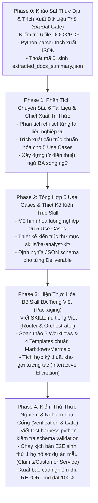

# LỘ TRÌNH TỔNG THỂ & PHÂN KỲ PHASE GATES (MASTER PLAN)
> **Đường dẫn**: `docs/plans/00_MASTER_PLAN.md`  
> **Dự án**: Bộ Skills Agent Kit cho Business Analyst (BA)  
> **Phương pháp luận**: Verification-Driven Planning (VDP) & Thin Vertical Slices  
> **Phiên bản**: 1.0.0 | **Ngày lập**: 2026-10-19  

---

## 1. SƠ ĐỒ PHỤ THUỘC LÁT CẮT THỰC THI (PHASE DEPENDENCY GRAPH)

---

## 2. CHI TIẾT TỪNG GIAI ĐOẠN & TIÊU CHUẨN CỔNG KIỂM SOÁT (PHASE GATES)

### PHASE 0: KHẢO SÁT THỰC ĐỊA & ĐỐI SOÁT CẤU TRÚC (SPIKES & GROUND TRUTH)
- **Trạng thái**: **ĐÃ HOÀN THÀNH 100% (GATE PASSED)**.
- **Mục tiêu**: Đọc toàn bộ nội dung nhị phân từ 4 tệp Word `.docx` và 2 tệp `.pdf` bằng Python, trích xuất cấu trúc các bảng biểu, style heading, và nội dung văn bản.
- **Đầu vào (Ground Truth)**:
  1. `Scope-Statement-Template_v3.docx` (5,324 ký tự, 5 bảng, 33 đoạn văn).
  2. `Business-Process-Template_v3.docx` (5,256 ký tự, 4 bảng, 31 đoạn văn).
  3. `Use-Case-Template_v3.docx` (3,860 ký tự, 2 bảng, 24 đoạn văn).
  4. `ReqChecklist-SupportCustomers_v2.docx` (15,356 ký tự, 1 bảng, 123 đoạn văn, 40+ câu hỏi khơi gợi).
  5. `BAJobInterviewPrepGuide.pdf` (3 trang, 1,963 ký tự).
  6. `BA_Skills_Assessment2.pdf` (10 trang, 8 bước quy trình BA, 12 kỹ thuật thực hành).
- **Lệnh kiểm chứng**:
  `python -c "import json; d=json.load(open('extracted_docs_summary.json', encoding='utf-8')); assert len(d) == 6; print('Phase 0 Verified: Exit 0')"`
- **Artifact nghiệm thu**: `extracted_docs_summary.json` (58,987 bytes).

---

### PHASE 1: PHÂN TÍCH CHUYÊN SÂU 6 TÀI LIỆU & CHIẾT XUẤT TRI THỨC (DEEP RESEARCH & EXTRACTION)
- **Trạng thái**: **ĐÃ HOÀN THÀNH 100% (GATE PASSED - Báo cáo tại docs/evidence/P1/REPORT.md)**.
- **Điều kiện tiên quyết**: Phase 0 đã qua cổng.
- **Nhiệm vụ cụ thể**:
  - `P1.1`: Phân tích sâu tệp `Scope-Statement-Template_v3.docx` $\to$ Trích xuất cấu trúc trường bắt buộc, ví dụ dự án bảo hiểm thực tế (Insurance Claims Processing), tiêu chí phân định In-Scope vs Out-of-Scope.
  - `P1.2`: Phân tích sâu tệp `Business-Process-Template_v3.docx` $\to$ Trích xuất cấu trúc As-Is / To-Be, cú pháp "Starts when... Ends when...", ma trận Business Rules liên kết với Activity Steps, và quy ước chuyển đổi sang sơ đồ Mermaid Swimlane.
  - `P1.3`: Phân tích sâu tệp `Use-Case-Template_v3.docx` $\to$ Trích xuất cấu trúc Happy Path, Alternate Flows (3a, 3b), Exception Flows, Actors, Pre/Post-Conditions, bổ sung định dạng User Story + Gherkin Criteria.
  - `P1.4`: Phân tích sâu tệp `ReqChecklist-SupportCustomers_v2.docx` $\to$ Chiết xuất bộ 5 nhóm câu hỏi khơi gợi (Scope, Triage & Routing, Handling, Monitoring, Self-Service/Preemption).
  - `P1.5`: Phân tích sâu 2 tệp PDF (`BA_Skills_Assessment2.pdf` & `BAJobInterviewPrepGuide.pdf`) $\to$ Trích xuất quy trình 8 bước của Laura Brandenburg và 12 kỹ năng BA kèm rubric đánh giá (Novice -> Expert).
- **Lệnh kiểm chứng**:
  `python scripts/verify_phase1_knowledge.py` (Exit code 0).
- **Artifact đầu ra**:
  - `docs/research/01_SCOPE_STATEMENT_DEEP_DIVE.md`
  - `docs/research/02_BUSINESS_PROCESS_DEEP_DIVE.md`
  - `docs/research/03_USE_CASE_SPEC_DEEP_DIVE.md`
  - `docs/research/04_REQUIREMENTS_CHECKLIST_DEEP_DIVE.md`
  - `docs/research/05_BA_METHODOLOGY_AND_SKILLS_ASSESSMENT.md`
  - `docs/research/06_BILINGUAL_BA_GLOSSARY.md`

---

### PHASE 2: TỔNG HỢP 5 USE CASES & THIẾT KẾ KIẾN TRÚC SKILL (SYNTHESIS & DESIGN)
- **Trạng thái**: **ĐÃ HOÀN THÀNH 100% (GATE PASSED)**.
- **Điều kiện tiên quyết**: Toàn bộ 6 tệp tài liệu nghiên cứu của Phase 1 đã hoàn tất và được nghiệm thu.
- **Nhiệm vụ cụ thể**:
  - `P2.1`: Thiết kế cấu trúc thư mục và đặc tả kỹ thuật cho `skills/ba-analyst-kit/`.
  - `P2.2`: Chuẩn hóa 5 luồng tác vụ (Workflows) tiếng Việt cho 5 Use Cases.
  - `P2.3`: Thiết kế bộ 4 mẫu biểu Markdown chuẩn (`templates/*.md`) có nhúng trường kiểm chứng tự động.
- **Lệnh kiểm chứng**:
  `python scripts/verify_skill_package.py` (Exit code 0).
- **Artifact đầu ra**: `docs/plans/impl/IMPL_P2_SKILL_PACKAGING.md` và các bản thảo thiết kế.

---

### PHASE 3: HIỆN THỰC HÓA BỘ SKILL BA TIẾNG VIỆT (PACKAGING & IMPLEMENTATION)
- **Trạng thái**: **ĐÃ HOÀN THÀNH 100% (GATE PASSED)**.
- **Điều kiện tiên quyết**: Thiết kế kiến trúc và mẫu biểu tại Phase 2 đã qua cổng.
- **Nhiệm vụ cụ thể**:
  - `P3.1`: Soạn thảo tệp `skills/ba-analyst-kit/SKILL.md` (Frontmatter chuẩn, router điều hướng 5 use cases, nguyên tắc phân tích, guardrails chống ảo giác).
  - `P3.2`: Khởi tạo 5 tệp workflow chi tiết trong `skills/ba-analyst-kit/workflows/`.
  - `P3.3`: Khởi tạo 4 tệp template Markdown chuẩn trong `skills/ba-analyst-kit/templates/`.
  - `P3.4`: Xây dựng từ điển thuật ngữ đối chiếu Anh - Việt trong `skills/ba-analyst-kit/references/ba_glossary.md`.
- **Lệnh kiểm chứng**:
  `python scripts/verify_skill_package.py` (Exit code 0).
- **Artifact đầu ra**: Bộ mã nguồn hoàn chỉnh của Skill tại `skills/ba-analyst-kit/`.

---

### PHASE 4: KIỂM THỬ THỰC NGHIỆM & NGHIỆM THU CỔNG (VERIFICATION & GATE CLOSURE)
- **Trạng thái**: **ĐÃ HOÀN THÀNH 100% (GATE PASSED - Báo cáo tại docs/evidence/REPORT.md)**.
- **Điều kiện tiên quyết**: Bộ Skill đã được đóng gói đầy đủ ở Phase 3.
- **Nhiệm vụ cụ thể**:
  - `P4.1`: Viết kịch bản kiểm thử mẫu (Test Harness) chạy thử nghiệm tạo 1 bộ hồ sơ phân tích BA thực tế từ bài toán "Hệ thống tiếp nhận và xử lý bồi thường bảo hiểm trực tuyến (Online Claims Support)".
  - `P4.2`: Chạy kiểm tra tự động cấu trúc đầu ra bằng `scripts/validate_ba_deliverables.py`:
    - Xác nhận Scope Statement đủ 10 mục bắt buộc.
    - Xác nhận Business Process có sơ đồ Mermaid hợp lệ và ma trận Business Rules khớp với các bước.
    - Xác nhận Use Case có đủ Happy Path, Alternate Flows 3a/3b, và Gherkin Acceptance Criteria.
  - `P4.3`: Xuất bản báo cáo nghiệm thu tổng thể `docs/evidence/REPORT.md` và hoàn tất bàn giao trong `docs/HANDOFF.md`.
- **Lệnh kiểm chứng**:
  `python scripts/run_full_verification.py` (Exit code 0).
- **Artifact đầu ra**:
  - Bộ tài liệu mẫu được sinh ra tại `examples/claims_support_system/`.
  - Báo cáo nghiệm thu `docs/evidence/REPORT.md`.
