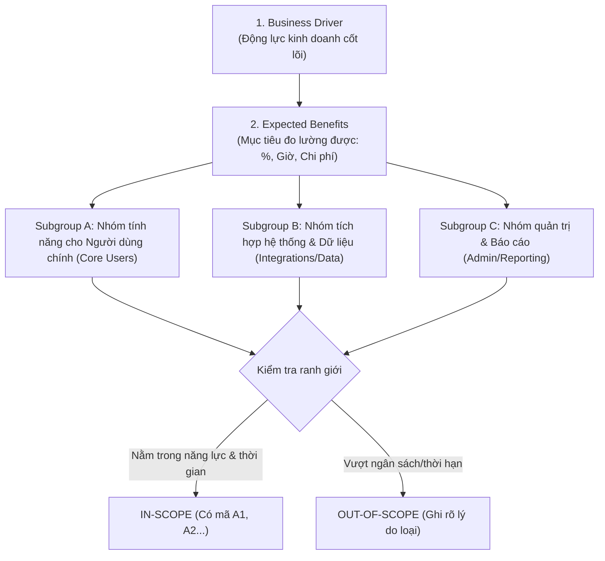
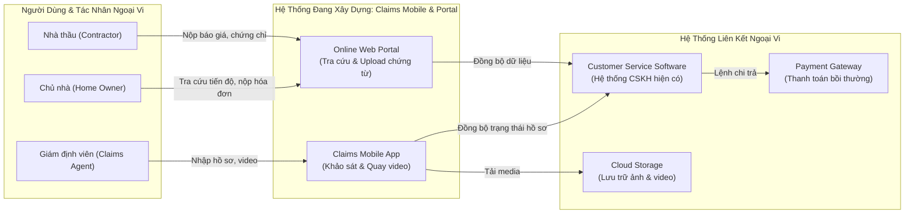

# PHÂN TÍCH CHUYÊN SÂU: ĐẶC TẢ PHẠM VI DỰ ÁN (SCOPE STATEMENT DEEP DIVE)
> **Mã tài liệu**: `docs/research/01_SCOPE_STATEMENT_DEEP_DIVE.md`  
> **Nguồn đối soát**: `Scope-Statement-Template_v3.docx` (Bridging The Gap / Laura Brandenburg, CBAP)  
> **Áp dụng cho**: Use Case 2 — Định nghĩa Scope Statement & Business Objectives  
> **Phiên bản**: 1.0.0 | **Ngày lập**: 2026-10-19  

---

## 1. TỔNG QUAN VÀ Ý NGHĨA CỐT LÕI CỦA SCOPE STATEMENT

Trong phương pháp luận phân tích nghiệp vụ chuẩn của Laura Brandenburg (Bridging The Gap), **Scope Statement** (Tuyên bố phạm vi dự án) là tài liệu hợp đồng nghiệp vụ then chốt nhất ở Bước 3 trong quy trình 8 bước. Nó đóng vai trò cầu nối giữa **Mục tiêu kinh doanh (Business Objectives)** cấp cao và **Yêu cầu chi tiết phần mềm (Detailed Requirements)**.

### Mục đích sống còn:
- **Thiết lập ranh giới bất biến (Boundary Invariants)**: Định nghĩa rõ ràng cái gì nằm trong phạm vi (In-Scope) và cái gì dứt khoát không làm (Out-of-Scope) để chống lại hiện tượng trôi phạm vi (Scope Creep).
- **Căn chỉnh kỳ vọng giữa Business & Tech**: Đảm bảo Business Sponsor, Product Owner và Đội ngũ Kỹ thuật có chung một định nghĩa về sự thành công của dự án trước khi viết một dòng code nào.
- **Phân rã tính năng cấp cao (Capabilities Subgroups)**: Nhóm các khả năng cần có của hệ thống thành các cụm có thể quản lý và phân kỳ được.

---

## 2. CẤU TRÚC 10 PHẦN BẮT BUỘC CỦA SCOPE STATEMENT

Dựa trên việc bóc tách cấu trúc nhị phân của tệp gốc `Scope-Statement-Template_v3.docx`, tài liệu Scope Statement chuẩn gồm đúng 10 mục:

| STT | Phần Bắt Buộc | Tên Gốc Tiếng Anh | Mục Đích Nghiệp Vụ & Quy Tắc Của Laura Brandenburg |
| :---: | :--- | :--- | :--- |
| **1** | Thông tin tài liệu | Document Information | Bảng kiểm soát: Tên dự án, Business Sponsor (người có thẩm quyền duyệt ngân sách), Prepared By, Stakeholders (kèm chức danh hoặc RACI matrix), Version, Status, Date. |
| **2** | Tổng quan dự án | Project Overview | Đoạn văn ngắn gọn từ 2 - 3 câu mô tả lý do doanh nghiệp đầu tư (Business Driver) và tóm tắt phạm vi giải pháp. |
| **3** | Lợi ích kỳ vọng | Expected Benefits | Danh sách từ 2 - 5 mục tiêu kinh doanh cốt lõi (Business Goals). **Quy tắc vàng**: Phải là kết quả nghiệp vụ (Outcomes), KHÔNG phải là giải pháp kỹ thuật (Solutions). Phải đo lường được (Quantifiable). |
| **4** | Năng lực giải pháp | Capabilities | Bảng liệt kê các khả năng cần đạt được của giải pháp (quy trình, phần mềm, tích hợp, dữ liệu), được chia thành các nhóm (Sub-groups: A, B, C...). Mã hóa `A1, A2... B1, B2...` |
| **5** | Giả định | Assumptions | Những điều kiện mà đội ngũ tin là đúng tại thời điểm lập kế hoạch nhưng chưa được kiểm chứng độc lập (ví dụ: bên thứ ba không đổi API trước ngày bàn giao). |
| **6** | Ràng buộc | Constraints | Các giới hạn cứng bắt buộc phải tuân thủ: Ngân sách, thời hạn chuyển giao (Deadline), nhân sự sẵn sàng, quy định pháp lý, hoặc nền tảng công nghệ có sẵn bắt buộc phải dùng (COTS/Legacy). |
| **7** | Ngoài phạm vi | Out of Scope | Danh sách tường minh các tính năng, yêu cầu hoặc mong muốn bị từ chối rõ ràng trong giai đoạn này. |
| **8** | Mô hình trực quan | Visual Models | Sơ đồ ngữ cảnh hệ thống (System Context Diagram 1 trang) hiển thị các tác nhân (Actors), các luồng thông tin và các hệ thống phụ thuộc. |
| **9** | Vấn đề còn mở | Open Issues | Danh sách các câu hỏi/điểm nghẽn chưa chốt được trong quá trình scoping, kèm người phụ trách (Owner) và hạn chót cam kết (Commitment Date). |
| **10** | Lịch sử sửa đổi | Revision History | Bảng kiểm toán phiên bản: Version, Date, Author, Description, Status. |

---

## 3. CASE STUDY THỰC TẾ TRÍCH XUẤT TỪ TÀI LIỆU GỐC (CLAIMS MOBILE APP)

Tệp mẫu gốc cung cấp một ví dụ thực chiến xuất sắc về dự án số hóa quy trình bồi thường bảo hiểm nhà cửa và xe hơi:

### 3.1. Project Overview (Tổng quan dự án)
> *"Chúng tôi muốn nâng cao hiệu suất làm việc của các giám định viên bồi thường (Claim Agents) và cắt giảm số lượng cuộc gọi thắc mắc của chủ nhà cũng như nhà thầu để kiểm tra tình trạng bồi thường và sửa chữa. Dự án này bao gồm việc xây dựng một ứng dụng di động (Mobile App) hỗ trợ toàn diện quy trình giám định tại hiện trường, tích hợp trực tiếp với phần mềm chăm sóc khách hàng (Customer Service Software), đồng thời cung cấp cổng trực tuyến (Online Portal) cho chủ nhà và nhà thầu tra cứu tiến độ và tải lên chứng từ liên quan."*

### 3.2. Expected Benefits (Lợi ích kỳ vọng & Chỉ số đo lường)
- Giảm thời gian trung bình một giám định viên lập và nộp hồ sơ bồi thường từ **8 giờ làm việc xuống còn 6 giờ hoặc ít hơn**.
- Giảm **50%** số lượng cuộc gọi kiểm tra tiến độ bồi thường từ phía chủ nhà.
- Giảm **50%** số lượng cuộc gọi kiểm tra tiến độ từ phía nhà thầu thi công.
- Tăng tỷ lệ chủ nhà tiếp nhận và sử dụng ứng dụng web trực tuyến lên **30%**.

### 3.3. Capabilities Table (Bảng năng lực giải pháp mẫu - Subgroup A: Onsite Claims Process)
| Mã | Năng lực giải pháp (Capability) | Tác nhân thụ hưởng |
| :--- | :--- | :--- |
| **A1** | Giám định viên có thể hoàn thành toàn bộ các bước lập và nộp hồ sơ bồi thường trên di động gồm: Video quay hiện trường, Ảnh chụp hiện trường, Hồ sơ tài liệu hoàn chỉnh | Claims Agent |
| **A2** | Khách hàng (Chủ nhà) có thể tự tải lên các tài liệu bổ trợ như bảng báo giá và hóa đơn trực tiếp vào hồ sơ | Home Owner |
| **A3** | Nhà thầu có thể tải lên các tài liệu chứng minh bảo hiểm, báo giá chi tiết và hóa đơn sửa chữa | Contractor |
| **A4** | Cho phép khách hàng và nhà thầu tạo mới và cập nhật hồ sơ cá nhân/doanh nghiệp để tái sử dụng qua nhiều vụ bồi thường | Customer & Contractor |
| **A5** | Rà soát lại toàn bộ yêu cầu chứng từ hiện tại và quy tắc nghiệp vụ để tinh gọn quy trình | Business Team |

---

## 4. QUY TẮC PHÂN RÃ NĂNG LỰC (CAPABILITIES SUBGROUPING RULES)

Khi Agent thực hiện Use Case 2 (Định nghĩa Scope Statement), Agent bắt buộc phải tuân theo các quy tắc sau:

### Quy ước định danh (ID Convention):
- Mỗi nhóm năng lực (Subgroup) mang 1 chữ cái in hoa: `A`, `B`, `C`...
- Mỗi năng lực con mang tiền tố chữ cái kèm số thứ tự: `A1`, `A2`, `A3`...
- Mô tả năng lực bắt đầu bằng cụm từ chỉ chủ thể và hành động rõ ràng: `"[Actor] can [Action] [Object] [Details]"` (Ví dụ: *"Giám định viên có thể quay video hiện trường..."*).

---

## 5. MA TRẬN PHÂN ĐỊNH RANH GIỚI (IN-SCOPE VS OUT-OF-SCOPE)

| Tiêu Chí | In-Scope (Trong Phạm Vi) | Out-of-Scope (Ngoài Phạm Vi) |
| :--- | :--- | :--- |
| **Mục đích** | Đóng gói những việc cam kết bàn giao trong phiên bản hiện tại | Chặn đứng kỳ vọng quá mức của stakeholder |
| **Cách viết** | Gắn với năng lực cụ thể có ID (`A1`, `B2`) | Liệt kê các ý tưởng hay ho nhưng tốn kém, hoặc các tính năng bị lùi sang Phase sau |
| **Ví dụ** | "Hỗ trợ giám định viên chụp ảnh và tải ảnh hiện trường qua app" | "Tính năng tự động nhận diện mức độ thiệt hại xe qua AI (hoãn sang Phase 2)" |
| **Quy tắc bắt buộc** | Phải liên kết trực tiếp tới ít nhất 1 Expected Benefit | Phải nêu rõ lý do tại sao loại bỏ (thiếu budget, thời gian, hoặc dữ liệu) |

---

## 6. SƠ ĐỒ NGỮ CẢNH HỆ THỐNG TRỰC QUAN (SYSTEM CONTEXT DIAGRAM VIA MERMAID)

Trong template gốc, mục **Visual Models** yêu cầu một "1-page system context diagram". Khi chuyển đổi sang Skill Agent, định dạng chuẩn là sơ đồ **Mermaid Flowchart** thể hiện ranh giới hệ thống:

---

## 7. GUARDRAILS CHO BA AGENT KHI TẠO SCOPE STATEMENT

Khi Skill BA kích hoạt tác vụ tạo Scope Statement, Agent bắt buộc phải kiểm tra qua Checklist chất lượng sau:
1. **Không nhầm lẫn Lợi ích (Benefit) với Tính năng (Feature)**:
   - *Sai*: "Lợi ích là xây dựng ứng dụng di động cho giám định viên."
   - *Đúng*: "Lợi ích là giảm thời gian nộp hồ sơ từ 8 giờ xuống 6 giờ."
2. **Mọi Capability phải có Subgroup và ID rõ ràng** (`A1`, `A2`...).
3. **Mục Out-of-Scope không được để trống**: Luôn phải có ít nhất 2 - 3 mục bị loại trừ để bảo vệ ngân sách và tiến độ dự án.
4. **Assumptions & Constraints phải được tách bạch**:
   - Assumptions: Những điều ta tin là đúng nhưng chưa kiểm chứng (Internal/External beliefs).
   - Constraints: Những giới hạn thực tế không thể thương lượng (Fixed Deadlines, Fixed Budget, Legal/Compliance).
