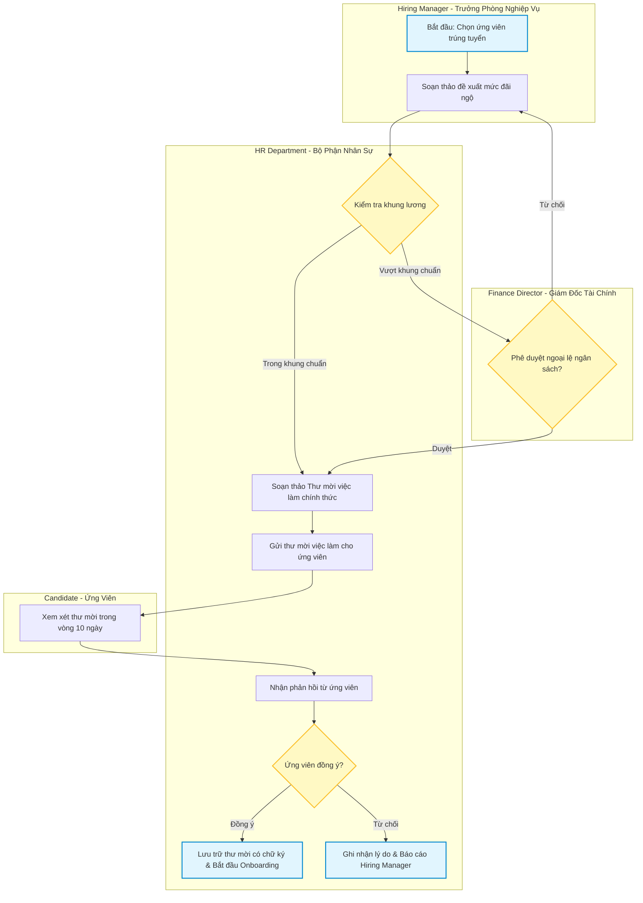

# PHÂN TÍCH CHUYÊN SÂU: MÔ HÌNH HÓA QUY TRÌNH NGHIỆP VỤ (BUSINESS PROCESS DEEP DIVE)
> **Mã tài liệu**: `docs/research/02_BUSINESS_PROCESS_DEEP_DIVE.md`  
> **Nguồn đối soát**: `Business-Process-Template_v3.docx` (Bridging The Gap / Laura Brandenburg, CBAP)  
> **Áp dụng cho**: Use Case 3 — Thiết kế Quy trình nghiệp vụ (Business Process Modeling)  
> **Phiên bản**: 1.0.0 | **Ngày lập**: 2026-10-19  

---

## 1. TỔNG QUAN VÀ Ý NGHĨA CỦA BUSINESS PROCESS DOCUMENT

Trong hệ thống tài liệu phân tích nghiệp vụ, **Business Process Document** (Tài liệu quy trình nghiệp vụ) là nền tảng sống còn để hiểu rõ cách thức tổ chức vận hành. Một giải pháp phần mềm dù hiện đại đến đâu cũng sẽ thất bại nếu không được đặt trên một quy trình nghiệp vụ mạch lạc.

### Nguyên lý thiết kế cốt lõi của Laura Brandenburg:
1. **Quy tắc Động từ - Danh từ (Verb - Noun Phrasing)**: Tiêu đề quy trình luôn luôn phải tuân theo cấu trúc `Động từ + Danh từ` (ví dụ: *"Tuyển dụng nhân sự"*, *"Nộp hồ sơ bồi thường"*, *"Tiếp nhận yêu cầu hỗ trợ"*, *"Duyệt báo giá"*). Tuyệt đối tránh đặt tên chung chung như *"Quy trình hệ thống"* hay *"Module bảo hiểm"*.
2. **Cặp đôi Ranh giới Bất biến (Boundary Pairs)**:
   - **Bắt đầu**: Phân định rõ giữa *Entry Criteria* (Điều kiện tiên quyết) và *Inputs* (Đầu vào hữu hình).
   - **Kết thúc**: Phân định rõ giữa *Outputs* (Đầu ra hữu hình) và *Exit Criteria* (Tiêu chuẩn hoàn tất quy trình).
3. **Cú pháp định danh phạm vi**: Bắt buộc phải có câu định vị:
   > *"Quy trình này bắt đầu khi [Sự kiện bắt đầu] và kết thúc khi [Sự kiện hoàn tất]."*
4. **Phân định rõ As-Is và To-Be**: Xác định rõ văn bản đang mô tả hiện trạng (As-Is - để tìm điểm nghẽn) hay quy trình tương lai tối ưu (To-Be - để lập trình phần mềm).

---

## 2. CẤU TRÚC 11 MỤC CHUẨN CỦA BUSINESS PROCESS DOCUMENT

Bóc tách từ tệp `Business-Process-Template_v3.docx`, tài liệu chuẩn bao gồm 11 mục:

| STT | Mục Chuẩn | Tên Tiếng Anh | Chi Tiết Đặc Tả & Hướng Dẫn Thực Hành |
| :---: | :--- | :--- | :--- |
| **1** | Thông tin tài liệu | Document Information | Title (Verb-Noun), Document Owner, Version, Status, Date. |
| **2** | Mục đích & Phạm vi | Purpose | 2 - 4 câu nêu lý do tồn tại của quy trình, là As-Is hay To-Be, kèm câu chuẩn: *"Quy trình này bắt đầu khi... và kết thúc khi..."* |
| **3** | Điều kiện kích hoạt | Entry Criteria | Các điều kiện cần có TRƯỚC KHI quy trình được phép bắt đầu. Thường do Chủ sở hữu quy trình (Process Owner) quy định. (Ví dụ: Trưởng phòng đã được cấp ngân sách tuyển dụng). |
| **4** | Đầu vào vật lý/số | Inputs | Các sản phẩm/dữ liệu hữu hình (email, form đăng ký, bản ghi DB, hợp đồng) mà người khởi tạo nhận được để bắt đầu công việc. |
| **5** | Sơ đồ luồng công việc | Workflow Diagram | Sơ đồ phân làn (Swimlane Diagram) trực quan hóa trình tự công việc, các điểm rẽ nhánh quyết định và sự chuyển giao giữa các vai trò. |
| **6** | Mô tả chi tiết hoạt động | Activity Descriptions | Mô tả văn xuôi tường minh từng bước hoạt động theo thứ tự đánh số. Thuật ngữ phải khớp 100% với Sơ đồ luồng công việc. |
| **7** | Ngoại lệ quy trình | Exceptions | Các tình huống bất thường, rẽ nhánh lỗi hoặc sự cố ngăn cản quy trình đi theo luồng chuẩn (Happy Path). |
| **8** | Quy tắc nghiệp vụ | Business Rules | Bảng ma trận các luật lệ, chính sách kinh doanh bắt buộc phải tuân thủ và ánh xạ trực tiếp tới số bước thực hiện. |
| **9** | Đầu ra | Outputs | Các sản phẩm hữu hình sinh ra từ quy trình (hợp đồng đã ký, hóa đơn đã xuất, email xác nhận). |
| **10** | Tiêu chuẩn kết thúc | Exit Criteria | Tiêu chuẩn để xác nhận quy trình đã hoàn tất thành công. Thường do đơn vị tiếp nhận đầu ra quy định. (Là Entry Criteria cho quy trình tiếp theo!). |
| **11** | Vai trò & Chỉ số đo lường | Roles & Metrics | Bảng phân quyền trách nhiệm (`Role \| Responsibility \| Who Fulfills`) và các chỉ số đo lường hiệu quả (Cycle time, SLA, Queue duration). |

---

## 3. CASE STUDY GỐC: QUY TRÌNH "MAKE JOB OFFER" (CHÀO MỜI VIỆC LÀM)

Template gốc minh họa một case study điển hình về quy trình tuyển dụng nhân sự:

- **Tiêu đề**: *Make Job Offer Process*
- **Câu phạm vi chuẩn**: *"Quy trình này bắt đầu khi Trưởng bộ phận tuyển dụng đưa ra quyết định chọn ứng viên cuối cùng và kết thúc khi ứng viên chính thức đồng ý hoặc từ chối thư mời việc làm."*
- **Entry Criteria**: Ngân sách vị trí tuyển dụng đã được Giám đốc Tài chính phê duyệt.
- **Input**: Bản mô tả công việc (Job Description) và Hồ sơ ứng viên đã qua phỏng vấn.
- **Business Rule mẫu**: *"Mọi thư mời việc làm (Job Offer) nếu sau 10 ngày làm việc không nhận được phản hồi từ ứng viên sẽ tự động xem như bị từ chối."* $\to$ Ánh xạ tới Bước 4 (Chờ phản hồi ứng viên).
- **Output**: Thư mời việc làm có chữ ký chấp thuận của ứng viên.
- **Exit Criteria**: Nhận được quyết định dứt khoát (Đồng ý hoặc Từ chối) từ phía ứng viên.
- **Metrics**: 
  - Tỷ lệ ứng viên chấp nhận thư mời việc làm (Offer Acceptance Rate: $\ge 85\%$).
  - Thời gian xử lý từ lúc chọn ứng viên đến khi gửi thư mời (Dưới 48 giờ làm việc).

---

## 4. MA TRẬN QUY TẮC NGHIỆP VỤ & PHÂN QUYỀN (TABLE SCHEMAS)

### 4.1. Bảng Ma Trận Quy Tắc Nghiệp Vụ (Business Rules Matrix)
Mọi quy tắc nghiệp vụ không được viết lơ lửng mà phải gắn chặt với bước thực thi:

| Mã Quy Tắc | Nội Dung Quy Tắc Nghiệp Vụ (Business Rule) | Bước Hoạt Động Thực Thi (Activity Step) |
| :--- | :--- | :--- |
| **BR-01** | Chỉ người có thẩm quyền Giám đốc trở lên mới được duyệt mức lương vượt khung quy định | Bước 2: Thẩm định gói thù lao |
| **BR-02** | Thư mời phải được gửi đồng thời qua email bảo mật và bưu điện bảo đảm | Bước 3: Phát hành Job Offer |
| **BR-03** | Hạn phản hồi mặc định là 10 ngày làm việc kể từ thời điểm gửi | Bước 4: Theo dõi phản hồi |

### 4.2. Bảng Phân Quyền Vai Trò (Roles & Responsibilities Matrix)
| Vai Trò (Role) | Trách Nhiệm Cụ Thể (Responsibility) | Bộ Phận / Ai Đảm Nhận (Who Fulfills) |
| :--- | :--- | :--- |
| **Hiring Manager** | Đề xuất ứng viên và mức lương dự kiến | Trưởng phòng nghiệp vụ |
| **HR Representative** | Soạn thảo thư mời theo mẫu, gửi và điều phối phản hồi | Chuyên viên Nhân sự |
| **Finance Director** | Thẩm định ngân sách và ký duyệt gói phúc lợi đặc biệt | Giám đốc Tài chính |
| **Candidate** | Xem xét, ký chấp nhận hoặc gửi văn bản từ chối | Ứng viên trúng tuyển |

---

## 5. QUY CHUẨN MÔ HÌNH HÓA SƠ ĐỒ SANG MERMAID SWIMLANE

Trong tài liệu của Laura Brandenburg, sơ đồ quy trình được vẽ bằng Visio hoặc swimlane diagram. Đối với Agentic Skill, toàn bộ sơ đồ phải được biểu diễn bằng **Mermaid Flowchart** phân làn trực quan:

---

## 6. GUARDRAILS CHO BA AGENT KHI THIẾT KẾ QUY TRÌNH NGHIỆP VỤ

1. **Phân biệt rạch ròi Entry Criteria và Inputs**:
   - *Entry Criteria* là TRẠNG THÁI / ĐIỀU KIỆN TIÊN QUYẾT (Condition).
   - *Inputs* là VẬT PHẨM / DỮ LIỆU CỤ THỂ (Artifact/Data).
2. **Phân biệt rạch ròi Outputs và Exit Criteria**:
   - *Outputs* là VẬT PHẨM TẠO RA (Deliverable).
   - *Exit Criteria* là TIÊU CHUẨN HOÀN THÀNH NGHIỆP VỤ (Acceptance Standard).
3. **Mọi điểm rẽ nhánh (Decision Diamond) trong sơ đồ Mermaid bắt buộc phải có đủ 2 luồng ra**:
   - Luồng tích cực (Yes/Success/Approved).
   - Luồng phủ định/ngoại lệ (No/Reject/Exception).
4. **Metrics phải đo lường được**: Tránh viết chung chung như *"Tăng độ hài lòng"*; phải viết *"Thời gian xử lý trung bình dưới X giờ, tỷ lệ lỗi dưới Y%"*.
