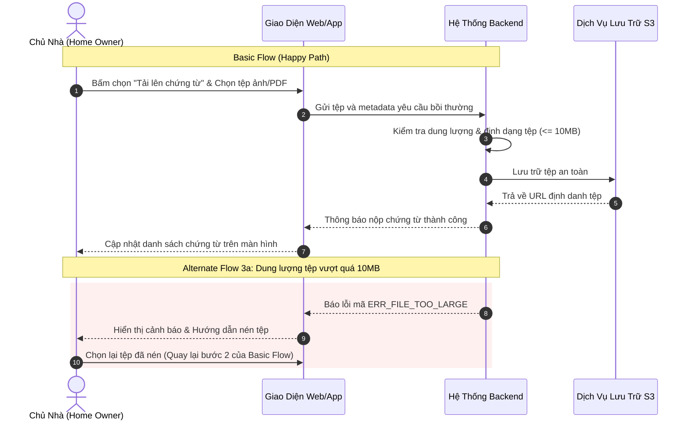

# PHÂN TÍCH CHUYÊN SÂU: ĐẶC TẢ USE CASE VÀ TÍCH HỢP AGILE USER STORIES (USE CASE SPEC DEEP DIVE)
> **Mã tài liệu**: `docs/research/03_USE_CASE_SPEC_DEEP_DIVE.md`  
> **Nguồn đối soát**: `Use-Case-Template_v3.docx` & `BA_Skills_Assessment2.pdf` (Bridging The Gap)  
> **Áp dụng cho**: Use Case 4 — Soạn thảo Use Case chi tiết & User Stories  
> **Phiên bản**: 1.0.0 | **Ngày lập**: 2026-10-19  

---

## 1. TỔNG QUAN VÀ Ý NGHĨA CỦA USE CASE TRONG KỸ THUẬT PHẦN MỀM

Theo định nghĩa của Laura Brandenburg (Bridging The Gap), **Use Case** (Trường hợp sử dụng) là một tài liệu dạng văn bản chi tiết mô tả sự tương tác qua lại giữa **Người dùng (User/Actor)** và **Hệ thống phần mềm (System)** nhằm đạt được một mục tiêu nghiệp vụ cụ thể.

### Tại sao Use Case vẫn là vũ khí tối thượng của BA?
- **Khắc phục sự hời hợt của User Story**: User Story trong Agile thường rất ngắn (`As a... I want... So that...`), dễ dẫn đến việc lập trình viên bỏ sót các kịch bản ngoại lệ, lỗi mạng hoặc luồng rẽ nhánh phức tạp.
- **Ranh giới tương tác rõ ràng**: Mô tả chính xác hành vi của User (Input/Action) và phản hồi của System (Validation, Processing, Output).
- **Cầu nối 2 chiều giữa Waterfall & Agile**: Một Use Case lớn có thể đóng vai trò như một Epic hoặc Feature trong Agile, từ đó bẻ nhỏ thành các User Stories có tiêu chí nghiệm thu (Acceptance Criteria) chặt chẽ.

---

## 2. CẤU TRÚC 10 PHẦN CHUẨN CỦA USE CASE THEO BRIDGING THE GAP

Bóc tách từ tệp gốc `Use-Case-Template_v3.docx`, tài liệu Use Case chuẩn gồm 10 mục:

| STT | Mục Chuẩn | Tên Tiếng Anh | Quy Tắc Thực Hành Của Laura Brandenburg |
| :---: | :--- | :--- | :--- |
| **1** | Tiêu đề Use Case | Title | Bắt buộc dùng cấu trúc `Động từ + Danh từ` (Verb-Noun). Ví dụ: *"Tải lên chứng từ bồi thường"*, *"Xác thực tài khoản"*. |
| **2** | Thông tin tài liệu | Document Information | Title, Document Owner, Version, Status, Date. |
| **3** | Mô tả tóm tắt | Brief Description | 1 - 2 câu tóm tắt mục tiêu, bắt buộc dùng cú pháp: *"Bắt đầu khi... và kết thúc khi..."* (Starts with / Ends with). |
| **4** | Tác nhân | Actors | Danh sách các vai trò con người (Primary/Secondary Actors) hoặc các hệ thống bên ngoài (System Actors) tham gia vào Use Case. |
| **5** | Tiền điều kiện | Pre-Conditions | Những trạng thái bắt buộc phải đúng TRƯỚC KHI Use Case bắt đầu (Ví dụ: *"Người dùng đã đăng nhập thành công và có quyền Khách hàng"*). |
| **6** | Luồng chuẩn (Happy Path) | Basic Flow | Chuỗi các bước tương tác lý tưởng diễn ra trong phần lớn thời gian ($>90\%$), được đánh số thứ tự từ 1 đến hết. |
| **7** | Luồng rẽ nhánh & Ngoại lệ | Alternate / Exception Flows | Đánh số theo bước phát sinh rẽ nhánh (Ví dụ: `3a`, `3b`).  <br>- *Alternate Flow*: Rẽ nhánh hợp lệ và quay trở lại luồng chuẩn. <br>- *Exception Flow*: Lỗi nghiêm trọng khiến Use Case dừng lại không hoàn tất được. |
| **8** | Hậu điều kiện | Post-Conditions | Trạng thái hệ thống bắt buộc phải đạt được sau khi luồng hoàn thành. Áp dụng chung cho cả Basic Flow và các Alternate Flows hợp lệ. |
| **9** | Yêu cầu bổ trợ | Supplemental Requirements | Các quy tắc nghiệp vụ đặc thù (Business Rules), ràng buộc phi chức năng (NFR: tốc độ xử lý, mã hóa bảo mật) áp dụng riêng cho Use Case này. |
| **10** | Mô hình trực quan | Visual Model | Sơ đồ tuần tự tương tác (Sequence Diagram) hoặc Sơ đồ hoạt động (Activity Flowchart) và phác thảo màn hình UI (Wireframe Mockup). |

---

## 3. CHI TIẾT KỸ THUẬT ĐẶC TẢ CÁC LUỒNG TƯƠNG TÁC (FLOW DYNAMICS)



### Quy ước đánh số Luồng rẽ nhánh và Ngoại lệ (Numbering Convention):
- Nếu rẽ nhánh xuất hiện tại **Bước 3** của Basic Flow:
  - Nhánh thay thế đầu tiên: `3a. Người dùng chọn tải lên từ Google Drive thay vì bộ nhớ máy tính.` $\to$ Sau khi chọn xong, quay lại Bước 4 của Basic Flow.
  - Nhánh thay thế thứ hai: `3b. Tệp tải lên bị trùng tên với chứng từ cũ.` $\to$ Hệ thống hỏi xác nhận ghi đè.
  - Ngoại lệ lỗi: `3c. Mất kết nối mạng khi đang truyền tệp.` $\to$ Hệ thống dừng quá trình, lưu nháp cục bộ và báo lỗi, Use Case kết thúc thất bại.

---

## 4. CẦU NỐI AGILE: CHUYỂN ĐỔI USE CASE SANG USER STORIES & GHERKIN AC

Để bộ Skill của Agent có tính ứng dụng cao nhất trong các môi trường Agile/Scrum hiện đại, BA Agent sẽ tự động trích xuất các User Stories kèm tiêu chí nghiệm thu định dạng **Gherkin (Given - When - Then)** từ Use Case:

### Mẫu User Story chuẩn:
```text
Title: US-01 — Tải lên hóa đơn sửa chữa bồi thường

Là một: Chủ nhà (Home Owner)
Tôi muốn: Tải lên các hóa đơn sửa chữa dạng PDF hoặc hình ảnh trực tiếp vào hồ sơ bồi thường
Để: Giám định viên xem xét duyệt thanh toán mà tôi không cần phải gửi thư giấy hay gọi điện thoại
```

### Tiêu chuẩn nghiệm thu Gherkin (Acceptance Criteria):

#### Kịch bản 1: Tải lên tệp hợp lệ (Happy Path)
```gherkin
Scenario: Chủ nhà tải lên hóa đơn PDF hợp lệ dưới 10MB
  Given Chủ nhà đã đăng nhập vào cổng thông tin và hồ sơ bồi thường đang ở trạng thái "Chờ chứng từ"
  When Chủ nhà chọn tệp "hoa_don_sua_chua.pdf" dung lượng 2.5MB và bấm "Tải lên"
  Then Hệ thống sẽ lưu trữ tệp vào hệ thống lưu trữ an toàn
  And Trạng thái của chứng từ hiển thị "Đã tải lên"
  And Hệ thống gửi thông báo cho Giám định viên phụ trách hồ sơ
```

#### Kịch bản 2: Tải lên tệp sai định dạng (Exception Flow)
```gherkin
Scenario: Chủ nhà tải lên tệp thực thi độc hại (.exe)
  Given Chủ nhà đang ở màn hình tải chứng từ
  When Chủ nhà chọn tệp có đuôi mở rộng ".exe"
  Then Hệ thống lập tức từ chối tệp tại biên giao diện
  And Hiển thị thông báo lỗi bằng tiếng Việt: "Chỉ chấp nhận các định dạng tệp: PDF, PNG, JPG, JPEG"
  And Không gửi request tải lên nào vào máy chủ nội bộ
```

---

## 5. BẢNG SO SÁNH GIỮA USE CASE VÀ USER STORY

| Tiêu Chí So Sánh | Use Case Truyền Thống | Agile User Story | Mô Hình Tích Hợp Của BA Skill |
| :--- | :--- | :--- | :--- |
| **Phạm vi (Scope)** | Toàn diện một chu trình tương tác từ đầu đến cuối | Một lát cắt nhỏ tạo ra giá trị độc lập trong Sprint | Dùng Use Case làm Kiến trúc gốc, phân rã thành các User Stories cho Sprint Backlog |
| **Chi tiết luồng lỗi** | Cực kỳ chi tiết (Luồng 3a, 3b, 3c...) | Thường bị bỏ qua hoặc ghi chú ngắn | Chuyển toàn bộ Exception Flow thành các Scenario Gherkin riêng biệt |
| **Đối tượng đọc** | BA, Tester, Architect, Tech Lead | Lập trình viên trong Daily/Planning | Cung cấp song song cả hai góc nhìn để lập trình viên hiểu toàn cảnh |
| **Độ ổn định** | Cao, ít thay đổi trong suốt vòng đời dự án | Biến động linh hoạt theo từng kỳ Sprint | Lưu trữ Use Case làm Master Documentation, lưu User Stories trên Jira/GitHub Issues |

---

## 6. GUARDRAILS CHO BA AGENT KHI SOẠN THẢO USE CASE

1. **Không mô tả chi tiết công nghệ nội bộ**:
   - *Sai*: "Người dùng bấm nút, hệ thống gọi SQL query SELECT * FROM claims..."
   - *Đúng*: "Người dùng bấm xác nhận, hệ thống kiểm tra tính hợp lệ của hồ sơ..."
2. **Luôn chỉ rõ chủ thể ở từng bước**: Mỗi bước trong Basic Flow phải bắt đầu bằng một Actor rõ ràng (*"Người dùng làm gì..."* hoặc *"Hệ thống phản hồi gì..."*).
3. **Mọi Alternate Flow phải chỉ rõ điểm quay lại**: Phải nêu rõ sau khi rẽ nhánh xong thì quay lại bước số mấy của Basic Flow, hoặc kết thúc Use Case tại đâu.
4. **Post-Conditions phải có trạng thái dữ liệu cụ thể**: Nêu rõ bản ghi được tạo mới, cập nhật cờ (flag), hoặc trigger sự kiện tiếp theo.
