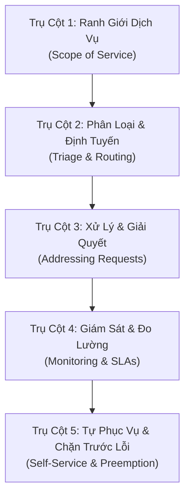

# PHÂN TÍCH CHUYÊN SÂU: KHUNG KHƠI GỢI YÊU CẦU & BỘ CHECKLIST PHỎNG VẤN (REQUIREMENTS CHECKLIST DEEP DIVE)
> **Mã tài liệu**: `docs/research/04_REQUIREMENTS_CHECKLIST_DEEP_DIVE.md`  
> **Nguồn đối soát**: `ReqChecklist-SupportCustomers_v2.docx` (Bridging The Gap / Laura Brandenburg, CBAP)  
> **Áp dụng cho**: Use Case 1 — Khơi gợi yêu cầu & Elicitation Sessions  
> **Phiên bản**: 1.0.0 | **Ngày lập**: 2026-10-19  

---

## 1. TỔNG QUAN VÀ Ý NGHĨA CỦA REQUIREMENTS DISCOVERY CHECKLIST

Trong thực tế dự án, một trong những sai lầm lớn nhất của Business Analyst hoặc AI Agent là **"ngồi đợi yêu cầu"** hoặc chỉ hỏi những câu hời hợt chung chung như *"Bạn muốn phần mềm làm gì?"*. 

Theo Laura Brandenburg, phương pháp tiếp cận chuẩn mực của Senior BA là sử dụng **Requirements Discovery Checklist** (Bộ danh mục khơi gợi yêu cầu chuyên sâu). Đây là công cụ giúp BA chủ động dẫn dắt các phiên phỏng vấn Stakeholder (Discovery Sessions), bóc tách từng ngóc ngách của bài toán nghiệp vụ, từ đó phát hiện ra các yêu cầu ngầm định mà chính khách hàng cũng chưa nghĩ tới.

### Triết lý "The Most Important Thing" của Laura Brandenburg:
> *"Điều quan trọng nhất trong việc xây dựng hệ thống hỗ trợ không chỉ đơn thuần là tiếp nhận và giải quyết yêu cầu thật nhanh, mà là tìm ra nguyên nhân gốc rễ ở các bước nghiệp vụ phía trước (Upstream Processes) để **ngăn chặn câu hỏi/khiếu nại phát sinh ngay từ đầu**."*

---

## 2. NĂM TRỤ CỘT KHƠI GỢI YÊU CẦU CỐT LÕI (5 ELICITATION PILLARS)

Bóc tách chi tiết từ tệp `ReqChecklist-SupportCustomers_v2.docx` (hơn 123 đoạn văn và 40 câu hỏi chuyên sâu), khung khơi gợi được chuẩn hóa thành 5 trụ cột:



---

## 3. BỘ CÂU HỎI KHƠI GỢI CHI TIẾT THEO TỪNG TRỤ CỘT (ELICITATION QUESTION MATRIX)

### Trụ Cột 1: Xác Định Phạm Vi Dịch Vụ (Scope of Service)
Mục tiêu: Đóng khung ranh giới hỗ trợ, tránh việc hệ thống bị quá tải bởi các yêu cầu ngoài thẩm quyền.

| Mã | Câu Hỏi Khơi Gợi Của BA | Các Phương Án Trả Lời & Lựa Chọn Nghiệp Vụ Cần Làm Rõ |
| :--- | :--- | :--- |
| **Q1.1** | Bạn cung cấp dịch vụ hỗ trợ cho những nhóm đối tượng nào? | - Khách hàng tiềm năng (Leads / Prospects)<br>- Người mua hàng lần đầu (First-time Buyers)<br>- Khách hàng trung thành / Thuê bao định kỳ (Subscribers)<br>- Đối tác kinh doanh / Đại lý phân phối / Nhà thầu |
| **Q1.2** | Những loại yêu cầu hỗ trợ nào hệ thống ĐƯỢC PHÉP tiếp nhận? | - Hỏi thông tin sản phẩm / dịch vụ<br>- Hướng dẫn sử dụng / Cài đặt kỹ thuật<br>- Tra cứu tiến độ đơn hàng / Hồ sơ bồi thường<br>- Khiếu nại chất lượng / Đổi trả / Hoàn tiền |
| **Q1.3** | Những loại yêu cầu nào hệ thống DỨT KHOÁT TỪ CHỐI xử lý? | - Yêu cầu tư vấn pháp lý vượt thẩm quyền<br>- Đòi hoàn tiền sau thời hạn chính sách cho phép<br>- Các sự vụ tranh chấp dân sự ngoài hợp đồng |
| **Q1.4** | Yêu cầu được tiếp nhận qua những kênh giao tiếp (Channels) nào? | - Cổng trực tuyến (Web Portal / Mobile App)<br>- Email hỗ trợ / Biểu mẫu liên hệ<br>- Tin nhắn trực tiếp (Chatbot / Live Chat / Zalo / Telegram)<br>- Cuộc gọi điện thoại / Tiếp nhận trực tiếp tại quầy |
| **Q1.5** | Thời gian làm việc và cam kết thời gian phản hồi (SLA) là gì? | - Giờ hành chính (8h - 17h, Thứ 2 - Thứ 6) hay 24/7/365?<br>- Thời gian phản hồi ban đầu (First Response Time): 15 phút, 2 giờ, hay 24 giờ?<br>- SLA có phân hạng theo gói dịch vụ (Standard vs VIP/Premium) không? |

---

### Trụ Cột 2: Phân Loại Và Định Tuyến Yêu Cầu (Triage & Routing)
Mục tiêu: Đảm bảo yêu cầu được chuyển tới đúng người có thẩm quyền trong thời gian ngắn nhất.

| Mã | Câu Hỏi Khơi Gợi Của BA | Quy Tắc Xử Lý Hệ Thống |
| :--- | :--- | :--- |
| **Q2.1** | Làm thế nào hệ thống nhận diện và phân loại loại yêu cầu? | - Tự động phân loại dựa trên Form danh mục người dùng chọn<br>- Phân loại bằng từ khóa hoặc AI/NLP xử lý ngôn ngữ tự nhiên<br>- Chuyên viên tiếp nhận ban đầu (L1) đọc và gán nhãn thủ công |
| **Q2.2** | Tiêu chuẩn thẩm định quyền được hỗ trợ (Eligibility Check) là gì? | - Kiểm tra mã khách hàng, số điện thoại hoặc mã hợp đồng có hiệu lực<br>- Nếu không đủ điều kiện: Gửi thông báo từ chối lịch sự và hướng dẫn đăng ký mới |
| **Q2.3** | Yêu cầu được định tuyến đến Cá nhân hay Đội nhóm (Queue)? | - Phân bổ luồng tròn (Round-Robin) cho các thành viên trong ca trực<br>- Đẩy vào Hàng đợi chung (Shared Queue) để nhân viên tự nhận (Pull)<br>- Định tuyến dựa trên kỹ năng chuyên môn (Skill-Based Routing) |
| **Q2.4** | Cơ chế xử lý khi người phụ trách vắng mặt (Failover / Backup)? | - Tự động chuyển giao (Escalate) cho Trưởng nhóm sau 30 phút không phản hồi<br>- Tự động phân phối lại cho nhân viên đang online khả dụng tiếp theo |

---

### Trụ Cột 3: Quy Trình Xử Lý & Giải Quyết (Addressing Requests)
Mục tiêu: Chuẩn hóa các bước thao tác, dữ liệu cần tra cứu và truyền thông kết quả.

| Mã | Câu Hỏi Khơi Gợi Của BA | Nội Dung Chi Tiết Cần Thu Thập |
| :--- | :--- | :--- |
| **Q3.1** | Tiêu chí nào xác nhận một yêu cầu đã được giải quyết trọn vẹn? | - Vấn đề kỹ thuật đã được khắc phục hoàn toàn<br>- Tiền đã được hoàn trả về tài khoản khách hàng<br>- Hoặc đã giải thích rõ ràng lý do từ chối theo đúng điều khoản |
| **Q3.2** | Luồng giao tiếp với người yêu cầu diễn ra như thế nào? | - Tự động gửi email/SMS thông báo khi trạng thái thay đổi<br>- Thông báo ai là người đang thụ lý hồ sơ kèm thông tin liên hệ<br>- Khách hàng có thể trao đổi 2 chiều trực tiếp trên cổng thông tin |
| **Q3.3** | Nhân viên cần tra cứu những thông tin gì để xử lý yêu cầu? | - Lịch sử mua hàng và các yêu cầu hỗ trợ trước đây (Single Customer View)<br>- Cơ sở tri thức (Knowledge Base) và Kịch bản ứng phó mẫu (Scripts)<br>- Chính sách bảo hành và bảng giá dịch vụ hiện hành |
| **Q3.4** | Kết quả xử lý được lưu trữ và kiểm toán (Audit Trail) ra sao? | - Ghi nhận nhật ký chi tiết: Người xử lý, Thời gian, Nội dung trao đổi, Kết quả<br>- Không cho phép chỉnh sửa hoặc xóa lịch sử trao đổi đã lưu |

---

### Trụ Cột 4: Giám Sát, Cảnh Báo & Đo Lường (Monitoring & SLAs)
Mục tiêu: Đảm bảo hiệu quả vận hành liên tục và cảnh báo sớm nguy cơ vỡ SLA.

| Mã | Câu Hỏi Khơi Gợi Của BA | Chỉ Số & Cơ Chế Giám Sát |
| :--- | :--- | :--- |
| **Q4.1** | Những chỉ số đo lường hiệu quả then chốt (KPIs / Metrics) là gì? | - **FCR (First Contact Resolution)**: Tỷ lệ giải quyết dứt điểm ngay lần đầu<br>- **MTTR (Mean Time to Resolve)**: Thời gian trung bình để xử lý dứt điểm<br>- **CSAT (Customer Satisfaction Score)**: Điểm đánh giá hài lòng sau xử lý |
| **Q4.2** | Điều gì xảy ra khi một yêu cầu có nguy cơ hoặc đã vi phạm SLA? | - Cảnh báo màu vàng khi đạt $75\%$ thời hạn SLA<br>- Báo động đỏ và gửi tin nhắn cảnh báo cho Giám đốc vận hành khi vượt $100\%$<br>- Báo cáo định kỳ hàng ngày về danh sách các sự vụ vi phạm SLA |

---

### Trụ Cột 5: Tự Phục Vụ & Chặn Trước Vấn Đề (Self-Service & Preemption)
Mục tiêu: Giảm tải tối đa cho đội ngũ hỗ trợ bằng cách trao quyền cho người dùng và tối ưu quy trình đầu nguồn.

| Mã | Câu Hỏi Khơi Gợi Của BA | Giải Pháp Công Nghệ & Nghiệp Vụ Cần Thiết Kế |
| :--- | :--- | :--- |
| **Q5.1** | Khách hàng thường hỏi những câu hỏi nào nhiều nhất ($80/20$)? | Xây dựng Trung tâm trợ giúp trực tuyến (Help Center / FAQ) tìm kiếm tức thì |
| **Q5.2** | Điểm nào trong quy trình bán hàng/giao hàng hay làm khách hàng bối rối? | Chỉnh sửa giao diện thanh toán, gửi email hướng dẫn tự động ngay sau khi mua hàng |
| **Q5.3** | Khách hàng có thể tự tra cứu thông tin hoặc tự thao tác những gì? | - Tự tra cứu trạng thái đơn hàng / hồ sơ bồi thường qua mã định danh<br>- Tự đổi mật khẩu, cập nhật địa chỉ hoặc hủy dịch vụ mà không cần gọi tổng đài |

---

## 4. QUY TRÌNH ĐIỀU PHỐI PHIÊN KHƠI GỢI (INTERACTIVE ELICITATION PROTOCOL) CHO AGENT

Khi Agent đóng vai trò BA kích hoạt Use Case 1, Agent sẽ tuân thủ quy trình 3 giai đoạn:

```text
GIAI ĐOẠN 1: BỐI CẢNH & PHÂN LOẠI
Agent chủ động quét kho tài liệu hiện có hoặc đặt 2-3 câu hỏi cốt lõi về:
- Lĩnh vực nghiệp vụ (E-commerce, Bảo hiểm, Ngân hàng, IT Support...)
- Tác nhân chính (Khách hàng, Giám định viên, Nhân viên trực quầy...)

GIAI ĐOẠN 2: THĂM DÒ CÓ ĐỊNH HƯỚNG THEO 5 TRỤ CỘT
Agent không hỏi dồn dập 40 câu hỏi, mà sử dụng kỹ thuật "Gói câu hỏi chọn lọc":
- Đưa ra câu hỏi kèm các gợi ý có sẵn (a/b/c inline) dựa trên thực tiễn ngành.
- Đề xuất 1 phương án mặc định hợp lý nhất để người dùng duyệt nhanh.

GIAI ĐOẠN 3: TỔNG HỢP & XÁC NHẬN RANH GIỚI
Agent xuất ra Bảng Tổng Hợp Yêu Cầu (Requirements Synthesis Matrix):
- Chốt rõ ràng In-Scope vs Out-of-Scope.
- Chuyển giao các kết luận sang làm đầu vào cho Scope Statement và Use Cases.
```
