# PHÂN TÍCH CHUYÊN SÂU: PHƯƠNG PHÁP LUẬN 8 BƯỚC BA VÀ MA TRẬN ĐÁNH GIÁ NĂNG LỰC (BA METHODOLOGY & SKILLS ASSESSMENT)
> **Mã tài liệu**: `docs/research/05_BA_METHODOLOGY_AND_SKILLS_ASSESSMENT.md`  
> **Nguồn đối soát**: `BA_Skills_Assessment2.pdf` & `BAJobInterviewPrepGuide.pdf` (Bridging The Gap / Laura Brandenburg, CBAP)  
> **Áp dụng cho**: Use Case 5 — Đánh giá chất lượng tài liệu & Khoảng cách kỹ năng BA  
> **Phiên bản**: 1.0.0 | **Ngày lập**: 2026-10-19  

---

## 1. TỔNG QUAN VỀ PHƯƠNG PHÁP LUẬN BRIDGING THE GAP

Khung phương pháp luận của Laura Brandenburg được xây dựng trên một triết lý thực chiến: **"Đưa dự án đi từ sự mơ hồ (Ambiguity) đến sự rõ ràng tuyệt đối (Clarity)"**. 

Thay vì sa vào những lý thuyết cồng kềnh khó áp dụng của BABOK truyền thống, Bridging The Gap tinh gọn toàn bộ vòng đời phân tích nghiệp vụ thành **Quy trình 8 bước tuần tự** và **12 kỹ thuật thực hành then chốt**.

```mermaid
flowchart LR
    S1["1. Định Hướng\n(Get Oriented)"] --> S2["2. Khám Phá Mục Tiêu\n(Discover Objectives)"]
    S2 --> S3["3. Định Nghĩa Phạm Vi\n(Define Scope)"]
    S3 --> S4["4. Lập Kế Hoạch BA\n(Formulate BA Plan)"]
    S4 --> S5["5. Đặc Tả Chi Tiết\n(Detailed Requirements)"]
    S5 --> S6["6. Hỗ Trợ Kỹ Thuật\n(Technical Implementation)"]
    S6 --> S7["7. Chuyển Giao Vận Hành\n(Business Adoption)"]
    S7 --> S8["8. Đánh Giá Giá Trị\n(Assess ROI)"]
```

---

## 2. QUY TRÌNH 8 BƯỚC PHÂN TÍCH NGHIỆP VỤ CHUẨN (THE 8-STEP BA PROCESS)

| Bước | Tên Tiếng Anh | Mục Tiêu & Hành Động Trọng Tâm Của BA | Deliverable / Artifact Đầu Ra |
| :---: | :--- | :--- | :--- |
| **1** | Định hướng dự án | **Get Oriented** | Khảo sát nhanh bối cảnh, hiểu rõ vai trò của mình trong dự án, nhận diện các hệ thống hiện có và năng lực quy trình hiện tại. | Tài liệu tổng quan bối cảnh (Project Context Sheet), Danh sách hệ thống liên quan |
| **2** | Khám phá mục tiêu kinh doanh | **Discover Business Objectives** | Đào sâu nguyên nhân thực sự thúc đẩy dự án (Business Drivers), bài toán cốt lõi cần giải quyết và các chỉ số đo lường thành công. | Danh sách Business Goals, Báo cáo phỏng vấn lãnh đạo |
| **3** | Định nghĩa phạm vi | **Define Scope** | Thống nhất giữa các bên về ranh giới dự án: những gì sẽ làm (In-Scope) và không làm (Out-of-Scope) trong giới hạn ngân sách/thời gian. | **Scope Statement**, Sơ đồ ngữ cảnh hệ thống (System Context Diagram) |
| **4** | Lập kế hoạch BA | **Formulate BA Plan** | Xác định danh sách các tài liệu phân tích cần giao nộp, lịch trình phỏng vấn, các bên liên quan cần tham vấn và mốc thời gian. | **BA Deliverables Plan**, Ma trận RACI các bên liên quan |
| **5** | Đặc tả yêu cầu chi tiết | **Define Detailed Requirements** | Đi sâu vào các tài liệu nghiệp vụ chi tiết theo nhịp độ lặp đi lặp lại (Iterative rhythm). | **Business Process Documents**, **Use Cases**, **User Stories & Gherkin AC** |
| **6** | Hỗ trợ đội ngũ kỹ thuật | **Support Technical Implementation** | Làm việc chặt chẽ với Tech Lead, Developers và QA để giải đáp thắc mắc, tham gia nghiệm thu kỹ thuật và kiểm thử chấp nhận (UAT). | Bảng giải trình yêu cầu kỹ thuật, Kịch bản UAT (UAT Test Cases) |
| **7** | Hỗ trợ doanh nghiệp ứng dụng | **Help Business Implement Solution** | Hỗ trợ đào tạo người dùng cuối, cập nhật quy trình làm việc chuẩn (SOPs) để tổ chức thực sự đón nhận giải pháp. | Tài liệu đào tạo người dùng (User Guides), Quy trình vận hành chuẩn (SOP) |
| **8** | Đánh giá giá trị tạo ra | **Assess Value Created (ROI)** | Đo lường hiệu quả thực tế sau khi golive: đối chiếu các chỉ số đạt được so với mục tiêu kinh doanh đã cam kết ở Bước 2. | Báo cáo đánh giá hiệu quả đầu tư (ROI Assessment Report) |

---

## 3. MA TRẬN 12 KỸ THUẬT PHÂN TÍCH NGHIỆP VỤ (12 CORE BA TECHNIQUES)

Bóc tách từ Phần 1 của `BA_Skills_Assessment2.pdf`, 12 kỹ thuật được phân loại thành 4 nhóm nghiệp vụ:

### Nhóm 1: Mô Hình Hóa Quy Trình (Process Modeling)
1. **Process Models (Sơ đồ quy trình)**: Vẽ sơ đồ luồng công việc cấp cao, sử dụng kỹ thuật phân làn (Swimlanes) và các điểm rẽ nhánh quyết định (Decision Points).
2. **Business Process Document (Văn bản quy trình nghiệp vụ)**: Soạn thảo tài liệu chi tiết mô tả quy trình dạng văn xuôi, bao gồm vai trò, quy tắc nghiệp vụ, ngoại lệ, điểm bắt đầu và điểm kết thúc.
3. **Discovery Session (Phiên khơi gợi yêu cầu)**: Điều phối cuộc họp đa phòng ban để thu thập dữ liệu về quy trình hiện tại (As-Is).
4. **Business Process Improvement (Cải tiến quy trình)**: Tối ưu hóa quy trình, thiết kế quy trình tương lai (To-Be) nhằm tạo ra sự đổi mới trong tổ chức.

### Nhóm 2: Đặc Tả Yêu Cầu Phần Mềm (Software Requirements)
5. **Use Cases (Trường hợp sử dụng)**: Soạn thảo văn bản chi tiết tương tác giữa Người dùng và Phần mềm để đạt mục tiêu cụ thể.
6. **Wireframes (Bản vẽ phác thảo giao diện)**: Dựng mô hình trực quan của giao diện người dùng (Mockup/Prototype) hỗ trợ làm rõ yêu cầu.
7. **Requirements Review & Validation (Thẩm định yêu cầu)**: Hợp tác với các bên liên quan để rà soát Use Case và Wireframe, bảo đảm tính khả thi kỹ thuật.
8. **User Stories (Câu chuyện người dùng Agile)**: Đặc tả yêu cầu chức năng theo chuẩn Agile phục vụ Product Backlog và Sprint Planning.

### Nhóm 3: Mô Hình Hóa Dữ Liệu & Kiến Trúc (Data & Architecture Modeling)
9. **Glossary (Thuật ngữ dự án)**: Tài liệu định nghĩa chuẩn hóa các thuật ngữ kinh doanh nhằm xóa bỏ hiểu lầm giữa các bộ phận.
10. **Entity Relationship Diagram - ERD (Sơ đồ thực thể quan hệ)**: Mô hình hóa các khái niệm dữ liệu kinh doanh cốt lõi và mối liên kết giữa chúng (Domain Model).
11. **System Context Diagram (Sơ đồ ngữ cảnh hệ thống)**: Sơ đồ trực quan thể hiện luồng trao đổi thông tin giữa các hệ thống phần mềm.
12. **Data Dictionary & Data Mapping (Từ điển dữ liệu & Ánh xạ dữ liệu)**: Ma trận đặc tả các thuộc tính dữ liệu cần lưu trữ (quy tắc, kiểu dữ liệu, bắt buộc/tùy chọn) và luồng di chuyển dữ liệu trong tích hợp API hoặc dịch chuyển hệ thống (Data Migration).

---

## 4. RUBRIC ĐÁNH GIÁ NĂNG LỰC BA THEO 3 CẤP ĐỘ (SKILL MATURITY RUBRIC)

Bảng tiêu chuẩn đánh giá năng lực cho từng kỹ thuật BA giúp Agent tự động kiểm toán chất lượng tài liệu và đánh giá khoảng cách kỹ năng:

| Kỹ Thuật | Novice (Mới bắt đầu) | Intermediate (Thành thạo) | Expert (Chuyên gia) |
| :--- | :--- | :--- | :--- |
| **Scope Definition** | Chỉ liệt kê danh sách tính năng đơn thuần; dễ bỏ sót mục Out-of-Scope; nhầm lẫn tính năng với lợi ích. | Viết được Scope Statement hoàn chỉnh; phân rã Subgroups rõ ràng; liên kết được tính năng với mục tiêu kinh doanh. | Chủ động đàm phán ranh giới với lãnh đạo cấp cao; nhận diện sớm Scope Creep; cân bằng tối ưu giữa ngân sách, thời hạn và chất lượng. |
| **Process Modeling** | Vẽ sơ đồ một làn đơn giản; thiếu các điểm rẽ nhánh lỗi; chưa phân định As-Is và To-Be. | Vẽ thành thạo sơ đồ Swimlane nhiều vai trò; lập bảng Business Rules và ma trận phân quyền khớp với từng bước. | Tối ưu hóa tinh gọn quy trình (Lean/Six Sigma); đo lường được Cycle Time và chi phí ẩn; dẫn dắt chuyển đổi số toàn diện. |
| **Use Case Authoring** | Chỉ viết được Happy Path; các bước tương tác mô tả mơ hồ không rõ chủ thể Actor; thiếu Exception Flows. | Viết đủ Happy Path, Alternate Flows (3a, 3b) và Exception Flows; thiết lập rõ Pre/Post-conditions. | Tích hợp hoàn hảo Use Case với User Stories & Gherkin AC; bao quát mọi kịch bản lỗi mạng, bảo mật và tải nặng; liên kết API contract. |
| **Requirements Elicitation** | Hỏi câu hỏi đóng (Có/Không); bị động ngồi chép lại những gì stakeholder nói mà không chất vấn. | Áp dụng trọn vẹn bộ câu hỏi Checklist 5 trụ cột; dẫn dắt cuộc họp lấy yêu cầu đa phòng ban hiệu quả. | Khơi gợi được các yêu cầu ngầm định (Unspoken Needs); phát hiện xung đột lợi ích giữa các phòng ban và hòa giải thành công. |

---

## 5. BÀI HỌC TỪ PHỎNG VẤN & BÁO CÁO KINH NGHIỆM DỰ ÁN (BA INTERVIEW & PORTFOLIO)

Trích xuất từ `BAJobInterviewPrepGuide.pdf`, cách một Senior BA chứng minh năng lực trước hội đồng tuyển dụng hoặc khách hàng:

### Khung Kể Chuyện STAR Cho Tài Liệu BA:
- **Situation (Bối cảnh)**: Khách hàng gặp khó khăn gì? (Ví dụ: Giám định viên mất 8 giờ để nộp một hồ sơ bồi thường, khách hàng gọi điện khiếu nại liên tục).
- **Task (Nhiệm vụ của BA)**: Bạn chịu trách nhiệm làm rõ điều gì? (Ví dụ: Cần xác định phạm vi dự án trong 3 tuần và chuẩn hóa quy trình giám định tại hiện trường).
- **Action (Hành động & Kỹ thuật áp dụng)**: 
  - Điều phối 3 phiên Discovery Sessions với bộ phận CSKH và Giám định.
  - Soạn thảo Scope Statement với 5 nhóm năng lực.
  - Vẽ sơ đồ Swimlane quy trình As-Is để tìm ra 2 điểm nghẽn giấy tờ, sau đó thiết kế quy trình To-Be tích hợp Mobile App.
  - Viết 12 Use Cases chi tiết cho các chức năng chụp ảnh, quay video và upload hóa đơn.
- **Result (Kết quả đo lường được)**: Giảm thời gian xử lý hồ sơ xuống còn 5.5 giờ (vượt mục tiêu 6 giờ), giảm 52% cuộc gọi khiếu nại, dự án bàn giao đúng tiến độ.
