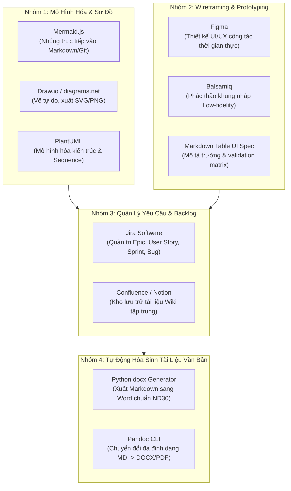

# BÁO CÁO NGHIÊN CỨU CHUYÊN SÂU: THỰC TIỄN NGHỀ BA VÀ KHUNG PHÁP LÝ TẠI VIỆT NAM
> **Mã tài liệu**: `docs/research/07_VIETNAM_BA_ECOSYSTEM_AND_REGULATIONS.md`  
> **Áp dụng cho**: Bộ Skill `ba-analyst-kit` bản địa hóa cho thị trường Việt Nam  
> **Phiên bản**: 1.0.0 | **Ngày lập**: 2026-10-19  

---

## 1. BỨC TRANH THỰC TẾ NGHỀ BUSINESS ANALYST (BA) TẠI VIỆT NAM

Khác với môi trường quốc tế nơi vai trò BA thường được phân định rất hẹp và chuyên biệt hóa cao, tại thị trường Việt Nam, một Senior BA cần phải linh hoạt thích ứng với 4 môi trường doanh nghiệp đặc thù:

### 1.1. Khối Công Ty Gia Công Phần Mềm (Software Outsource / FPT, KMS, TMA, NashTech, VTI...)
- **Đặc thù**: Làm việc trực tiếp với khách hàng nước ngoài (Nhật Bản, Mỹ, Úc, Singapore) hoặc khách hàng doanh nghiệp lớn trong nước.
- **Trọng tâm tài liệu**: Viết tài liệu đặc tả yêu cầu phần mềm (**SRS - Software Requirements Specification**), **BRD (Business Requirements Document)**, và chuyển hóa sang **User Stories & Gherkin AC** cho đội Dev/QA.
- **Thách thức lớn nhất**: Bất đồng múi giờ, rào cản ngôn ngữ, và việc khách hàng liên tục thay đổi yêu cầu mà không chịu ký phụ lục phát sinh ngân sách (Change Request / CR).

### 1.2. Khối Công Ty Công Nghệ & Khởi Nghiệp (Product & Scale-up / VNG, MoMo, VNPay, Tiki, One Mount...)
- **Đặc thù**: Phát triển sản phẩm phục vụ hàng triệu người dùng cuối (B2C hoặc B2B SaaS).
- **Trọng tâm tài liệu**: BA đóng vai trò như **Product Owner (PO)** hoặc **Product Analyst**: Viết PRD (Product Requirements Document), lập kế hoạch đo lường dữ liệu (**Event Tracking Plan** cho Google Analytics/Mixpanel/Amplitude), thiết kế kịch bản thử nghiệm A/B Testing, và tối ưu hóa phễu chuyển đổi (Conversion Funnel).

### 1.3. Khối Ngân Hàng, Tài Chính & Bảo Hiểm (BFSI / Vietcombank, Techcombank, MB, VPBank, FWD...)
- **Đặc thù**: Quy mô hệ thống phân tán phức tạp (Core Banking, Core Insurance, Payment Gateway, Loyalty, LOS/LMS), dữ liệu giao dịch khổng lồ và độ rủi ro cực cao.
- **Trọng tâm tài liệu**: Thẩm định quy trình nghiệp vụ (SOP), ma trận hạch toán kế toán, luồng đối soát (Reconciliation), quy tắc phòng chống gian lận (Anti-Fraud), quản lý rủi ro tín dụng và tuân thủ kiểm toán bảo mật thông tin (PCI-DSS, ISO 27001).

### 1.4. Khối Doanh Nghiệp Nhà Nước & Dự Án Chuyển Đổi Số Công
- **Đặc thù**: Đấu thầu theo quy định nhà nước, giải ngân theo giai đoạn nghiệm thu hồ sơ giấy tờ.
- **Trọng tâm tài liệu**: Hồ sơ đề xuất giải pháp, thiết kế thi công, quy chuẩn thể thức văn bản chuẩn doanh nghiệp, tích hợp Cơ sở dữ liệu quốc gia về dân cư qua **VNeID / C06**, và tuân thủ Khung kiến trúc Chính phủ điện tử Việt Nam.

---

## 2. CÁC QUY CHUẨN AN TOÀN & NGHIỆP VỤ BẮT BUỘC BA PHẢI ĐƯA VÀO HỒ SƠ PHÂN TÍCH

Một lỗi phổ biến của các BA tại Việt Nam là chỉ tập trung vào luồng chức năng (Functional Requirements) mà bỏ qua các yêu cầu an toàn & bảo mật dữ liệu, dẫn đến việc hệ thống không thể đưa vào vận hành thực tế. 

Dưới đây là 5 quy chuẩn an toàn & nghiệp vụ sống còn bắt buộc phải có trong tài liệu BA:

| Quy Chuẩn Nghiệp Vụ & An Toàn | Nội Dung Cốt Lõi | Tác Động Trực Tiếp Đến Yêu Cầu Thiết Kế Của BA |
| :--- | :--- | :--- |
| **Quy chuẩn bảo vệ dữ liệu cá nhân** *(Data Protection & Privacy)* | - Bắt buộc phải có sự đồng ý tường minh (Explicit Consent) của chủ thể dữ liệu trước khi thu thập. - Tách biệt dữ liệu cá nhân cơ bản và nhạy cảm (sinh trắc học, tài chính, định vị). - Quyền rút lại sự đồng ý, quyền yêu cầu xóa dữ liệu (Right to be Forgotten). | - Thiết kế màn hình "Điều khoản sử dụng & Đồng ý thu thập dữ liệu" có checkbox không được tick sẵn. - Thiết kế chức năng cho phép người dùng tự xóa tài khoản hoặc tải về toàn bộ dữ liệu cá nhân. - Mã hóa AES-256 dữ liệu nhạy cảm trong DB; lập hồ sơ Đánh giá tác động xử lý dữ liệu cá nhân (DPIA). |
| **Quy chuẩn xác thực sinh trắc học** *(Giao dịch giá trị cao)* | - Bắt buộc xác thực sinh trắc học khuôn mặt khớp với dữ liệu trên thẻ CCCD gắn chip (qua NFC hoặc tài khoản VNeID định danh mức 2). - Áp dụng khi chuyển tiền trên 10 triệu VNĐ/lần hoặc tổng giao dịch trong ngày vượt quá 20 triệu VNĐ. | - Trong Use Case chuyển tiền/thanh toán, bắt buộc bổ sung **Alternate Flow rẽ nhánh**: Nếu số tiền $\ge$ 10,000,000 VNĐ $\to$ Kích hoạt SDK Face Authentication đối soát NFC thẻ chip. - Bổ sung mã lỗi `ERR_BIOMETRIC_FAIL` khi khuôn mặt không khớp. |
| **Quy chuẩn chữ ký số & hợp đồng điện tử** *(Digital Signature & e-Contract)* | - Công nhận giá trị pháp lý đầy đủ của thông điệp dữ liệu, chứng từ điện tử và chữ ký số. - Quy định về chữ ký điện tử an toàn và dịch vụ chứng thực chữ ký số từ xa (Remote Signing / SmartCA). | - Thiết kế quy trình ký hợp đồng điện tử (e-Contract) không cần in giấy; tích hợp với các nhà cung cấp chứng thực số (VNPT, Viettel, FPT, MISA). - Lưu vết bằng chứng số (Audit Log) kèm dấu thời gian đáng tin cậy (Timestamping Authority - TSA). |
| **Quy chuẩn hóa đơn điện tử VAT** *(e-Invoice Integration)* | - Bắt buộc sử dụng Hóa đơn điện tử có mã hoặc không có mã của cơ quan thuế. - Chuẩn dữ liệu hóa đơn điện tử định dạng XML theo quy định của Tổng cục Thuế. | - Đặc tả tính năng xuất hóa đơn điện tử tự động ngay sau khi đơn hàng thành công. - Thiết kế API kết nối với phần mềm hóa đơn (MISA meInvoice, VNPT Invoice, Viettel Sinvoice). |
| **Quy chuẩn thể thức văn bản hành chính** *(Enterprise Document Formatting)* | - Quy chuẩn trình bày tài liệu: Khổ giấy A4, font Times New Roman, cỡ chữ 13-14, khoảng cách dòng 1.3 - 1.5 lines, căn lề chuẩn (trên/dưới 20-25mm, trái 30-35mm, phải 15-20mm). - Thẩm quyền ký, dấu chức danh và số văn bản. | - Các tài liệu nghiệm thu, biên bản UAT, quy chế vận hành và hợp đồng dự án xuất ra tài liệu bắt buộc phải tuân theo đúng thể thức này để được phê duyệt. |

---

## 3. CÁC QUY TRÌNH (WORKFLOWS) ĐẶC THÙ TRONG DỰ ÁN VIỆT NAM

### 3.1. Quy Trình Chốt Yêu Cầu & Chống "Lật Kèo" (Requirement Sign-off Protocol)
- **Thực trạng**: Khách hàng hoặc stakeholder người Việt thường có thói quen trao đổi qua tin nhắn Zalo, gọi điện thoại hoặc nói miệng trong cuộc họp, sau đó từ chối thừa nhận khi sản phẩm hoàn thành.
- **Quy trình chuẩn hóa của BA**:
  1. **Nhật ký trao đổi tức thời (Action Items on Meeting Minutes)**: Sau mỗi cuộc họp, trong vòng tối đa 2 giờ làm việc, BA gửi email tóm tắt bằng tiếng Việt rõ ràng với cấu trúc: *Vấn đề đã thảo luận - Quyết định đã chốt - Người chịu trách nhiệm - Hạn cam kết*.
  2. **Quy tắc im lặng đồng thuận (Passive Sign-off Clause)**: Cuối email luôn cài điều khoản: *"Nếu sau 24 giờ làm việc quý đơn vị không có ý kiến phản hồi khác bằng văn bản, các nội dung trên được coi là đã thống nhất chính thức để đội ngũ kỹ thuật tiến hành triển khai."*

### 3.2. Quy Trình Nghiệm Thu Chấp Nhận Người Dùng (UAT & Handover Protocol)
- **Thực trạng**: Dự án phần mềm tại Việt Nam thường bị treo thanh toán ở giai đoạn nghiệm thu UAT vì khách hàng thử nghiệm không có kế hoạch, phát sinh yêu cầu mới vô tận.
- **Quy trình chuẩn hóa của BA**:
  1. Ban hành **Kế hoạch UAT (UAT Plan)** trước 1 tuần kèm phạm vi các tính năng được nghiệm thu (chỉ nghiệm thu những gì trong Scope Statement).
  2. Phân loại lỗi theo mức độ nghiêm trọng:
     - **Critical (Lỗi chặn)**: Treo hệ thống, mất dữ liệu, tính sai tiền $\to$ Bắt buộc sửa trước khi Go-live.
     - **Major (Lỗi lớn)**: Không thao tác được tính năng chính, có cách khắc phục tạm thời.
     - **Minor (Lỗi nhỏ / Thẩm mỹ)**: Lệch màu sắc, sai chính tả $\to$ Ghi nhận vào Backlog phiên bản sau, không được lấy làm lý do từ chối ký biên bản UAT.
  3. Ký **Biên bản nghiệm thu kỹ thuật (Technical Acceptance Certificate)** bằng chữ ký số hoặc văn bản có dấu đỏ.

---

## 4. HỆ SINH THÁI CÔNG CỤ (TOOLS) HỖ TRỢ BA HIỆN ĐẠI

Để tối đa hóa năng suất và giảm 70% thời gian soạn thảo thủ công, bộ công cụ cần trang bị cho BA gồm 4 nhóm:

