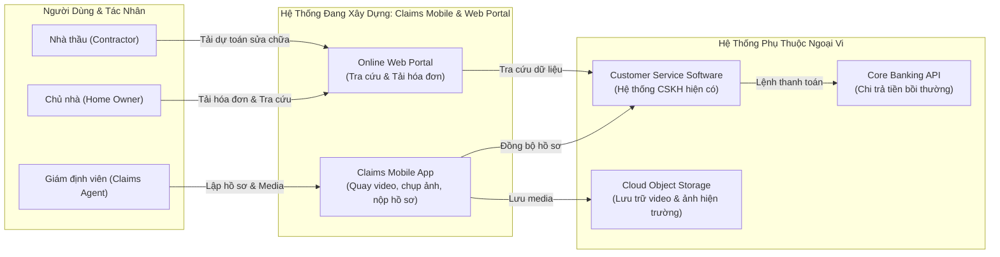

# DỰ ÁN HỆ THỐNG GIÁM ĐỊNH & BỒI THƯỜNG TRỰC TUYẾN — TUYÊN BỐ PHẠM VI (SCOPE STATEMENT)
> **Mã tài liệu**: `DOC-SCOPE-CLAIMS-01`  
> **Trạng thái**: Approved  
> **Áp dụng chuẩn**: Bridging The Gap (Laura Brandenburg, CBAP)  

---

## 1. THÔNG TIN TÀI LIỆU (DOCUMENT INFORMATION)

| Trường Thông Tin | Giá Trị Chi Tiết |
| :--- | :--- |
| **Tên tài liệu (Document Title)** | Tuyên bố phạm vi dự án Ứng dụng Giám định Hiện trường & Cổng Bồi thường Trực tuyến |
| **Người bảo trợ dự án (Business Sponsor)** | Nguyễn Văn An — Phó Tổng Giám đốc Vận hành Bảo hiểm |
| **Người lập (Prepared By)** | Senior Business Analyst Team |
| **Các bên liên quan (Stakeholders)** | Trưởng phòng Giám định bồi thường, Trưởng phòng CSKH, Giám đốc Công nghệ IT, Đại diện Nhà thầu |
| **Phiên bản (Version)** | 1.0 |
| **Trạng thái (Status)** | Approved |
| **Ngày cập nhật (Date)** | 2026-10-19 |

---

## 2. TỔNG QUAN DỰ ÁN (PROJECT OVERVIEW)

> "Chúng tôi muốn nâng cao hiệu suất làm việc của đội ngũ giám định viên bồi thường (Claim Agents) và cắt giảm áp lực cuộc gọi thắc mắc của chủ nhà và nhà thầu để kiểm tra tiến độ bồi thường. Dự án này bao gồm việc phát triển một ứng dụng di động (Claims Mobile App) hỗ trợ giám định toàn diện tại hiện trường, tích hợp trực tiếp với phần mềm chăm sóc khách hàng (Customer Service Software), đồng thời cung cấp cổng thông tin trực tuyến (Online Portal) cho phép chủ nhà và nhà thầu tự tra cứu hồ sơ và tải lên hóa đơn, báo giá sửa chữa."

---

## 3. LỢI ÍCH KỲ VỌNG & MỤC TIÊU KINH DOANH (EXPECTED BENEFITS)

- **Mục tiêu 1**: Giảm thời gian trung bình một giám định viên lập và nộp hồ sơ bồi thường từ **8 giờ làm việc xuống còn 6 giờ hoặc ít hơn**.
- **Mục tiêu 2**: Cắt giảm **50%** số lượng cuộc gọi kiểm tra tiến độ bồi thường từ phía chủ nhà trong vòng 3 tháng sau golive.
- **Mục tiêu 3**: Cắt giảm **50%** số lượng cuộc gọi kiểm tra tiến độ từ phía các nhà thầu thi công.
- **Mục tiêu 4**: Tăng tỷ lệ chủ nhà tiếp nhận và tự sử dụng cổng tra cứu trực tuyến lên **30%** so với mốc cơ sở năm trước.

---

## 4. BẢNG NĂNG LỰC GIẢI PHÁP (CAPABILITIES MATRIX)

### Nhóm Năng Lực A: Quy Trình Giám Định Tại Hiện Trường (Onsite Claims Process)
| Mã (ID) | Năng Lực Giải Pháp (Capability Description) | Tác Nhân Thụ Hưởng (Target User) |
| :---: | :--- | :--- |
| **A1** | Giám định viên có thể hoàn thành toàn bộ các bước lập và nộp hồ sơ bồi thường trên thiết bị di động gồm: Video quay hiện trường, Ảnh chụp chi tiết tổn thất, Biên bản giám định điện tử | Claims Agent |
| **A2** | Chủ nhà có thể tải lên các chứng từ bổ trợ như báo giá và hóa đơn sửa chữa trực tiếp vào hồ sơ | Home Owner |
| **A3** | Nhà thầu có thể tải lên chứng chỉ bảo hiểm, bảng dự toán chi tiết và hóa đơn thanh toán | Contractor |
| **A4** | Cung cấp khả năng lưu trữ hồ sơ hồ sơ cá nhân và nhà thầu để tái sử dụng qua nhiều vụ bồi thường | Customer & Contractor |
| **A5** | Rà soát và tinh gọn các quy tắc thẩm định tài liệu hiện tại để loại bỏ 3 bước ký duyệt giấy tờ trùng lặp | Business Team |

### Nhóm Năng Lực B: Tích Hợp Hệ Thống & Cổng Thông Tin Trực Tuyến (Online Portal & Integration)
| Mã (ID) | Năng Lực Giải Pháp (Capability Description) | Tác Nhân Thụ Hưởng (Target User) |
| :---: | :--- | :--- |
| **B1** | Tự động đồng bộ trạng thái hồ sơ bồi thường từ Mobile App sang phần mềm Chăm sóc khách hàng (CRM) | System Integration |
| **B2** | Cung cấp màn hình tra cứu tiến độ bồi thường thời gian thực không cần đăng nhập phức tạp (tra cứu qua Mã hồ sơ + OTP) | Home Owner & Contractor |

---

## 5. GIẢ ĐỊNH (ASSUMPTIONS)

1. Mạng viễn thông di động 4G/5G tại các khu vực dân cư có độ phủ sóng tối thiểu 95% để hỗ trợ upload video hiện trường.
2. Hệ thống CRM chăm sóc khách hàng hiện tại hỗ trợ kết nối RESTful API và cho phép webhook đẩy dữ liệu 2 chiều.

---

## 6. RÀNG BUỘC (CONSTRAINTS)

1. **Thời hạn (Timeline)**: Phiên bản Pilot phải chạy thử nghiệm với 50 giám định viên trong vòng 3 tháng dương lịch.
2. **Bảo mật (Security)**: Video và hình ảnh hiện trường tổn thất phải được mã hóa AES-256 khi lưu trữ và tuân thủ quy định bảo vệ dữ liệu cá nhân.

---

## 7. NGOÀI PHẠM VI (OUT OF SCOPE)

1. Không triển khai tính năng tự động nhận diện thiệt hại bằng trí tuệ nhân tạo (AI Damage Recognition) trong Phase 1; dời sang Phase 2.
2. Không hỗ trợ giám định viên sử dụng máy tính bảng chạy hệ điều hành Windows cũ (dưới Windows 10).
3. Không chi trả tiền bồi thường trực tiếp qua cổng thanh toán quốc tế (chỉ hỗ trợ chuyển khoản ngân hàng nội địa).

---

## 8. MÔ HÌNH NGỮ CẢNH TRỰC QUAN (SYSTEM CONTEXT DIAGRAM)

---

## 9. VẤN ĐỀ CÒN MỞ (OPEN ISSUES)

| Mã (ID) | Nội Dung Vấn Đề Chưa Thống Nhất | Người Chịu Trách Nhiệm (Owner) | Hạn Cam Kết (Target Date) |
| :---: | :--- | :--- | :---: |
| **ISS-01** | Quyết định dung lượng tối đa cho mỗi clip video quay hiện trường (đề xuất: 60 giây, dưới 50MB) | Trưởng phòng Giám định | 2026-10-25 |

---

## 10. LỊCH SỬ SỬA ĐỔI (REVISION HISTORY)

| Phiên Bản (V.) | Ngày (Date) | Người Thực Hiện (Author) | Nội Dung Thay Đổi (Description) | Trạng Thái (Status) |
| :---: | :---: | :--- | :--- | :---: |
| 1.0 | 2026-10-19 | Senior BA Team | Ban hành tài liệu phạm vi chính thức đã phê duyệt | Approved |
