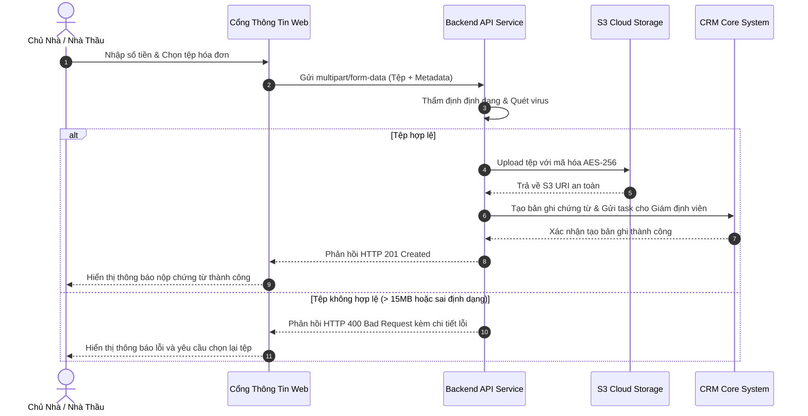

# ĐẶC TẢ USE CASE: TẢI LÊN CHỨNG TỪ BỔ TRỢ BỒI THƯỜNG (UPLOAD SUPPORTING EVIDENCE)
> **Mã Use Case**: `UC-CLAIMS-02`  
> **Trạng thái**: Approved  
> **Áp dụng chuẩn**: Bridging The Gap kết hợp Agile Gherkin Criteria  

---

## 1. THÔNG TIN USE CASE (DOCUMENT INFORMATION)

| Trường Thông Tin | Giá Trị Chi Tiết |
| :--- | :--- |
| **Tiêu đề (Use Case Title)** | Tải lên chứng từ bổ trợ bồi thường (Upload Supporting Claim Evidence) |
| **Người phụ trách (Document Owner)** | Senior Business Analyst Team |
| **Phiên bản (Version)** | 1.0 |
| **Trạng thái (Status)** | Approved |
| **Ngày cập nhật (Date)** | 2026-10-19 |

---

## 2. MÔ TẢ TÓM TẮT (BRIEF DESCRIPTION)

> "Use Case này mô tả tương tác giữa Chủ nhà hoặc Nhà thầu với Cổng thông tin bồi thường trực tuyến nhằm tải lên các báo giá, hóa đơn sửa chữa hoặc chứng chỉ thi công bổ trợ cho hồ sơ bồi thường hiện có.  
> **Quá trình bắt đầu khi** Người dùng truy cập liên kết tra cứu hồ sơ và chọn 'Tải lên chứng từ' **và kết thúc khi** Hệ thống lưu trữ tệp an toàn và gửi thông báo cho Giám định viên thụ lý."

---

## 3. CÁC TÁC NHÂN LIÊN QUAN (ACTORS)

| Nhóm Tác Nhân | Tên Tác Nhân | Vai Trò & Trách Nhiệm |
| :--- | :--- | :--- |
| **Primary Actor** | Chủ nhà (Home Owner) / Nhà thầu (Contractor) | Người trực tiếp tải lên các tệp hóa đơn, báo giá |
| **Secondary Actor** | Giám định viên (Claims Agent) | Người nhận thông báo và thẩm định tính hợp lệ của hóa đơn |
| **System Actor** | Dịch vụ Lưu trữ S3 (Cloud Storage) & Dịch vụ SMS OTP | Hệ thống lưu trữ tệp và bảo mật xác thực danh tính |

---

## 4. TIỀN ĐIỀU KIỆN (PRE-CONDITIONS)

1. Hồ sơ bồi thường tồn tại trên hệ thống và đang ở trạng thái `CHỜ BỔ SUNG CHỨNG TỪ`.
2. Người dùng đã xác thực thành công qua Mã hồ sơ (Claim ID) và mã OTP gửi về số điện thoại đăng ký.

---

## 5. LUỒNG THAO TÁC CHUẨN (BASIC FLOW / HAPPY PATH)

1. **Người dùng**: Nhấp vào nút "Thêm chứng từ mới" trên giao diện chi tiết hồ sơ bồi thường.
2. **Hệ thống**: Hiển thị bảng chọn loại chứng từ (Hóa đơn VAT, Báo giá gara/nhà thầu, Chứng chỉ bảo hiểm) và vùng kéo-thả tệp.
3. **Người dùng**: Chọn loại chứng từ là "Hóa đơn sửa chữa", nhập số tiền thanh toán thực tế và kéo tệp PDF hóa đơn vào hệ thống.
4. **Hệ thống**: Kiểm tra định dạng tệp (PDF/JPG/PNG), quét virus và xác nhận dung lượng $\le$ 15MB theo quy tắc `BR-UC-01`.
5. **Hệ thống**: Đẩy tệp lên Cloud Storage an toàn và lưu bản ghi liên kết vào bảng `claim_documents`.
6. **Hệ thống**: Cập nhật trạng thái chứng từ thành "ĐÃ TẢI LÊN — CHỜ THẨM ĐỊNH".
7. **Hệ thống**: Gửi thông báo đẩy (Push Notification) tức thì đến Mobile App của Giám định viên thụ lý.
8. **Hệ thống**: Hiển thị thông báo màu xanh chúc mừng và cập nhật danh sách chứng từ hiển thị trên màn hình của Người dùng.

---

## 6. CÁC LUỒNG RẼ NHÁNH VÀ NGOẠI LỆ (ALTERNATE & EXCEPTION FLOWS)

### Luồng Rẽ Nhánh Thay Thế (Alternate Flows)
- **3a. Người dùng chụp ảnh trực tiếp từ camera điện thoại**:
  1. Tại Bước 3, người dùng chọn "Chụp ảnh hóa đơn bằng camera".
  2. Ứng dụng kích hoạt camera, người dùng chụp ảnh hóa đơn rõ nét.
  3. Hệ thống tự động căn chỉnh góc và nén ảnh về chuẩn JPG tối ưu.
  4. Người dùng xác nhận ảnh chụp và **quay trở lại Bước 4 của Basic Flow**.

### Luồng Ngoại Lệ & Xử Lý Lỗi (Exception Flows)
- **4a. Tệp tải lên vượt quá 15MB**:
  1. Tại Bước 4, hệ thống phát hiện dung lượng tệp vượt quá 15MB.
  2. Hệ thống dừng tải lên, hiển thị thông báo lỗi: "Dung lượng tệp vượt quá giới hạn 15MB. Vui lòng nén tệp hoặc liên hệ tổng đài để được hỗ trợ."
  3. Người dùng chọn tệp khác và **quay trở lại Bước 3 của Basic Flow**.
- **4b. Tệp bị nghi vấn nhiễm mã độc**:
  1. Tại Bước 4, bộ lọc bảo mật phát hiện chữ ký tệp thực thi độc hại giả mạo PDF.
  2. Hệ thống cô lập và xóa tệp ngay lập tức, ghi log bảo mật `SEC_ALERT_MALICIOUS_UPLOAD`.
  3. Hiển thị cảnh báo: "Tệp tải lên không an toàn. Vui lòng kiểm tra lại thiết bị của bạn."
  4. Use Case kết thúc thất bại.

---

## 7. HẬU ĐIỀU KIỆN (POST-CONDITIONS)

1. Tệp chứng từ được lưu trữ an toàn với đường dẫn bảo mật không thể truy cập công khai.
2. Bản ghi mới được tạo trong cơ sở dữ liệu liên kết với mã hồ sơ bồi thường.
3. Giám định viên nhận được task việc cần làm (Pending Task).

---

## 8. MỞ RỘNG AGILE: USER STORY & GHERKIN ACCEPTANCE CRITERIA

### User Story
```text
Title: US-CLAIMS-01 — Chủ nhà tải lên hóa đơn sửa chữa bồi thường

Là một: Chủ nhà đã nộp hồ sơ bồi thường
Tôi muốn: Tự tải hóa đơn sửa chữa dạng PDF hoặc ảnh qua trang web trực tuyến
Để: Hồ sơ bồi thường của tôi được thanh toán nhanh chóng mà tôi không cần phải đến văn phòng công ty bảo hiểm
```

### Tiêu Chuẩn Nghiệm Thu Gherkin (Acceptance Criteria)

#### Kịch bản 1: Tải lên hóa đơn hợp lệ (Happy Path)
```gherkin
Scenario: Chủ nhà tải lên hóa đơn PDF dung lượng hợp lệ
  Given Chủ nhà đã xác thực thành công vào hồ sơ bồi thường mã "CLM-2026-99"
  And Hồ sơ đang ở trạng thái "CHỜ BỔ SUNG CHỨNG TỪ"
  When Chủ nhà chọn loại "Hóa đơn VAT", tải lên tệp "hoa_don_gara_oto.pdf" dung lượng 3.2MB và bấm "Gửi chứng từ"
  Then Hệ thống sẽ lưu tệp an toàn lên Cloud Storage
  And Cập nhật danh sách chứng từ với trạng thái "ĐÃ TẢI LÊN — CHỜ THẨM ĐỊNH"
  And Gửi thông báo đến Giám định viên phụ trách
```

#### Kịch bản 2: Tải lên tệp không hợp lệ (Exception Flow)
```gherkin
Scenario: Chủ nhà chọn tệp sai định dạng (.exe)
  Given Chủ nhà đang ở màn hình chọn tệp chứng từ
  When Chủ nhà chọn tệp có tên "hoa_don.exe"
  Then Hệ thống lập tức chặn tệp ngay tại giao diện trình duyệt
  And Hiển thị thông báo: "Chỉ chấp nhận các tệp định dạng: PDF, PNG, JPG, JPEG"
  And Nút "Gửi chứng từ" chuyển sang trạng thái vô hiệu hóa (disabled)
```

---

## 9. SƠ ĐỒ TUẦN TỰ TƯƠNG TÁC MERMAID (SEQUENCE DIAGRAM)



---

## 10. LỊCH SỬ SỬA ĐỔI (REVISION HISTORY)

| Phiên Bản (V.) | Ngày (Date) | Người Thực Hiện (Author) | Nội Dung Thay Đổi (Description) | Trạng Thái (Status) |
| :---: | :---: | :--- | :--- | :---: |
| 1.0 | 2026-10-19 | Senior BA Team | Ban hành tài liệu đặc tả Use Case chính thức | Approved |
