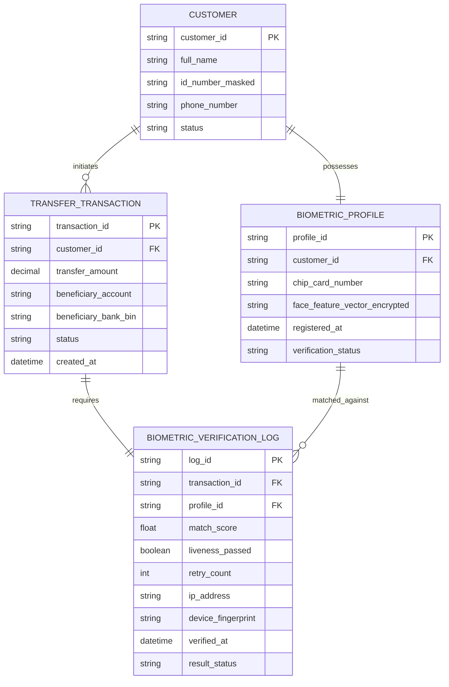

# TỪ ĐIỂN DỮ LIỆU & ERD: PHÂN HỆ XÁC THỰC SINH TRẮC HỌC
> **Mã tài liệu**: `DOC-DATA-FIN09-001`  
> **Trạng thái**: Approved  
> **Áp dụng chuẩn**: Bridging The Gap kết hợp Quy chuẩn Bảo vệ Dữ liệu Cá nhân & Xác thực Sinh trắc học  
> **Dự án**: Ngân Hàng Số — Xác Thực Sinh Trắc Học Giao Dịch Giá Trị Cao  

---

## 1. THÔNG TIN TÀI LIỆU (DOCUMENT INFORMATION)

| Trường Thông Tin | Giá Trị Chi Tiết |
| :--- | :--- |
| **Tên tài liệu (Document Title)** | Từ điển dữ liệu phân hệ Xác thực Sinh trắc học `UC-FIN-09` |
| **Phân hệ nghiệp vụ** | Quản lý xác thực sinh trắc học & Kiểm soát gian lận (Biometric & Fraud) |
| **Người lập (Prepared By)** | Senior Business Analyst & Data Architect |
| **Phiên bản (Version)** | 2.0.0 |
| **Ngày lập (Date)** | 2026-10-20 |

---

## 2. SƠ ĐỒ MỐI QUAN HỆ THỰC THỂ (ENTITY RELATIONSHIP DIAGRAM - ERD)

---

## 3. TỪ ĐIỂN THUỘC TÍNH DỮ LIỆU (DATA ATTRIBUTES MATRIX)

### Bảng Thực Thể: `BIOMETRIC_VERIFICATION_LOG` (Nhật ký xác thực sinh trắc học giao dịch)
*Mô tả: Lưu trữ vết kiểm toán kỹ thuật cho từng lần quét khuôn mặt khi chuyển tiền trên 10 triệu VNĐ.*

| Tên Thuộc Tính | Tên Trường CSDL | Kiểu Dữ Liệu | Độ Dài | Bắt Buộc | Ràng Buộc & Quy Tắc Kiểm Tra (Validation) | Chính Sách Bảo Mật & Che Giấu (Data Masking) |
| :--- | :--- | :--- | :---: | :---: | :--- | :--- |
| **Mã vết xác thực** | `log_id` | UUIDv7 | 36 | Có (PK) | Khóa chính sinh tự động | Hiển thị nguyên bản |
| **Mã giao dịch** | `transaction_id` | String | 32 | Có (FK) | Liên kết với lệnh chuyển tiền `TRANSFER_TRANSACTION` | Hiển thị nguyên bản |
| **Điểm tương đồng** | `match_score` | Decimal(5,2) | - | Có | Giá trị từ `0.00` đến `100.00`. Đạt khi $\ge 85.00$ | Hiển thị phần trăm (%) |
| **Đạt kiểm tra người thật** | `liveness_passed` | Boolean | - | Có | `TRUE` (người thật) / `FALSE` (giả mạo) | Hiển thị nguyên bản |
| **Số lần thử lại** | `retry_count` | SmallInt | - | Có | Giá trị từ 1 đến 3. Vượt quá 3 khóa 60 phút | Không che giấu |
| **Địa chỉ IP người dùng** | `ip_address` | String | 45 | Có | Định dạng chuẩn IPv4 hoặc IPv6 | Che 2 byte cuối (`113.190.***.***`) |
| **Dấu vân tay thiết bị** | `device_fingerprint`| String | 64 | Có | Băm SHA-256 từ IMEI, Model và OS | Không che giấu |
| **Thời điểm xác thực** | `verified_at` | Timestamp | - | Có | Ghi nhận chính xác đến mili-giây (UTC+7) | Bất biến (Immutable) |
| **Trạng thái kết quả** | `result_status` | Enum | 20 | Có | `PASSED`, `FAILED_MISMATCH`, `FAILED_SPOOF`, `LOCKED` | Không che giấu |

---

## 4. QUY TẮC BẢO MẬT & BẢO VỆ DỮ LIỆU SINH TRẮC HỌC

1. **Tuyệt đối cấm lưu ảnh khuôn mặt thô (Raw Face Image)**:
   - Các khung ảnh quét từ camera chỉ xử lý trong bộ nhớ RAM tạm thời của điện thoại để trích xuất Feature Vector 512 chiều, sau đó giải phóng bộ nhớ ngay lập tức.
2. **Mã hóa dữ liệu tại chỗ (Encryption at Rest)**:
   - Chuỗi Vector đặc trưng khuôn mặt được mã hóa bằng thuật toán `AES-256-GCM` với khóa bảo mật do hệ thống quản lý khóa HSM (Hardware Security Module) cấp phát.
3. **Chính sách bất biến (Immutability)**:
   - Bảng `BIOMETRIC_VERIFICATION_LOG` được thiết lập quyền cơ sở dữ liệu `APPEND-ONLY`. Mọi câu lệnh `UPDATE`, `DELETE`, `TRUNCATE` đều bị chặn cứng ở tầng Database Engine.
