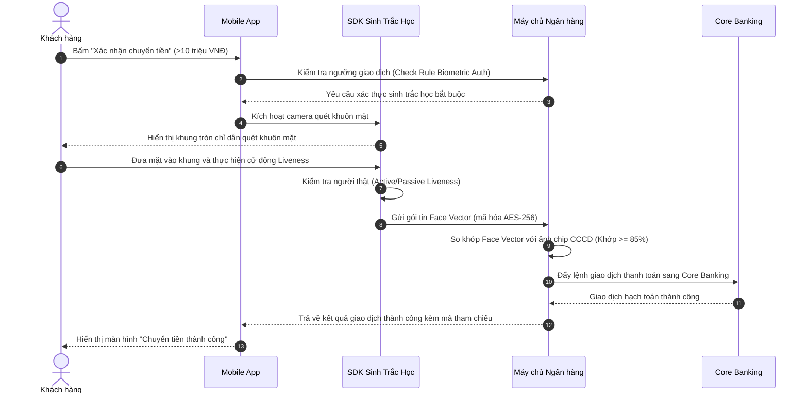

# ĐẶC TẢ USE CASE: XÁC THỰC SINH TRẮC HỌC KHUÔN MẶT CHO GIAO DỊCH GIÁ TRỊ CAO
> **Mã Use Case**: `UC-FIN-09`  
> **Trạng thái**: Approved  
> **Áp dụng chuẩn**: Bridging The Gap (Laura Brandenburg) kết hợp Quy chuẩn Xác thực Sinh trắc học & Bảo vệ Dữ liệu Cá nhân  
> **Tài liệu nguồn**: `skills/ba-analyst-kit/references/master_use_cases_catalog.md` (Domain `FIN`)  

---

## 1. THÔNG TIN USE CASE (DOCUMENT INFORMATION)

| Trường Thông Tin | Giá Trị Chi Tiết |
| :--- | :--- |
| **Tiêu đề (Use Case Title)** | Xác Thực Sinh Trắc Học Khuôn Mặt Cho Giao Dịch Tài Chính Giá Trị Cao |
| **Mã định danh (Use Case ID)** | `UC-FIN-09` |
| **Phân hệ nghiệp vụ** | Ngân hàng điện tử & Thanh toán trực tuyến (Digital Banking & Payments) |
| **Người phụ trách (Owner)** | Business Analyst Chuyên Trách Fintech & Compliance |
| **Phiên bản (Version)** | 2.0.0 |
| **Ngày lập (Date)** | 2026-10-20 |

---

## 2. MÔ TẢ TÓM TẮT (BRIEF DESCRIPTION)

Use Case này mô tả quá trình xác thực khuôn mặt người dùng khớp với dữ liệu sinh trắc học đã lưu trong chip thẻ Căn cước công dân (CCCD) khi thực hiện giao dịch chuyển tiền hoặc thanh toán có giá trị vượt ngưỡng quy định kiểm soát an toàn giao dịch.

> **Quá trình bắt đầu khi** Khách hàng xác nhận lệnh chuyển tiền có giá trị trên 10,000,000 VNĐ hoặc giao dịch làm tổng mức chi tiêu trong ngày vượt quá 20,000,000 VNĐ, **và kết thúc khi** Hệ thống xác thực sinh trắc học thành công và chuyển lệnh thanh toán sang hệ thống xử lý giao dịch lõi (Core Banking).

---

## 3. CÁC TÁC NHÂN LIÊN QUAN (ACTORS)

| Nhóm Tác Nhân | Tên Tác Nhân | Vai Trò & Trách Nhiệm Trong Use Case |
| :--- | :--- | :--- |
| **Tác nhân chính (Primary Actor)** | Khách hàng chuyển tiền | Người dùng ứng dụng Mobile Banking trực tiếp quét khuôn mặt để xác thực |
| **Tác nhân phụ (Secondary Actor)** | Giao dịch viên / Hỗ trợ khách hàng | Tiếp nhận hỗ trợ khi khách hàng bị từ chối xác thực nhiều lần |
| **Tác nhân hệ thống (System Actor)** | Dịch vụ AI Liveness Detection | Kiểm tra tính sống của khuôn mặt (chống ảnh in, video phát lại, mặt nạ 3D) |
| **Tác nhân hệ thống** | Dịch vụ So khớp Sinh trắc (Face Matching) | So sánh vector khuôn mặt trực tiếp với vector ảnh gốc lưu từ chip CCCD |
| **Tác nhân hệ thống** | Hệ thống Core Banking / Napas | Nhận lệnh chuyển tiền sau khi xác thực sinh trắc học hoàn tất |

---

## 4. TIỀN ĐIỀU KIỆN (PRE-CONDITIONS)

1. Khách hàng đã đăng nhập vào ứng dụng Mobile Banking trên thiết bị hợp lệ.
2. Tài khoản khách hàng đã hoàn thành định danh điện tử (eKYC) với thẻ CCCD gắn chip và dữ liệu khuôn mặt gốc đã được lưu mã hóa an toàn trên hệ thống máy chủ ngân hàng.
3. Số dư tài khoản thanh toán của khách hàng đủ để thực hiện số tiền chuyển và các khoản phí liên quan.
4. Số tiền của giao dịch hiện tại $> 10,000,000$ VNĐ hoặc tổng giá trị giao dịch lũy kế trong ngày sau khi thực hiện lệnh này $> 20,000,000$ VNĐ (theo quy chuẩn kiểm soát giao dịch giá trị cao).

---

## 5. LUỒNG THAO TÁC CHUẨN (BASIC FLOW / HAPPY PATH)



1. **Khách hàng**: Tại màn hình Chi tiết chuyển tiền, kiểm tra thông tin người nhận, số tiền ($>10,000,000$ VNĐ) và bấm nút "Tiếp tục".
2. **Hệ thống (Server)**: Kiểm tra số tiền giao dịch và tổng hạn mức trong ngày. Nhận diện giao dịch thuộc diện bắt buộc xác thực sinh trắc học theo quy chuẩn kiểm soát giao dịch giá trị cao, gửi chỉ thị yêu cầu quét khuôn mặt về Mobile App.
3. **Hệ thống (Mobile App)**: Hiển thị màn hình thông báo: *"Theo quy chuẩn an toàn giao dịch, giao dịch trên 10 triệu đồng cần xác thực khuôn mặt chính chủ"* và kích hoạt Camera trước.
4. **Khách hàng**: Đưa khuôn mặt vào trong khung tròn hiển thị trên màn hình điện thoại ở nơi đủ ánh sáng.
5. **Hệ thống (SDK Sinh trắc học)**: Thực hiện kiểm tra tính sống (Passive Liveness Detection kết hợp cử động chớp mắt ngẫu nhiên) để loại trừ giả mạo.
6. **Hệ thống (SDK Sinh trắc học)**: Trích xuất các điểm đặc trưng hình học (Feature Vector 512 chiều) của khuôn mặt, mã hóa gói tin và gửi về Máy chủ xác thực của ngân hàng.
7. **Hệ thống (Server)**: Đối soát gói tin vector khuôn mặt với vector ảnh chuẩn trích xuất từ chip thẻ CCCD đã lưu trữ. Điểm tương đồng đạt $94.6\%$ (vượt ngưỡng quy định tối thiểu $85\%$).
8. **Hệ thống (Server)**: Ghi nhật ký xác thực thành công, giải phóng lệnh chuyển tiền và đẩy sang phân hệ Core Banking xử lý hạch toán.
9. **Hệ thống (Mobile App)**: Hiển thị màn hình hóa đơn xác nhận: *"Giao dịch chuyển tiền thành công"* kèm số tham chiếu giao dịch.

---

## 6. CÁC LUỒNG RẼ NHÁNH VÀ NGOẠI LỆ (ALTERNATE & EXCEPTION FLOWS)

### Luồng Rẽ Nhánh (Alternate Flows)

- **4a. Môi trường ánh sáng quá tối hoặc quá chói**:
  1. SDK phát hiện cường độ sáng dưới ngưỡng 20 Lux hoặc chói lóa trên 800 Lux.
  2. Màn hình tự động tăng độ sáng tối đa để hỗ trợ chiếu sáng khuôn mặt (Flash Screen Fill).
  3. Hiển thị thông báo hỗ trợ: *"Vui lòng di chuyển đến nơi có ánh sáng đều, tránh ngược sáng."*
  4. Quay trở lại Bước 4 của Luồng chuẩn.

- **5a. Thiết bị không hỗ trợ Liveness 3D / Camera bị che mờ**:
  1. SDK phát hiện camera bị mờ hoặc góc nhìn bị che khuất một phần.
  2. Hiển thị chỉ dẫn: *"Vui lòng lau sạch ống kính camera trước và không đeo kính râm, khẩu trang."*
  3. Cho phép khách hàng điều chỉnh lại và bấm "Thử lại".

### Luồng Xử Lý Lỗi & Ngoại LỆ (Exception Flows)

- **5b. Phát hiện gian lận giả mạo khuôn mặt (Spoofing Attack / Fake Face Detected)**:
  1. SDK phát hiện hình ảnh được đưa vào là màn hình điện thoại khác phát lại video, ảnh in trên giấy, hoặc mặt nạ silicon.
  2. Hệ thống lập tức dừng luồng quét, ghi log cảnh báo an ninh `ERR_SPOOFING_DETECTED` kèm mã thiết bị và địa chỉ IP.
  3. Hiển thị thông báo trung tính: *"Xác thực khuôn mặt không thành công. Vui lòng thực hiện với khuôn mặt thật của chính chủ."*
  4. Hủy lệnh chuyển tiền hiện tại; không cho phép tiếp tục thao tác gian lận.

- **7a. Khuôn mặt không khớp ảnh chip CCCD (Match Score < 85%)**:
  1. Máy chủ đối soát trả về điểm tương đồng dưới $85\%$ (Ví dụ: do khách hàng can thiệp thẩm mỹ lớn, chấn thương hoặc người khác cố tình chuyển tiền).
  2. Ghi nhận 1 lần xác thực thất bại.
  3. **Nếu số lần thử sai $< 3$ lần trong phiên**: Hiển thị thông báo: *"Khuôn mặt không khớp với hồ sơ CCCD đã đăng ký. Bạn còn [X] lần thử lại"* và cho phép quét lại.
  4. **Nếu sai quá 3 lần liên tiếp**: 
     - Tự động khóa tính năng chuyển tiền trực tuyến của tài khoản trong 60 phút để phòng ngừa tấn công chiếm quyền thiết bị.
     - Gửi tin nhắn SMS cảnh báo bảo mật về số điện thoại đăng ký.
     - Hướng dẫn khách hàng mang CCCD gắn chip ra quầy giao dịch ngân hàng gần nhất để cập nhật lại dữ liệu sinh trắc học.

- **8a. Mất kết nối mạng trong quá trình gửi dữ liệu xác thực (Network Timeout)**:
  1. Sau 10 giây không nhận được phản hồi từ máy chủ xác thực sinh trắc học.
  2. Hệ thống KHÔNG thực hiện trừ tiền và KHÔNG chuyển tiếp lệnh sang Core Banking.
  3. Hiển thị thông báo: *"Kết nối mạng bị gián đoạn. Giao dịch chưa được thực hiện. Quý khách vui lòng kiểm tra lại kết nối Internet và thử lại."*

---

## 7. QUY TẮC NGHIỆP VỤ (BUSINESS RULES)

| Mã Quy Tắc | Tên Quy Tắc | Diễn Giải Chi Tiết |
| :---: | :--- | :--- |
| **BR-FIN-01** | **Ngưỡng Giá Trị Giao Dịch Bắt Buộc** | Bắt buộc xác thực sinh trắc học khuôn mặt đối với: 1) Từng giao dịch chuyển tiền $> 10,000,000$ VNĐ; 2) Giao dịch bất kỳ làm tổng hạn mức chuyển tiền trong ngày vượt quá $20,000,000$ VNĐ; 3) Giao dịch thanh toán hàng hóa dịch vụ $> 100,000,000$ VNĐ/lần (Quy chuẩn kiểm soát hạn mức giao dịch an toàn). |
| **BR-FIN-02** | **Ngưỡng Độ Trùng Khớp Khuôn Mặt** | Điểm số tương đồng sinh trắc học (Biometric Match Score) giữa vector khuôn mặt trực tiếp và vector lưu từ chip CCCD phải đạt tối thiểu **$\ge 85\%$**. |
| **BR-FIN-03** | **Tiêu Chuẩn Liveness Detection** | Thuật toán kiểm tra người thật phải đạt chứng chỉ bảo mật quốc tế ISO/IEC 30107-3 (iBeta Level 2) chống giả mạo hình thức 2D và 3D. |
| **BR-FIN-04** | **Giới Hạn Thử Lại & Khóa An Toàn** | Khách hàng chỉ được phép thử lại tối đa 03 lần quét khuôn mặt trong một phiên giao dịch. Quá 3 lần sai liên tiếp, hệ thống tự động khóa tính năng chuyển tiền giá trị cao trong 60 phút. |
| **BR-FIN-05** | **Bảo Vệ Dữ Liệu Sinh Trắc Học** | Không lưu trữ ảnh chụp thô (Raw Face Image) trên máy chủ ngân hàng sau khi xác thực. Chỉ lưu trữ chuỗi Vector đặc trưng được băm và mã hóa AES-256 theo quy chuẩn an toàn & bảo vệ dữ liệu cá nhân. |

---

## 8. CẦU NỐI AGILE: USER STORY & TIÊU CHÍ NGHIỆM THU GHERKIN

### User Story 1 (Happy Path — Chuyển tiền thành công)
```text
Là một (As a): Khách hàng đang thực hiện chuyển khoản 15,000,000 VNĐ trên ứng dụng Mobile Banking
Tôi muốn (I want): Hệ thống kích hoạt camera xác thực khuôn mặt của tôi khớp với thẻ CCCD đã đăng ký
Để (So that): Giao dịch chuyển tiền được xử lý an toàn, đúng quy chuẩn bảo mật và tiền được gửi đến người nhận
```

#### Tiêu chí nghiệm thu Gherkin:
```gherkin
Scenario: Khách hàng xác thực khuôn mặt thành công khi chuyển 15 triệu VNĐ
  Given Khách hàng đã đăng nhập và nhập lệnh chuyển số tiền "15,000,000" VNĐ
  And Tài khoản có số dư khả dụng "20,000,000" VNĐ
  When Khách hàng bấm "Tiếp tục"
  Then Màn hình hiển thị thông báo yêu cầu xác thực khuôn mặt cho giao dịch giá trị cao
  When Khách hàng đưa khuôn mặt vào khung hình và vượt qua kiểm tra Liveness
  And Điểm so khớp khuôn mặt đạt 94.6% (vượt ngưỡng 85%)
  Then Hệ thống xử lý lệnh chuyển tiền thành công
  And Màn hình hiển thị thông báo chuyển tiền thành công kèm mã tham chiếu giao dịch
```

### User Story 2 (Exception Flow — Khóa giao dịch khi sai quá 3 lần)
```text
Là một (As a): Hệ thống bảo mật ngân hàng
Tôi muốn (I want): Khóa tính năng chuyển tiền khi khách hàng xác thực sai khuôn mặt quá 3 lần liên tiếp
Để (So that): Chặn đứng kẻ gian cố tình dùng điện thoại nhặt được để đánh cắp tiền
```

#### Tiêu chí nghiệm thu Gherkin:
```gherkin
Scenario: Hệ thống khóa chuyển tiền khi xác thực khuôn mặt thất bại 3 lần liên tiếp
  Given Khách hàng đang thực hiện giao dịch chuyển tiền 12,000,000 VNĐ
  When Khách hàng quét khuôn mặt nhưng điểm tương đồng chỉ đạt 62% (dưới 85%)
  And Khách hàng tiếp tục thử lại và thất bại đủ 3 lần liên tiếp
  Then Hệ thống hủy lệnh chuyển tiền hiện tại
  And Tài khoản bị tạm khóa tính năng chuyển tiền trực tuyến trong vòng 60 phút
  And Một tin nhắn SMS cảnh báo bảo mật được gửi đến số điện thoại đăng ký của chủ tài khoản
```

---

## 9. ĐIỀU KIỆN KẾT THÚC (POST-CONDITIONS)

1. **Thành công**:
   - Giao dịch được hạch toán trừ tiền tài khoản nguồn và ghi nhận tại tài khoản thụ hưởng.
   - Bản ghi nhật ký kiểm toán sinh trắc học bất biến (Immutable Audit Log) được lưu vết với mã tham chiếu, điểm tương đồng %, địa chỉ IP, và thời gian chính xác đến mili-giây.
2. **Thất bại**:
   - Số dư tài khoản không bị trừ.
   - Trạng thái phiên giao dịch chuyển sang `FAILED_BIOMETRIC`.
   - Ghi nhận số lần thất bại vào hệ thống giám sát gian lận (Fraud Detection System).
