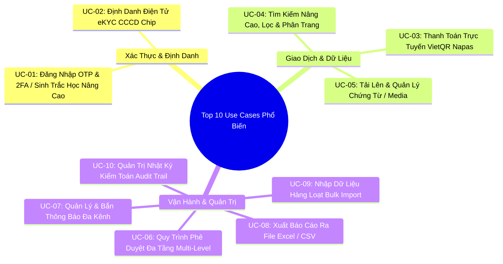

# THƯ VIỆN CÁC USE CASE KINH ĐIỂN THƯỜNG GẶP (COMMON USE CASES LIBRARY)
> **Mã tài liệu**: `skills/ba-analyst-kit/references/common_use_cases_library.md`  
> **Áp dụng cho**: Bộ Skill `ba-analyst-kit` & Soạn thảo đặc tả Use Case chi tiết  
> **Phiên bản**: 1.0.0 | **Ngày lập**: 2026-10-19  

---

## 1. TỔNG QUAN & TẦM QUAN TRỌNG CỦA VIỆC CHUẨN HÓA CÁC USE CASE KINH ĐIỂN

Trong thực tế phát triển phần mềm (đặc biệt tại thị trường Việt Nam từ Khởi nghiệp, Outsource đến Ngân hàng/Fintech), có đến **70% - 80% các tính năng của mọi hệ thống** xoay quanh các kịch bản tương tác kinh điển: Đăng nhập/Xác thực, eKYC, Thanh toán QR/Thẻ, Tìm kiếm/Lọc, Tải tệp, Phê duyệt, Nhập/Xuất Excel, Thông báo và Nhật ký kiểm toán.

Tuy nhiên, rất nhiều BA thiếu kinh nghiệm thường mắc phải các lỗi chí mạng:
1. **Chỉ viết Happy Path (Luồng lý tưởng)** mà bỏ quên các luồng lỗi (Exception Flows: mất mạng, timeout cổng thanh toán, tài khoản bị khóa, tệp nhiễm mã độc).
2. **Thiếu quy tắc nghiệp vụ biên (Edge Business Rules)**: Không quy định rõ số lần nhập sai mật khẩu tối đa, thời gian hết hạn mã OTP, hay cơ chế xử lý khi khách hàng chuyển khoản thừa/thiếu tiền.
3. **Không tích hợp tiêu chuẩn kỹ thuật & bảo mật**: Bỏ quên quy chuẩn sinh trắc học khuôn mặt CCCD chip cho giao dịch giá trị cao, quy chuẩn bảo vệ dữ liệu cá nhân, hay định dạng hóa đơn điện tử VAT.

Tài liệu này đóng gói **Top 10 Use Cases phổ biến và quan trọng nhất**, phân tích chi tiết từ Actors, Tiền điều kiện, Luồng chuẩn, Các luồng rẽ nhánh, Ngoại lệ lỗi, Quy tắc nghiệp vụ và Kịch bản nghiệm thu Gherkin.

---

## 2. TOP 10 USE CASES PHỔ BIẾN NHẤT TRONG DỰ ÁN PHẦN MỀM



---

### USE CASE 01: ĐĂNG NHẬP, XÁC THỰC HAI YẾU TỐ (2FA / OTP) & SINH TRẮC HỌC
- **Mã Use Case**: `UC-AUTH-01`
- **Mục tiêu**: Cho phép người dùng đăng nhập an toàn vào hệ thống bằng Số điện thoại/Mật khẩu kết hợp xác thực OTP hoặc Sinh trắc học.
- **Tác nhân (Actors)**:
  - Primary Actor: Người dùng cuối (Khách hàng / Nhân viên).
  - System Actor: SMS Gateway / Zalo ZNS / SDK Sinh trắc học FaceID.
- **Tiền điều kiện (Pre-Conditions)**: Tài khoản người dùng đã được kích hoạt trong hệ thống và không ở trạng thái bị khóa.

#### Luồng Thao Tác Chuẩn (Basic Flow):
1. Người dùng mở màn hình đăng nhập, nhập Số điện thoại và Mật khẩu, bấm "Đăng nhập".
2. Hệ thống kiểm tra thông tin tài khoản và băm mật khẩu (Argon2id/Bcrypt).
3. Hệ thống nhận diện tài khoản bật chế độ bảo mật 2FA, sinh mã OTP ngẫu nhiên 6 chữ số và gửi qua tin nhắn SMS/ZNS đến số điện thoại đã đăng ký.
4. Màn hình chuyển sang giao diện nhập OTP với đồng hồ đếm ngược 120 giây.
5. Người dùng nhập đúng 6 chữ số OTP.
6. Hệ thống xác thực OTP thành công, khởi tạo phiên làm việc (Access Token JWT hiệu lực 15 phút, Refresh Token lưu trong HttpOnly Cookie hiệu lực 30 ngày).
7. Hệ thống chuyển hướng người dùng vào Trang chủ ứng dụng.

#### Các Luồng Rẽ Nhánh & Ngoại Lệ (Alternate & Exception Flows):
- **1a. Đăng nhập nhanh bằng Sinh trắc học (Vân tay / Khuôn mặt trên Mobile App)**:
  1. Người dùng mở App và chọn biểu tượng FaceID/Vân tay.
  2. Thiết bị kích hoạt cảm biến sinh trắc học cục bộ (Biometric Prompt).
  3. Sau khi thiết bị xác thực khớp, App gửi chữ ký số lưu trong Keystore/Keychain lên Server.
  4. Server xác nhận chữ ký hợp lệ và đăng nhập ngay, bỏ qua bước nhập mật khẩu và OTP.
- **2a. Sai mật khẩu quá 5 lần liên tiếp (Chống Brute-force)**:
  1. Hệ thống ghi nhận số lần sai đạt ngưỡng 5 lần.
  2. Hệ thống tự động khóa tài khoản tạm thời trong 15 phút và gửi email/SMS cảnh báo đăng nhập bất thường.
  3. Hiển thị thông báo: *"Tài khoản của bạn đã bị tạm khóa 15 phút do nhập sai mật khẩu nhiều lần."*
- **5a. Mã OTP hết hạn hoặc nhập sai quá 3 lần**:
  1. Nếu đồng hồ đếm ngược về 0: Mã OTP bị hủy hiệu lực; nút "Gửi lại mã OTP" sáng lên (cho phép gửi lại tối đa 3 lần/ngày).
  2. Nếu người dùng nhập sai OTP: Báo lỗi *"Mã OTP không chính xác. Bạn còn X lần thử"*. Sai quá 3 lần $\to$ Khóa luồng xác thực và bắt đầu lại.

#### Quy Tắc Nghiệp Vụ (Business Rules):
- **BR-AUTH-01**: Mã OTP có độ dài đúng 6 chữ số, thời gian sống (TTL) là 120 giây, chỉ được sử dụng một lần duy nhất (One-Time).
- **BR-AUTH-02**: Mọi mật khẩu phải có độ dài tối thiểu 8 ký tự, bao gồm chữ hoa, chữ thường, số và ký tự đặc biệt.

#### Kịch Bản Nghiệm Thu Gherkin (Acceptance Criteria):
```gherkin
Scenario: Người dùng đăng nhập thành công với mật khẩu và OTP hợp lệ
  Given Người dùng có tài khoản hợp lệ với số điện thoại "0912345678"
  When Người dùng nhập đúng mật khẩu và bấm "Đăng nhập"
  Then Hệ thống gửi mã OTP 6 số về điện thoại
  When Người dùng nhập đúng mã OTP trong vòng 120 giây
  Then Đăng nhập thành công và chuyển vào màn hình Trang chủ
```

---

### USE CASE 02: ĐỊNH DANH ĐIỆN TỬ (eKYC) QUA THẺ CCCD GẮN CHIP & SINH TRẮC HỌC
- **Mã Use Case**: `UC-AUTH-02`
- **Áp dụng chuẩn**: Quy chuẩn Bảo vệ Dữ liệu Cá nhân & Xác thực Sinh trắc học.
- **Mục tiêu**: Xác thực danh tính khách hàng bằng cách đối soát khuôn mặt và dữ liệu thẻ Căn cước công dân gắn chip qua kết nối NFC hoặc OCR.
- **Tác nhân**: Khách hàng, Dịch vụ OCR nhận diện văn bản, Dịch vụ Liveness Detection (Chống giả mạo), Cơ sở dữ liệu C06 Bộ Công An / VNeID.

#### Luồng Thao Tác Chuẩn (Basic Flow):
1. Người dùng chọn chức năng "Định danh tài khoản (eKYC)" trên ứng dụng di động.
2. Ứng dụng hiển thị hướng dẫn chụp ảnh CCCD (không chói sáng, không mất góc).
3. Người dùng chụp ảnh mặt trước và mặt sau của thẻ CCCD gắn chip.
4. Hệ thống OCR tự động trích xuất thông tin: Số CCCD (12 số), Họ tên, Ngày sinh, Quê quán, Ngày hết hạn.
5. Người dùng áp mặt sau thẻ CCCD vào đầu đọc NFC của điện thoại để đọc dữ liệu bảo mật trong chip.
6. Hệ thống yêu cầu quét khuôn mặt (Face Scan): Người dùng quay mặt trái, phải, mỉm cười, chớp mắt theo hướng dẫn.
7. Dịch vụ Liveness Detection kiểm tra người thật (loại trừ video phát lại, ảnh in hoặc mặt nạ silicon 3D).
8. Hệ thống so khớp khuôn mặt vừa quét với ảnh lưu trong chip CCCD (tỷ lệ khớp $\ge 85\%$).
9. Hệ thống xác nhận định danh thành công, nâng hạng tài khoản lên mức đã xác thực (Verified Account).

#### Các Luồng Rẽ Nhánh & Ngoại Lệ:
- **3a. Ảnh chụp CCCD không hợp lệ (Mờ, lóa sáng, mất góc hoặc chụp lại từ màn hình khác)**:
  1. Hệ thống AI phát hiện ảnh kém chất lượng hoặc phát hiện chụp lại qua màn hình (Moire pattern).
  2. Lập tức hiển thị thông báo lỗi tại biên: *"Ảnh chụp bị mờ hoặc lóa sáng. Vui lòng đặt thẻ trên mặt phẳng và chụp lại."*
- **5a. Điện thoại không có đầu đọc NFC**:
  1. Chuyển sang luồng rẽ nhánh: Đối soát dữ liệu qua tài khoản định danh điện tử **VNeID mức 2** bằng hình thức liên kết App-to-App.
- **8a. Khuôn mặt không khớp ảnh CCCD (Dưới ngưỡng 85%)**:
  1. Hệ thống ghi log cảnh báo `ERR_FACIAL_MISMATCH`.
  2. Cho phép người dùng thử lại tối đa 3 lần. Nếu vẫn không khớp $\to$ Chuyển hồ sơ sang luồng hậu kiểm Video KYC thủ công với nhân viên chăm sóc khách hàng.

---

### USE CASE 03: THANH TOÁN TRỰC TUYẾN QUA MÃ VIETQR (NAPAS 247)
- **Mã Use Case**: `UC-PAY-01`
- **Mục tiêu**: Sinh mã VietQR động chứa số tiền và nội dung đơn hàng, tự động xác nhận khi tiền vào tài khoản trong vòng 3 giây.
- **Tác nhân**: Khách hàng, Cổng thanh toán / Ngân hàng thụ hưởng, Hệ thống Web/App.

#### Luồng Thao Tác Chuẩn (Basic Flow):
1. Tại màn hình Thanh toán đơn hàng, người dùng chọn phương thức "Chuyển khoản qua mã VietQR (Napas 247)".
2. Hệ thống gọi API ngân hàng sinh **Mã VietQR động** chuẩn Napas chứa: Ngân hàng thụ hưởng, Số tài khoản, Số tiền chính xác của đơn hàng, và Mã đơn hàng duy nhất trong phần nội dung chuyển khoản.
3. Màn hình hiển thị mã QR kèm đồng hồ đếm ngược thanh toán 15 phút.
4. Khách hàng mở ứng dụng ngân hàng bất kỳ trên điện thoại, quét mã QR và xác nhận chuyển tiền.
5. Ngân hàng xử lý giao dịch chuyển tiền nhanh 24/7.
6. Máy chủ ngân hàng gửi Webhook thông báo nhận tiền (`IPN - Instant Payment Notification`) tới hệ thống backend.
7. Hệ thống backend kiểm tra chữ ký số HMAC của webhook, đối soát số tiền và mã đơn hàng.
8. Hệ thống tự động cập nhật trạng thái đơn hàng thành "ĐÃ THANH TOÁN".
9. Màn hình của khách hàng tự động chuyển sang trang thông báo: "Thanh toán thành công" (không cần khách hàng bấm nút nào).

#### Các Luồng Ngoại Lệ & Xử Lý Lỗi (Exceptions):
- **4a. Khách hàng chuyển sai số tiền (Thiếu tiền hoặc Thừa tiền)**:
  1. Hệ thống ghi nhận số tiền thực nhận khác với số tiền đơn hàng.
  2. Trạng thái đơn hàng chuyển thành "THANH TOÁN THIẾU — CHỜ BỔ SUNG" hoặc "THANH TOÁN THỪA".
  3. Hệ thống tự động gửi thông báo cho khách hàng kèm hướng dẫn chuyển nốt phần còn thiếu hoặc hướng dẫn hoàn tiền thừa.
- **6a. Mất kết nối Webhook giữa Ngân hàng và Hệ thống (Webhook Timeout)**:
  1. Hệ thống kích hoạt cơ chế chạy ngầm (Cronjob Reconciliation / Đối soát định kỳ mỗi 60 giây) gọi API tra cứu trạng thái giao dịch từ ngân hàng.
  2. Ngay khi tìm thấy giao dịch thành công, hệ thống bù trạng thái (Auto-Reconcile) và gửi hóa đơn cho khách.
- **3a. Hết thời gian đếm ngược 15 phút mà tiền chưa về**:
  1. Mã VietQR hết hiệu lực; hệ thống giải phóng lượng hàng giữ chỗ trong kho (Release Inventory).
  2. Trạng thái đơn hàng chuyển thành "HẾT HẠN THANH TOÁN".

---

### USE CASE 04: TÌM KIẾM NÂNG CAO, LỌC ĐA CHIỀU & PHÂN TRANG (SEARCH, FILTER & PAGINATION)
- **Mã Use Case**: `UC-SEARCH-01`
- **Mục tiêu**: Hỗ trợ người dùng tra cứu nhanh danh mục hàng ngàn sản phẩm/hồ sơ với bộ lọc đa tiêu chí và thời gian phản hồi dưới 300ms.

#### Luồng Thao Tác Chuẩn (Basic Flow):
1. Người dùng nhập từ khóa vào ô tìm kiếm (Ví dụ: *"bảo hiểm xe ô tô"*).
2. Hệ thống hiển thị hộp gợi ý tự động (Autocomplete Suggestion) các từ khóa và danh mục phổ biến sau khi người dùng gõ từ ký tự thứ 2.
3. Người dùng chọn một gợi ý hoặc bấm Enter.
4. Hệ thống tải trang danh sách kết quả kèm các bộ lọc đa chiều (Faceted Filters) ở cột bên trái: Khoảng giá, Hãng sản xuất, Khu vực, Đánh giá sao.
5. Người dùng tích chọn bộ lọc "Giá từ 1 triệu - 5 triệu" và chọn sắp xếp "Mới nhất".
6. Hệ thống tự động cập nhật danh sách hiển thị, chỉ tải 20 bản ghi trên mỗi trang (Trang 1).
7. Người dùng bấm chuyển sang Trang 2 hoặc cuộn xuống cuối màn hình (Infinite Scroll).
8. Hệ thống tải tiếp 20 bản ghi tiếp theo mà không làm giật lag giao diện.

#### Các Luồng Rẽ Nhánh & Ngoại Lệ:
- **1a. Tìm kiếm không có kết quả (Zero Results)**:
  1. Hệ thống hiển thị thông báo thân thiện: *"Rất tiếc, không tìm thấy kết quả phù hợp cho từ khóa '[Từ khóa]'."*
  2. Gợi ý kiểm tra lại lỗi chính tả hoặc hiển thị danh mục các sản phẩm đang bán chạy nhất.
- **1b. Ký tự tìm kiếm chứa mã độc tấn công (SQL Injection / XSS)**:
  1. Tầng Controller lọc sạch (Sanitize) toàn bộ các ký tự nguy hiểm (`<script>`, `' OR 1=1--`, dấu nháy đơn kép).
  2. Tuyệt đối không cho phép query trực tiếp vào SQL thô mà bắt buộc sử dụng Parameterized Query hoặc Search Engine (Elasticsearch / PostgreSQL Full-Text Search).

---

### USE CASE 05: TẢI LÊN VÀ QUẢN LÝ CHỨNG TỪ / MEDIA AN TOÀN
- **Mã Use Case**: `UC-FILE-01`
- **Mục tiêu**: Cho phép người dùng tải lên các tệp hóa đơn, ảnh tổn thất hoặc hợp đồng PDF, tự động nén, quét virus và lưu trữ an toàn.

#### Luồng Thao Tác Chuẩn:
1. Người dùng bấm chọn "Tải lên tài liệu" hoặc kéo thả tệp vào khung upload.
2. Hệ thống kiểm tra phần mở rộng tệp (File Extension) và chữ ký byte thực tế (Magic Bytes / MIME Type).
3. Hệ thống kiểm tra dung lượng tệp ($\le 15\text{MB}$ đối với ảnh/PDF, $\le 50\text{MB}$ đối với video).
4. Hệ thống tạo tên tệp ngẫu nhiên theo chuẩn UUIDv7 để tránh trùng lặp và tránh lộ đường dẫn nhạy cảm.
5. Hệ thống đẩy tệp lên Cloud Storage (S3 / MinIO) với chế độ mã hóa server-side AES-256.
6. Hệ thống tạo bản ghi liên kết vào bảng `attached_documents` với đường dẫn bảo mật (Presigned URL có thời hạn truy cập).
7. Giao diện hiển thị thumbnail ảnh thu nhỏ và thanh tiến trình hoàn tất 100%.

#### Các Luồng Ngoại Lệ:
- **2a. Tệp giả mạo phần mở rộng (Ví dụ file `.exe` đổi tên thành `.pdf`)**:
  1. Kiểm tra Magic Bytes phát hiện tiêu đề file không phải `%PDF-` chuẩn.
  2. Hệ thống lập tức từ chối và ghi log cảnh báo bảo mật: `ERR_INVALID_MIME_TYPE`.
- **3a. Tệp vượt quá dung lượng quy định**:
  1. Chặn ngay tại phía Client giao diện trước khi tệp được đẩy lên mạng (Zero-Waste Bandwidth).
  2. Báo lỗi: *"Dung lượng tệp vượt quá 15MB. Vui lòng nén tệp trước khi gửi."*

---

### USE CASE 06: QUY TRÌNH TRÌNH DUYỆT & PHÊ DUYỆT ĐA TẦNG (MULTI-LEVEL APPROVAL WORKFLOW)
- **Mã Use Case**: `UC-WF-01`
- **Mục tiêu**: Điều phối quy trình xét duyệt hồ sơ từ Nhân viên lập $\to$ Trưởng phòng thẩm định $\to$ Giám đốc phê duyệt chi trả.

#### Luồng Thao Tác Chuẩn:
1. Nhân viên nghiệp vụ hoàn tất hồ sơ và bấm nút "Trình phê duyệt".
2. Hệ thống kiểm tra tính đầy đủ của hồ sơ, chuyển trạng thái thành `CHỜ TRƯỞNG PHÒNG DUYỆT`, và gửi thông báo cho Trưởng phòng phụ trách.
3. Trưởng phòng mở xem chi tiết hồ sơ, đối soát chứng từ và chọn "Đồng ý chuyển cấp trên".
4. Hệ thống cập nhật trạng thái thành `CHỜ GIÁM ĐỐC DUYỆT` và chuyển giao việc vào danh sách chờ của Giám đốc.
5. Giám đốc xem xét hạn mức ngân sách và bấm "Phê duyệt chính thức" kèm chữ ký số.
6. Trạng thái hồ sơ chuyển thành `ĐÃ DUYỆT — CHỜ CHI TRẢ`.
7. Hệ thống tự động gửi thông báo chúc mừng tới Người lập ban đầu và tự động tạo phiếu chi sang phần mềm Kế toán/ERP.

#### Các Luồng Rẽ Nhánh:
- **3a. Trưởng phòng yêu cầu bổ sung thông tin (Send Back / Request Changes)**:
  1. Trưởng phòng chọn "Yêu cầu chỉnh sửa", nhập lý do bắt buộc vào ô ghi chú.
  2. Trạng thái hồ sơ chuyển về `YÊU CẦU BỔ SUNG`.
  3. Người lập nhận được thông báo, cập nhật lại chứng từ và nộp lại hồ sơ (Quay lại Bước 1).
- **5a. Giám đốc từ chối phê duyệt (Reject)**:
  1. Giám đốc bấm "Từ chối", nhập lý do bác bỏ bắt buộc.
  2. Hồ sơ đóng vĩnh viễn ở trạng thái `BỊ TỪ CHỐI`.
  3. Gửi thông báo kèm lý do bác bỏ cho các bên liên quan.

---

### USE CASE 07: QUẢN LÝ VÀ BẮN THÔNG BÁO ĐA KÊNH (OMNICHANNEL NOTIFICATIONS)
- **Mã Use Case**: `UC-NOTIF-01`
- **Mục tiêu**: Điều phối gửi thông báo tự động tới người dùng qua Push Notification, Email và Tin nhắn SMS/Zalo theo phân cấp độ ưu tiên.

#### Luồng Thao Tác Chuẩn:
1. Một sự kiện nghiệp vụ xảy ra trong hệ thống (Ví dụ: Hồ sơ bồi thường được thanh toán thành công).
2. Hệ thống xác định cấu hình nhận thông báo của người dùng và mức độ ưu tiên của sự kiện:
   - **Mức High (Khẩn cấp / Giao dịch tiền / OTP)**: Bắn Push Notification tức thì + Gửi tin nhắn SMS/ZNS.
   - **Mức Medium (Cập nhật tiến độ / Nhắc nhở)**: Bắn Push Notification trên App + Gửi Email tổng hợp.
   - **Mức Low (Tin tức khuyến mại / Tin hệ thống)**: Chỉ lưu vào Hộp thư thông báo trong App (In-app Notification Center).
3. Hệ thống tạo bản ghi thông báo trong cơ sở dữ liệu với cờ `is_read = FALSE`.
4. Người dùng mở App, biểu tượng quả chuông hiển thị huy hiệu chấm đỏ (Badge counter).
5. Người dùng chạm vào thông báo để mở chi tiết; hệ thống cập nhật cờ `is_read = TRUE` và chuyển hướng tới màn hình nghiệp vụ tương ứng (Deep-linking).

---

### USE CASE 08: XUẤT BÁO CÁO DỮ LIỆU RA FILE EXCEL / CSV (DATA EXPORT)
- **Mã Use Case**: `UC-DATA-01`
- **Mục tiêu**: Cho phép người dùng kết xuất hàng ngàn dòng dữ liệu nghiệp vụ ra tệp bảng tính Excel có định dạng chuẩn, có che giấu dữ liệu nhạy cảm (Data Masking).

#### Luồng Thao Tác Chuẩn:
1. Người dùng áp dụng các điều kiện lọc tại màn hình Báo cáo quản trị (Ví dụ: Từ ngày A đến ngày B, chi nhánh TP.HCM).
2. Người dùng nhấp vào nút "Xuất dữ liệu Excel (.xlsx)".
3. Hệ thống kiểm tra quyền hạn (Role-based Authorization):
   - Nếu là Nhân viên thường: Tự động che mờ (Masking) 4 số giữa của CCCD (`1234****5678`) và ẩn số tài khoản ngân hàng theo quy chuẩn bảo vệ dữ liệu cá nhân.
   - Nếu là Quản trị viên cấp cao: Cho phép xuất dữ liệu nguyên bản.
4. **Nếu tập dữ liệu nhỏ ($\le 10,000$ dòng)**: Hệ thống đóng gói dữ liệu stream trực tiếp và tải ngay về máy tính trong vòng dưới 3 giây.
5. **Nếu tập dữ liệu lớn ($> 10,000$ dòng)**: Hệ thống chuyển tác vụ sang Background Worker xử lý ngầm, hiển thị thông báo: *"Báo cáo dung lượng lớn đang được khởi tạo. Hệ thống sẽ gửi liên kết tải về qua email của bạn trong ít phút."*

---

### USE CASE 09: NHẬP DỮ LIỆU HÀNG LOẠT TỪ FILE EXCEL (BULK IMPORT)
- **Mã Use Case**: `UC-IMPORT-01`
- **Mục tiêu**: Cho phép nạp đồng thời hàng trăm bản ghi từ file bảng tính, có cơ chế kiểm tra lỗi từng dòng và trả về báo cáo lỗi chi tiết.

#### Luồng Thao Tác Chuẩn:
1. Người dùng bấm "Tải tệp mẫu chuẩn (.xlsx)" để lấy định dạng cột hợp lệ.
2. Người dùng điền dữ liệu vào tệp mẫu và tải lên hệ thống.
3. Hệ thống đọc từng dòng trong file Excel và kiểm tra tính hợp lệ: Định dạng ngày tháng, số điện thoại, trùng lặp mã định danh, trường bắt buộc để trống.
4. **Nếu toàn bộ các dòng đều hợp lệ**: Hệ thống thực hiện một transaction cơ sở dữ liệu duy nhất (Database Transaction) để nạp toàn bộ vào hệ thống và báo thành công: *"Đã nhập thành công 250/250 bản ghi."*
5. **Nếu phát hiện một số dòng bị lỗi**:
   - Hệ thống rollback dữ liệu hoặc chỉ nạp các dòng hợp lệ (tùy cấu hình chính sách).
   - Hệ thống tự động sinh một tệp Excel kết quả phản hồi (Error Feedback Excel): Giữ nguyên các dòng dữ liệu bị lỗi, bôi đỏ các ô sai và thêm cột ghi chú nguyên nhân lỗi ở cột cuối cùng để người dùng tải về sửa lại và nộp lại.

---

### USE CASE 10: QUẢN TRỊ NHẬT KÝ KIỂM TOÁN THAO TÁC (AUDIT TRAIL & SYSTEM LOGGING)
- **Mã Use Case**: `UC-AUDIT-01`
- **Áp dụng chuẩn**: Tiêu chuẩn an toàn thông tin ISO 27001 & Kiểm toán bảo mật dữ liệu.
- **Mục tiêu**: Lưu vết bất biến (Immutable Ledger) mọi hành vi tạo, sửa, xóa, duyệt và đăng nhập của người dùng để phục vụ thanh tra và truy cứu trách nhiệm.

#### Luồng Thao Tác Chuẩn:
1. Khi bất kỳ người dùng nào thực hiện một thao tác thay đổi dữ liệu nhạy cảm (Tạo hợp đồng, Đổi trạng thái bồi thường, Cập nhật số điện thoại, Chuyển tiền):
2. Tầng Database Trigger hoặc Application Interceptor tự động ghi lại một bản ghi Audit Log bất biến:
   - `timestamp`: Thời gian chính xác đến mili-giây.
   - `user_id` & `user_role`: Định danh và vai trò người thực hiện.
   - `client_ip` & `user_agent`: Địa chỉ IP và thông tin thiết bị/trình duyệt.
   - `action`: Loại thao tác (`CREATE`, `UPDATE`, `DELETE`, `APPROVE`).
   - `entity_type` & `entity_id`: Bản ghi dữ liệu bị tác động.
   - `old_values` & `new_values`: Bảng so sánh dữ liệu trước và sau khi thay đổi (Diff JSON).
3. Bảng Audit Log được thiết lập chế độ **Chỉ Thêm (Append-Only)**: Tuyệt đối cấm thao tác `UPDATE` hoặc `DELETE` trên bảng này kể cả tài khoản Quản trị viên (Super Admin).
4. Cung cấp màn hình tra cứu Audit Trail cho bộ phận Pháp chế và Kiểm soát nội bộ xem lại lịch sử biến động của từng hồ sơ.
