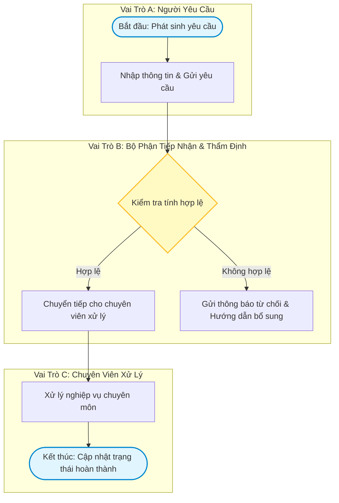

# QUY TRÌNH: [ĐỘNG TỪ + DANH TỪ] (BUSINESS PROCESS DOCUMENT)
> **Mã quy trình**: `PROC-001`  
> **Trạng thái**: [Draft / In Review / Approved]  
> **Áp dụng chuẩn**: Bridging The Gap (Laura Brandenburg, CBAP)  

---

## 1. THÔNG TIN QUY TRÌNH (DOCUMENT INFORMATION)

| Trường Thông Tin | Giá Trị Chi Tiết |
| :--- | :--- |
| **Tiêu đề quy trình (Process Title)** | [Động từ + Danh từ — Ví dụ: Tiếp Nhận và Xử Lý Yêu Cầu Hỗ Trợ] |
| **Chủ sở hữu quy trình (Process Owner)** | [Họ tên, Chức vụ - Trưởng phòng vận hành / nghiệp vụ] |
| **Phiên bản (Version)** | 1.0 |
| **Trạng thái (Status)** | [Draft / Approved] |
| **Ngày cập nhật (Date)** | [YYYY-MM-DD] |

---

## 2. MỤC ĐÍCH & PHẠM VI (PURPOSE & SCOPE)
*[Hướng dẫn: Đoạn văn ngắn 2 - 4 câu nêu lý do tồn tại, chỉ rõ As-Is hay To-Be, và bắt buộc chứa câu cú pháp chuẩn]*

> "Quy trình này mô tả trạng thái [Hiện trạng As-Is / Tương lai To-Be] của hoạt động [Tên hoạt động]. Mục đích nhằm chuẩn hóa các thao tác, rút ngắn thời gian xử lý và giảm thiểu sai sót.  
> **Quy trình này bắt đầu khi** [Mô tả sự kiện / điều kiện kích hoạt ban đầu] **và kết thúc khi** [Mô tả sự kiện / trạng thái hoàn tất cuối cùng]."

---

## 3. ĐIỀU KIỆN KÍCH HOẠT (ENTRY CRITERIA)
*[Hướng dẫn: Các điều kiện trạng thái bắt buộc phải có trước khi quy trình bắt đầu; do Process Owner quy định]*

- [ ] Điều kiện 1: [Trạng thái tài khoản / hồ sơ hợp lệ]
- [ ] Điều kiện 2: [Đã được cấp ngân sách / phê duyệt quyền thao tác]

---

## 4. DỮ LIỆU & VẬT PHẨM ĐẦU VÀO (INPUTS)
*[Hướng dẫn: Các chứng từ, form, email, bản ghi DB hữu hình nhận được để bắt đầu công việc]*

- **Đầu vào 1**: [Form đăng ký yêu cầu trực tuyến / Email khiếu nại]
- **Đầu vào 2**: [Tệp ảnh hoặc tài liệu đính kèm]

---

## 5. SƠ ĐỒ LUỒNG CÔNG VIỆC PHÂN LÀN (WORKFLOW SWIMLANE DIAGRAM)

---

## 6. MÔ TẢ CHI TIẾT TỪNG BƯỚC HOẠT ĐỘNG (ACTIVITY DESCRIPTIONS)

### Bước 1: [Tên bước thao tác 1]
- **Người thực hiện (Actor)**: [Vai trò đảm nhiệm]
- **Mô tả hành động**: [Mô tả văn xuôi chi tiết các thao tác thực hiện]
- **Quy tắc liên quan**: Tuân thủ quy tắc nghiệp vụ `BR-01`.

### Bước 2: [Tên bước thao tác 2]
- **Người thực hiện (Actor)**: [Vai trò đảm nhiệm]
- **Mô tả hành động**: [Mô tả văn xuôi chi tiết các thao tác thực hiện]
- **Điểm rẽ nhánh**: Nếu [Điều kiện đúng] thì chuyển sang Bước 3; nếu [Điều kiện sai] thì xử lý theo Ngoại lệ `EX-01`.

---

## 7. CÁC TÌNH HUỐNG NGOẠI LỆ (EXCEPTIONS)

| Mã Ngoại Lệ | Điểm Phát Sinh | Mô Tả Tình Huống Ngoại Lệ | Hướng Xử Lý Khắc Phục |
| :---: | :---: | :--- | :--- |
| **EX-01** | Bước 2 | Khách hàng không cung cấp đủ chứng từ sau 3 ngày | Hệ thống tự động gửi email nhắc nhở lần 2; nếu sau 7 ngày không bổ sung sẽ đóng hồ sơ |
| **EX-02** | Bước 3 | Người xử lý chính vắng mặt đột xuất | Tự động phân phối lại hồ sơ cho người dự phòng (Backup Role) |

---

## 8. BẢNG QUY TẮC NGHIỆP VỤ (BUSINESS RULES MATRIX)

| Mã Quy Tắc (Rule ID) | Nội Dung Quy Tắc Nghiệp Vụ | Bước Áp Dụng (Activity Step) |
| :---: | :--- | :---: |
| **BR-01** | [Chính sách / Luật lệ quy định về thẩm quyền, hạn mức, thời gian] | Bước 1 |
| **BR-02** | [Chính sách / Luật lệ quy định về bảo mật, định dạng, điều kiện] | Bước 2 |

---

## 9. SẢN PHẨM ĐẦU RA (OUTPUTS)
*[Hướng dẫn: Sản phẩm hữu hình sinh ra từ quy trình]*

- **Đầu ra 1**: [Biên bản nghiệm thu / Hóa đơn điện tử / Email xác nhận giải quyết]
- **Đầu ra 2**: [Bản ghi nhật ký trạng thái đã được lưu trong cơ sở dữ liệu]

---

## 10. TIÊU CHUẨN HOÀN TẤT QUY TRÌNH (EXIT CRITERIA)
*[Hướng dẫn: Tiêu chuẩn xác nhận quy trình kết thúc thành công; là Entry Criteria của quy trình downstream]*

- [ ] Tiêu chuẩn 1: [Khách hàng nhận được kết quả và xác nhận hài lòng / Không còn khiếu nại]
- [ ] Tiêu chuẩn 2: [Toàn bộ dữ liệu giao dịch đã được đồng bộ với hệ thống kế toán / ERP]

---

## 11. PHÂN QUYỀN VAI TRÒ & CHỈ SỐ ĐO LƯỜNG (ROLES & METRICS)

### Bảng Phân Quyền Vai Trò
| Vai Trò (Role) | Trách Nhiệm Cụ Thể (Responsibilities) | Ai Đảm Nhận (Who Fulfills) |
| :--- | :--- | :--- |
| **[Vai trò 1]** | [Mô tả trách nhiệm cốt lõi] | [Bộ phận / Chức danh] |
| **[Vai trò 2]** | [Mô tả trách nhiệm cốt lõi] | [Bộ phận / Chức danh] |

### Chỉ Số Đo Lường Hiệu Quả (Metrics)
1. **Thời gian chu kỳ (Cycle Time)**: Thời gian từ lúc tiếp nhận đến khi xử lý dứt điểm $\le$ [X giờ / ngày].
2. **Tỷ lệ hoàn thành đúng hạn (SLA Compliance)**: Đạt tối thiểu [Y]% trên tổng số yêu cầu hàng tháng.
3. **Mức độ hài lòng của khách hàng (CSAT)**: Điểm trung bình đánh giá đạt $\ge$ [Z/5 sao].
