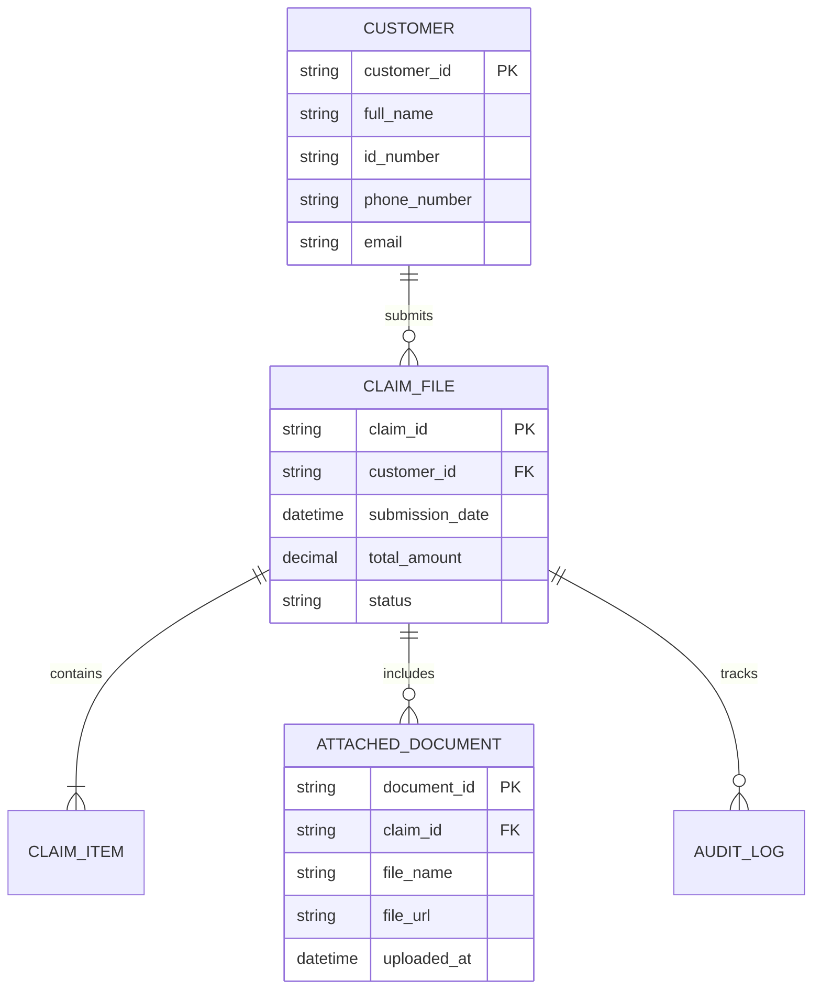

# [TÊN DỰ ÁN] — TỪ ĐIỂN DỮ LIỆU & MÔ HÌNH THỰC THỂ (DATA DICTIONARY & DOMAIN MODEL)
> **Mã tài liệu**: `DOC-DATA-DICT-001`  
> **Trạng thái**: Draft / In Review / Approved  
> **Áp dụng chuẩn**: Bridging The Gap (Laura Brandenburg, CBAP) & CSDL Doanh Nghiệp  

---

## 1. THÔNG TIN TÀI LIỆU (DOCUMENT INFORMATION)

| Trường Thông Tin | Giá Trị Chi Tiết |
| :--- | :--- |
| **Tên tài liệu (Document Title)** | Từ điển dữ liệu nghiệp vụ [Tên Dự Án] |
| **Phân hệ / Module** | [Tên phân hệ — Ví dụ: Khách hàng / Đơn hàng / Bồi thường] |
| **Người lập (Prepared By)** | [Họ tên - Business Analyst] |
| **Phiên bản (Version)** | 1.0 |
| **Ngày lập (Date)** | [YYYY-MM-DD] |

---

## 2. SƠ ĐỒ MỐI QUAN HỆ THỰC THỂ (ENTITY RELATIONSHIP DIAGRAM - ERD)
*[Hướng dẫn: Trực quan hóa cấu trúc dữ liệu và mối quan hệ 1-1, 1-N, N-N giữa các thực thể cốt lõi bằng khối mã Mermaid]*

---

## 3. TỪ ĐIỂN THUỘC TÍNH DỮ LIỆU (DATA ATTRIBUTES MATRIX)

### Thực thể: `[TÊN THỰC THỂ — Ví dụ: CUSTOMER / HỒ SƠ KHÁCH HÀNG]`
*Mô tả: Lưu trữ thông tin định danh và hồ sơ cá nhân của khách hàng.*

| Tên Thuộc Tính (Logical Name) | Tên Trường CSDL (Physical Field) | Kiểu Dữ Liệu (Data Type) | Độ Dài (Length) | Bắt Buộc (Mandatory) | Ràng Buộc / Giá Trị Hợp Lệ (Validation Rules) | Quy Định Bảo Vệ & Ghi Chú (Security & Masking) |
| :--- | :--- | :--- | :---: | :---: | :--- | :--- |
| **Mã khách hàng** | `customer_id` | UUIDv7 / String | 36 | Có (PK) | Tự động sinh bởi hệ thống | Không che giấu |
| **Họ và tên** | `full_name` | Unicode String | 150 | Có | Viết hoa chữ cái đầu, chỉ chứa chữ cái và khoảng trắng | Chuẩn bảo vệ dữ liệu |
| **Số CCCD / Hộ chiếu** | `id_number` | String | 12 | Có | Đúng 12 chữ số theo chuẩn CCCD Việt Nam | **Data Masking**: Che 4 số giữa (`1234****5678`) khi hiển thị |
| **Số điện thoại di động** | `phone_number` | String | 10 | Có | Bắt đầu bằng 03, 05, 07, 08, 09 (10 chữ số) | **Data Masking**: Ẩn 3 số cuối (`0912***456`) |
| **Thư điện tử (Email)** | `email` | String | 255 | Không | Đúng cú pháp RFC 5322 | Lưu trữ mã hóa |
| **Trạng thái tài khoản** | `status` | Enum String | 20 | Có | `ACTIVE`, `PENDING_KYC`, `SUSPENDED`, `LOCKED` | Mặc định: `PENDING_KYC` |
| **Thời điểm tạo** | `created_at` | Timestamp | - | Có | Múi giờ UTC+7 | Ghi tự động tại biên |

---

## 4. QUY TẮC TOÀN VẸN & TẬP GIÁ TRỊ TỰ ĐIỂN (LOOKUP TABLES & ENUMS)

### Bảng Danh Mục: `[Tên Bảng Danh Mục — Ví dụ: LOẠI CHỨNG TỪ / DOCUMENT_TYPE]`
| Mã (Code) | Tên Hiển Thị (Display Name) | Diễn Giải Nghiệp Vụ (Description) | Trạng Thái (Active) |
| :---: | :--- | :--- | :---: |
| `CCCD_FRONT` | Mặt trước CCCD gắn chip | Ảnh chụp rõ nét mặt trước thẻ căn cước | Có |
| `CCCD_BACK` | Mặt sau CCCD gắn chip | Ảnh chụp rõ chip điện tử và vân tay | Có |
| `DAMAGE_IMG` | Ảnh hiện trường tổn thất | Ảnh chụp hiện trường tai nạn / thiệt hại | Có |
| `INVOICE_PDF`| Hóa đơn viện phí / sửa chữa | Hóa đơn điện tử VAT chuẩn doanh nghiệp | Có |

---

## 5. RANH GIỚI BẢO MẬT & VÒNG ĐỜI DỮ LIỆU (DATA GOVERNANCE & LIFECYCLE)

1. **Chính sách lưu vết và bất biến (Audit & Immutability)**:
   - Các trường tài chính (`amount`, `payment_status`) không được phép cập nhật trực tiếp mà phải qua giao dịch bù trừ.
2. **Quyền xóa và thu hồi dữ liệu cá nhân (Right to Erasure)**:
   - Khi người dùng gửi yêu cầu hủy tài khoản, các trường dữ liệu định danh (`full_name`, `phone_number`, `id_number`) được làm sạch hoặc ẩn danh hóa (`Anonymized`), chỉ giữ lại mã định danh vô danh phục vụ báo cáo tài chính/kiểm toán.
3. **Quy định sao lưu và thời gian lưu trữ (Data Retention)**:
   - Hồ sơ giao dịch và nhật ký kiểm toán lưu giữ tối thiểu 05 năm theo Luật Kế toán và quy định của Ngân hàng Nhà nước.
