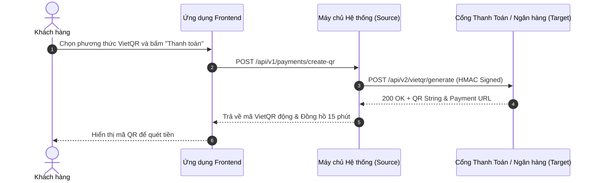

# [TÊN DỰ ÁN] — ĐẶC TẢ ÁNH XẠ DỮ LIỆU & TÍCH HỢP HỆ THỐNG (DATA MAPPING & API SPECIFICATION)
> **Mã tài liệu**: `DOC-DATA-MAP-001`  
> **Trạng thái**: Draft / In Review / Approved  
> **Áp dụng chuẩn**: Bridging The Gap (Laura Brandenburg, CBAP) & Tích Hợp API Doanh Nghiệp  

---

## 1. THÔNG TIN GIAO TIẾP TÍCH HỢP (INTEGRATION OVERVIEW)

| Trường Thông Tin | Giá Trị Chi Tiết |
| :--- | :--- |
| **Tên giao thức / API** | [Tên giao thức — Ví dụ: API Tạo mã VietQR động / Webhook Đối soát] |
| **Hệ thống gửi (Source System)** | [Hệ thống nội bộ — Ví dụ: Ứng dụng Bồi thường Bảo hiểm] |
| **Hệ thống nhận (Target System)** | [Hệ thống đối tác — Ví dụ: Cổng thanh toán Napas / Ngân hàng thụ hưởng] |
| **Giao thức kết nối (Protocol)** | RESTful API / JSON over HTTPS / Webhook HMAC-SHA256 |
| **Tần suất / Kích hoạt (Trigger)** | Hướng sự kiện (Event-driven): Khi người dùng bấm xác nhận thanh toán |
| **Người lập (Prepared By)** | [Họ tên - Business Analyst] |
| **Ngày cập nhật (Date)** | [YYYY-MM-DD] |

---

## 2. SƠ ĐỒ NGỮ CẢNH HỆ THỐNG & DÒNG CHẢY DỮ LIỆU (SYSTEM CONTEXT DIAGRAM)
*[Hướng dẫn: Mô tả luồng thông tin qua lại giữa hệ thống hiện tại và các hệ thống vệ tinh bằng Mermaid Sequence hoặc Flowchart]*

---

## 3. MA TRẬN ÁNH XẠ DỮ LIỆU (DATA MAPPING MATRIX)

### Hướng Dữ Liệu: `Yêu Cầu (Request Payload: Source -> Target)`
*Mô tả: Dữ liệu hệ thống gửi sang đối tác để khởi tạo giao dịch.*

| STT | Trường Dữ Liệu Nguồn (Source Field) | Kiểu Dữ Liệu Nguồn | Trường Dữ Liệu Đích (Target Field) | Kiểu Dữ Liệu Đích | Bắt Buộc | Quy Tắc Chuyển Đổi & Biến Đổi (Transformation Logic) |
| :-: | :--- | :--- | :--- | :--- | :-: | :--- |
| 1 | `claim_file.claim_id` | UUIDv7 | `orderId` | String(32) | Có | Lấy 8 ký tự đầu gạch nối mã hóa: `CLM-XXXXX` |
| 2 | `claim_file.approved_amount`| Decimal(15,2) | `amount` | Long Integer | Có | Làm tròn thành số nguyên VNĐ (nhân 1, loại bỏ phần thập phân) |
| 3 | `bank_account.bank_code` | String(6) | `beneficiaryBank` | String(6) | Có | Chuẩn hóa theo mã định danh ngân hàng BIN của Napas |
| 4 | `bank_account.account_num` | String(20) | `beneficiaryAccount` | String(20) | Có | Loại bỏ toàn bộ dấu cách và ký tự đặc biệt |
| 5 | `current_timestamp` | DateTime UTC | `requestTime` | ISO 8601 | Có | Chuyển đổi sang định dạng `YYYY-MM-DDTHH:mm:ss+07:00` |
| 6 | *Tự động sinh tại Server* | String | `signature` | String(64) | Có | Băm HMAC-SHA256(`orderId + amount + secret_key`) |

---

### Hướng Dữ Liệu: `Phản Hồi / Webhook (Response / IPN Payload: Target -> Source)`
*Mô tả: Dữ liệu máy chủ đối tác đẩy ngược về để cập nhật trạng thái.*

| STT | Trường Đối Tác Đẩy Về (Target Field) | Kiểu Dữ Liệu | Trường Cập Nhật Nguồn (Source Field) | Bắt Buộc | Quy Tắc Xử Lý & Đối Soát Nghiệp Vụ (Reconciliation Rule) |
| :-: | :--- | :--- | :--- | :-: | :--- |
| 1 | `gatewayTransactionId` | String(64) | `payments.gateway_trans_id` | Có | Lưu vết mã giao dịch ngân hàng để đối soát |
| 2 | `orderId` | String(32) | `payments.order_code` | Có | Tìm kiếm bản ghi thanh toán tương ứng trong hệ thống |
| 3 | `paidAmount` | Long Integer | `payments.actual_amount` | Có | Đối soát: Nếu `paidAmount == claim.approved_amount` $\to$ Thành công. Nếu khác $\to$ Treo cờ lệch tiền |
| 4 | `statusCode` | String(10) | `payments.status` | Có | Nếu `00` $\to$ Cập nhật `PAID`. Nếu khác `00` $\to$ Cập nhật `FAILED` |
| 5 | `signature` | String(64) | - | Có | Kiểm tra chữ ký hợp lệ trước khi thực hiện ghi dữ liệu |

---

## 4. XỬ LÝ LỖI, BÙ TRỪ & TIMEOUT (ERROR HANDLING & RETRY POLICY)

1. **Chính sách Thử lại Tự động (Retry Policy)**:
   - Nếu gọi API thất bại do mất mạng hoặc Timeout (HTTP 502/504): Kích hoạt cơ chế Thử lại lũy tiến (Exponential Backoff: sau 5s, 15s, 60s, tối đa 3 lần).
2. **Cơ chế Bù trừ Trạng thái (Reconciliation Fallback)**:
   - Nếu không nhận được Webhook trong vòng 15 phút: Cronjob chạy mỗi phút tự động gọi API tra cứu trạng thái giao dịch (`GET /api/v2/transactions/{orderId}/status`) để đối soát bù.
3. **Quy định Idempotency (Tránh xử lý lặp lại)**:
   - Mọi bản tin Webhook nhận từ đối tác bắt buộc phải kiểm tra `gatewayTransactionId`. Nếu mã giao dịch đã được xử lý trước đó, trả về HTTP 200 OK ngay lập tức và bỏ qua bước ghi dữ liệu trùng lặp.
