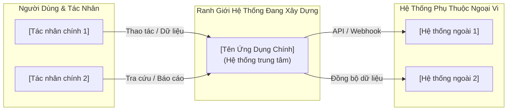

# [TÊN DỰ ÁN] — TUYÊN BỐ PHẠM VI DỰ ÁN (SCOPE STATEMENT)
> **Mã tài liệu**: `DOC-SCOPE-001`  
> **Trạng thái**: Draft / In Review / Approved  
> **Áp dụng chuẩn**: Bridging The Gap (Laura Brandenburg, CBAP)  

---

## 1. THÔNG TIN TÀI LIỆU (DOCUMENT INFORMATION)

| Trường Thông Tin | Giá Trị Chi Tiết |
| :--- | :--- |
| **Tên tài liệu (Document Title)** | Tuyên bố phạm vi dự án [Tên Dự Án] |
| **Người bảo trợ dự án (Business Sponsor)** | [Họ tên, Chức vụ - Người có thẩm quyền quyết định phạm vi và ngân sách] |
| **Người lập (Prepared By)** | [Họ tên - Business Analyst] |
| **Các bên liên quan (Stakeholders)** | [Danh sách người đóng góp, chức danh / Ma trận RACI] |
| **Phiên bản (Version)** | 1.0 |
| **Trạng thái (Status)** | [Draft / Approved] |
| **Ngày cập nhật (Date)** | [YYYY-MM-DD] |

---

## 2. TỔNG QUAN DỰ ÁN (PROJECT OVERVIEW)
*[Hướng dẫn: Đoạn văn ngắn gọn 2 - 3 câu mô tả lý do doanh nghiệp đầu tư (Business Driver) và tóm tắt phạm vi giải pháp]*

> "[Doanh nghiệp chúng tôi muốn giải quyết bài toán... bằng cách triển khai giải pháp... nhằm hỗ trợ các đối tượng...]"

---

## 3. LỢI ÍCH KỲ VỌNG & MỤC TIÊU KINH DOANH (EXPECTED BENEFITS)
*[Hướng dẫn: Danh sách 2 - 5 mục tiêu kinh doanh cụ thể, có thể đo lường được (Outcomes), KHÔNG mô tả giải pháp kỹ thuật (Solutions)]*

- **Mục tiêu 1**: Giảm [chỉ số thời gian/chi phí] từ [mức hiện tại] xuống còn [mức kỳ vọng] trong vòng [thời gian].
- **Mục tiêu 2**: Tăng tỷ lệ [chỉ số đo lường: tiếp nhận, chuyển đổi, thỏa mãn] lên [X]% so với mốc cơ sở năm trước.
- **Mục tiêu 3**: Cắt giảm [Y]% số lượng cuộc gọi khiếu nại / hỗ trợ thủ công liên quan đến [vấn đề].

---

## 4. BẢNG NĂNG LỰC GIẢI PHÁP (CAPABILITIES MATRIX)
*[Hướng dẫn: Liệt kê các năng lực cần có để đạt được mục tiêu kinh doanh, phân bổ theo các nhóm chữ cái A, B, C...]*

### Nhóm Năng Lực A: [Tên Nhóm Phân Vệ A — Ví Dụ: Người Dùng Trực Tuyến]
| Mã (ID) | Năng Lực Giải Pháp (Capability Description) | Tác Nhân Thụ Hưởng (Target User) |
| :---: | :--- | :--- |
| **A1** | [Chủ thể] có thể [Hành động] [Đối tượng] để [Mục đích] | [Người dùng cuối / Khách hàng] |
| **A2** | [Chủ thể] có thể [Hành động] [Đối tượng] để [Mục đích] | [Nhân viên nghiệp vụ] |
| **A3** | [Chủ thể] có thể [Hành động] [Đối tượng] để [Mục đích] | [Quản trị viên] |

### Nhóm Năng Lực B: [Tên Nhóm Phân Vệ B — Ví Dụ: Tích Hợp Hệ Thống & Quản Trị]
| Mã (ID) | Năng Lực Giải Pháp (Capability Description) | Tác Nhân Thụ Hưởng (Target User) |
| :---: | :--- | :--- |
| **B1** | Hệ thống tự động đồng bộ dữ liệu giữa [Hệ thống A] và [Hệ thống B] | [Hệ thống nền tảng] |
| **B2** | Cung cấp báo cáo thống kê định kỳ về [Chỉ số nghiệp vụ] | [Lãnh đạo / Business Owner] |

---

## 5. GIẢ ĐỊNH (ASSUMPTIONS)
*[Hướng dẫn: Những điều kiện ta tin là đúng nhưng chưa kiểm chứng độc lập]*

1. Hệ thống của đối tác thứ ba [Tên hệ thống] sẽ giữ nguyên chuẩn giao tiếp API hiện tại trong suốt quá trình triển khai.
2. Đội ngũ nhân viên tiếp nhận đã được trang bị thiết bị di động đạt cấu hình tối thiểu [Thông số].

---

## 6. RÀNG BUỘC (CONSTRAINTS)
*[Hướng dẫn: Các giới hạn thực tế không thể thương lượng: Ngân sách, Thời hạn, Nhân sự, Pháp lý]*

1. **Thời hạn (Timeline)**: Giải pháp bắt buộc phải bàn giao và chạy thử nghiệm trước ngày [YYYY-MM-DD].
2. **Công nghệ (Technology)**: Tận dụng cơ sở dữ liệu và hạ tầng máy chủ hiện có của [Tổ chức].
3. **Pháp lý & Bảo mật (Compliance)**: Tuân thủ quy định an toàn bảo mật và bảo vệ dữ liệu cá nhân theo [Quy chuẩn/Tiêu chuẩn].

---

## 7. NGOÀI PHẠM VI (OUT OF SCOPE)
*[Hướng dẫn: Danh sách tường minh các tính năng KHÔNG LÀM trong giai đoạn này để bảo vệ ngân sách]*

1. Không triển khai tính năng [Tính năng phức tạp X] trong Phase 1; sẽ xem xét lại trong Phase 2.
2. Không hỗ trợ các thiết bị phần cứng đời cũ chạy hệ điều hành dưới [Phiên bản OS].
3. Không thực hiện việc chuyển đổi dữ liệu lịch sử vượt quá [X năm].

---

## 8. MÔ HÌNH NGỮ CẢNH TRỰC QUAN (SYSTEM CONTEXT DIAGRAM)

---

## 9. VẤN ĐỀ CÒN MỞ (OPEN ISSUES)

| Mã (ID) | Nội Dung Vấn Đề Chưa Thống Nhất | Người Chịu Trách Nhiệm (Owner) | Hạn Cam Kết Giải Quyết (Target Date) |
| :---: | :--- | :--- | :---: |
| **ISS-01** | [Mô tả điểm nghẽn hoặc chính sách chưa chốt] | [Họ tên / Bộ phận] | [YYYY-MM-DD] |

---

## 10. LỊCH SỬ SỬA ĐỔI (REVISION HISTORY)

| Phiên Bản (V.) | Ngày (Date) | Người Thực Hiện (Author) | Nội Dung Thay Đổi (Description) | Trạng Thái (Status) |
| :---: | :---: | :--- | :--- | :---: |
| 1.0 | [YYYY-MM-DD] | [Tác giả] | Khởi tạo bản thảo phạm vi ban đầu | Draft |
