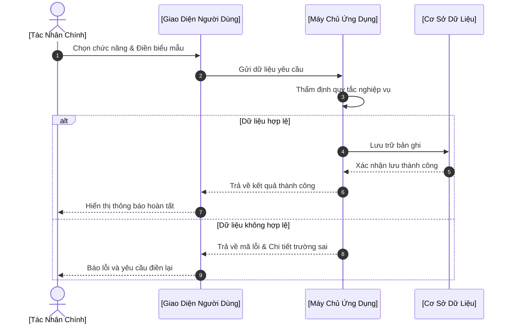

# ĐẶC TẢ USE CASE: [ĐỘNG TỪ + DANH TỪ]
> **Mã Use Case**: `UC-001`  
> **Trạng thái**: [Draft / In Review / Approved]  
> **Áp dụng chuẩn**: Bridging The Gap kết hợp Agile Gherkin Criteria  

---

## 1. THÔNG TIN USE CASE (DOCUMENT INFORMATION)

| Trường Thông Tin | Giá Trị Chi Tiết |
| :--- | :--- |
| **Tiêu đề (Use Case Title)** | [Động từ + Danh từ — Ví dụ: Đăng Ký Yêu Cầu Bồi Thường] |
| **Người phụ trách (Document Owner)** | [Họ tên - Business Analyst] |
| **Phiên bản (Version)** | 1.0 |
| **Trạng thái (Status)** | [Draft / Approved] |
| **Ngày cập nhật (Date)** | [YYYY-MM-DD] |

---

## 2. MÔ TẢ TÓM TẮT (BRIEF DESCRIPTION)
*[Hướng dẫn: 1 - 2 câu tóm tắt mục tiêu, bắt buộc dùng câu cú pháp chuẩn]*

> "Use Case này mô tả quá trình tương tác giữa [Actor chính] và [Hệ thống] nhằm [Đạt mục tiêu cụ thể].  
> **Quá trình bắt đầu khi** [Mô tả sự kiện kích hoạt / Người dùng chọn chức năng...] **và kết thúc khi** [Hệ thống xác nhận hoàn tất thành công]."

---

## 3. CÁC TÁC NHÂN LIÊN QUAN (ACTORS)

| Nhóm Tác Nhân | Tên Tác Nhân | Vai Trò & Trách Nhiệm Trong Use Case |
| :--- | :--- | :--- |
| **Tác nhân chính (Primary Actor)** | [Người dùng cuối / Khách hàng] | Người trực tiếp thao tác và hưởng lợi từ Use Case |
| **Tác nhân phụ (Secondary Actor)** | [Nhân viên CSKH / Giám định viên] | Người hỗ trợ hoặc tiếp nhận xử lý phía sau |
| **Tác nhân hệ thống (System Actor)** | [Payment Gateway / Cloud Storage] | Hệ thống bên ngoài được gọi trong quá trình xử lý |

---

## 4. TIỀN ĐIỀU KIỆN (PRE-CONDITIONS)
*[Hướng dẫn: Những trạng thái bắt buộc phải đúng trước khi Use Case bắt đầu]*

1. Người dùng đã đăng nhập vào hệ thống với tài khoản hợp lệ.
2. Hồ sơ / giao dịch liên quan đang ở trạng thái cho phép thao tác [Trạng thái].

---

## 5. LUỒNG THAO TÁC CHUẨN (BASIC FLOW / HAPPY PATH)
*[Hướng dẫn: Trình tự các bước tương tác lý tưởng diễn ra thuận lợi, đánh số từ 1 đến hết. Mỗi bước bắt đầu bằng một Actor rõ ràng]*

1. **Người dùng**: Chọn chức năng [Tên chức năng] trên giao diện.
2. **Hệ thống**: Hiển thị màn hình nhập thông tin kèm các trường dữ liệu bắt buộc.
3. **Người dùng**: Điền đầy đủ thông tin vào biểu mẫu và bấm nút [Hành động / Xác nhận].
4. **Hệ thống**: Kiểm tra tính hợp lệ của dữ liệu đầu vào theo quy tắc `BR-01`.
5. **Hệ thống**: Thực hiện lưu trữ bản ghi vào cơ sở dữ liệu và gửi thông báo xác nhận.
6. **Hệ thống**: Hiển thị thông báo thành công và chuyển hướng người dùng về [Màn hình đích].

---

## 6. CÁC LUỒNG RẼ NHÁNH VÀ NGOẠI LỆ (ALTERNATE & EXCEPTION FLOWS)

### Luồng Rẽ Nhánh Thay Thế (Alternate Flows)
- **3a. Người dùng chọn phương thức thay thế**:
  1. Tại Bước 3, người dùng chọn tải lên từ [Nguồn thay thế khác].
  2. Hệ thống mở cửa sổ tương ứng.
  3. Người dùng hoàn tất việc chọn và **quay trở lại Bước 4 của Basic Flow**.

### Luồng Ngoại Lệ & Xử Lý Lỗi (Exception Flows)
- **4a. Dữ liệu nhập không hợp lệ hoặc thiếu trường bắt buộc**:
  1. Tại Bước 4, hệ thống phát hiện trường [Tên trường] bị để trống hoặc sai định dạng.
  2. Hệ thống bôi đỏ trường lỗi và hiển thị thông báo chi tiết: "[Thông báo lỗi cụ thể]".
  3. Hệ thống giữ nguyên các dữ liệu hợp lệ đã nhập, người dùng sửa lại và **quay lại Bước 3 của Basic Flow**.
- **4b. Lỗi kết nối dịch vụ ngoại vi / Mất mạng**:
  1. Tại Bước 4, hệ thống không thể kết nối tới [Hệ thống ngoại vi].
  2. Hệ thống tự động retry 3 lần; nếu vẫn lỗi thì ghi log `ERR_GATEWAY_TIMEOUT`.
  3. Hiển thị thông báo: "Hệ thống đang bận, vui lòng thử lại sau ít phút".
  4. Use Case kết thúc thất bại; không lưu trữ dữ liệu rác.

---

## 7. HẬU ĐIỀU KIỆN (POST-CONDITIONS)
*[Hướng dẫn: Trạng thái bắt buộc đạt được sau khi luồng hoàn thành]*

1. Bản ghi mới được tạo trong cơ sở dữ liệu với trạng thái `[Trạng thái mới]`.
2. Hệ thống gửi email / thông báo xác nhận tự động tới người dùng.

---

## 8. YÊU CẦU BỔ TRỢ & QUY TẮC NGHIỆP VỤ (SUPPLEMENTAL REQUIREMENTS)

### Quy Tắc Nghiệp Vụ Riêng
- **BR-UC-01**: Tệp đính kèm không được vượt quá 10MB và chỉ hỗ trợ định dạng `.pdf, .jpg, .png`.

### Yêu Cầu Phi Chức Năng (Non-Functional Requirements)
- **Hiệu năng (Performance)**: Thời gian phản hồi xử lý biểu mẫu không vượt quá 2.0 giây.
- **Bảo mật (Security)**: Toàn bộ dữ liệu truyền tải phải được mã hóa qua TLS 1.3.

---

## 9. MỞ RỘNG AGILE: USER STORIES & TIÊU CHUẨN NGHIỆM THU GHERKIN

### User Story
```text
Title: US-[Mã] — [Tên tính năng ngắn gọn]

Là một (As a): [Vai trò tác nhân chính]
Tôi muốn (I want): [Thực hiện hành động gì]
Để (So that): [Đạt được lợi ích gì cho công việc / trải nghiệm]
```

### Kịch Bản Nghiệm Thu (Acceptance Criteria - Gherkin Syntax)

#### Kịch bản 1: Thực hiện thành công (Happy Path)
```gherkin
Scenario: Người dùng thao tác thành công với dữ liệu hợp lệ
  Given Người dùng đang ở màn hình [Tên màn hình] và đã điền đủ thông tin
  When Người dùng bấm nút "Xác nhận"
  Then Hệ thống sẽ lưu dữ liệu và trả về thông báo "Thao tác thành công"
  And Trạng thái giao dịch được cập nhật thành "HOAN_TAT"
```

#### Kịch bản 2: Xử lý lỗi đầu vào (Exception Flow)
```gherkin
Scenario: Người dùng gửi biểu mẫu thiếu thông tin bắt buộc
  Given Người dùng để trống trường "[Tên trường bắt buộc]"
  When Người dùng bấm nút "Xác nhận"
  Then Hệ thống sẽ không gửi dữ liệu đi
  And Hiển thị thông báo lỗi: "Vui lòng nhập đầy đủ thông tin [Tên trường]"
```

---

## 10. SƠ ĐỒ TUẦN TỰ TRỰC QUAN (MERMAID SEQUENCE DIAGRAM)



---

## 11. LỊCH SỬ SỬA ĐỔI (REVISION HISTORY)

| Phiên Bản (V.) | Ngày (Date) | Người Thực Hiện (Author) | Nội Dung Thay Đổi (Description) | Trạng Thái (Status) |
| :---: | :---: | :--- | :--- | :---: |
| 1.0 | [YYYY-MM-DD] | [Tác giả] | Khởi tạo tài liệu Use Case | Draft |
